# RefPicker 共有ガイド

プロジェクトの **公式データ**（ルートのファイル・切り抜き・タグ・メジャー・プロジェクトの設定）を、配る側（共有元）から受け取る人へ配り、
更新を届け、必要なら複数の人で一緒に編集するまでを、**配り方のパターンごとに図で** 説明します。
共有先は、**渡し方**（データだけ共有／ファイルも共有）と **範囲**（全ての範囲／フィルタで範囲を指定）の2つを選んで作ります（§0）。

- 対象 OS: Windows
- 共有の操作は、設定ウィンドウの **「プロジェクト」** タブ（「共有」の枠と、「受け取る」「別の PC へ移す」の段）から行います。**「選んで書き出す…」** だけは、メイン画面の **書き出し** メニューにあります（§6.1）。
- 関連: [ユーザーガイド](USER_GUIDE.md)（画面全体の操作）

> **ライセンスについて**
> **受け取る人はライセンス認証が要りません**。受け取る件数の制限もありません。
> **共有を始める・共有先を足す・選んで書き出すには、スタジオ用のライセンスが必要です**。
> **共同編集者は例外で、全員にスタジオ用のライセンスが必要です**（§5）。
> 詳しくは [スタジオ用ライセンスのご案内](https://animtools.github.io/RefPicker/landing/buy/studio.html)。

> 図は Mermaid で描いています。GitHub ではそのまま図になります。VS Code のプレビューで見るときは拡張機能「Markdown Preview Mermaid Support」を入れてください。
> アプリのスクリーンショットはすべて、デモ用に生成した **架空の設定資料** で撮影しています。

---

## 0. どのパターンを読めばいいか

共有先は、**渡し方** と **範囲** の2つを選んで作ります。

- **渡し方**（作るときに決めます。あとから変えるときは作り直します）
  - **データだけ共有**（一覧の札「参照」）: ファイルは写さず、受け取る人が元の場所（社内サーバーなど）を各自で読みます。元の場所に届く人向けです。
  - **ファイルも共有**（札「複製」）: 範囲のファイルを共有フォルダへ写して渡します。元の場所に届かない人（社外など）向けです。
- **範囲**（あとからいつでも切り替えられます。共同編集中の共有先を除く）
  - **全ての範囲**: 全部の公式のファイル。受け取る人が、自分の **受け取り範囲** でさらに選べます。
  - **フィルタで範囲を指定**（札「範囲指定」）: 配る側が絞り込みの条件で決めます。受け取る人には受け取り範囲を聞きません。

範囲は、共有先を作ったあとで選びます。設定 → プロジェクト の「共有先」の欄でその共有先を選び、右の中身で選びます。
初めの範囲は、データだけ共有なら **全ての範囲**、ファイルも共有なら **フィルタで範囲を指定**（条件なし）です。条件が無いあいだは、反映してもその共有先には何も書かれません（§3.1）。

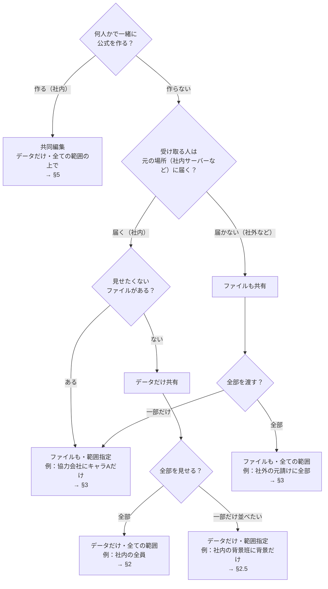

| 組み合わせ | ファイルの運び方 | 範囲を決める人 | ここから受け取った人が共同編集者になれるか | 節 |
|---|---|---|---|---|
| データだけ・全ての範囲 | **参照**（複製しない。元のファイルを各自が読む） | 受け取る人（受け取り範囲） | **できる**（§5） | §2 |
| データだけ・範囲指定 | **参照**（複製しない） | 配る側（範囲の条件）。**目隠しにはならない**（下の注意） | できない | §2.5 |
| ファイルも・全ての範囲 | **同梱**（全部を共有フォルダに複製） | 受け取る人（受け取り範囲） | できない | §3 |
| ファイルも・範囲指定 | **同梱**（範囲のファイルだけを複製） | 配る側（範囲の条件） | できない | §3 |

共同編集中のプロジェクトにも、ファイルも共有の共有先は足せます（§5.4）。

> **データだけ共有の範囲は目隠しになりません**。アプリに並ぶものを絞るだけで、受け取る人は元のフォルダを開けば範囲外のファイルも見られます。見せたくないファイルがある相手には、**ファイルも共有** を使ってください。

ほかの使い方:

| パターン | 中身 | 節 |
|---|---|---|
| 共有先を複数持つ | 上の組み合わせを相手ごとに。**バージョンはプロジェクトで1つ** | §4 |
| 共同編集 | データだけ・全ての範囲の上で、何人かで公式を作る | §5 |
| 選んで書き出す（ZIP） | その場の選択を ZIP にして一回きりで手渡す | §6 |

共有の終わらせ方は §7、データルート（RefPicker のデータの置き場）と PC の関係は §8、RefPicker を新しいバージョンにするときのことは §9 です。

---

## 1. 共通の考え方

### 1.1 登場する人と、プロジェクトの種類

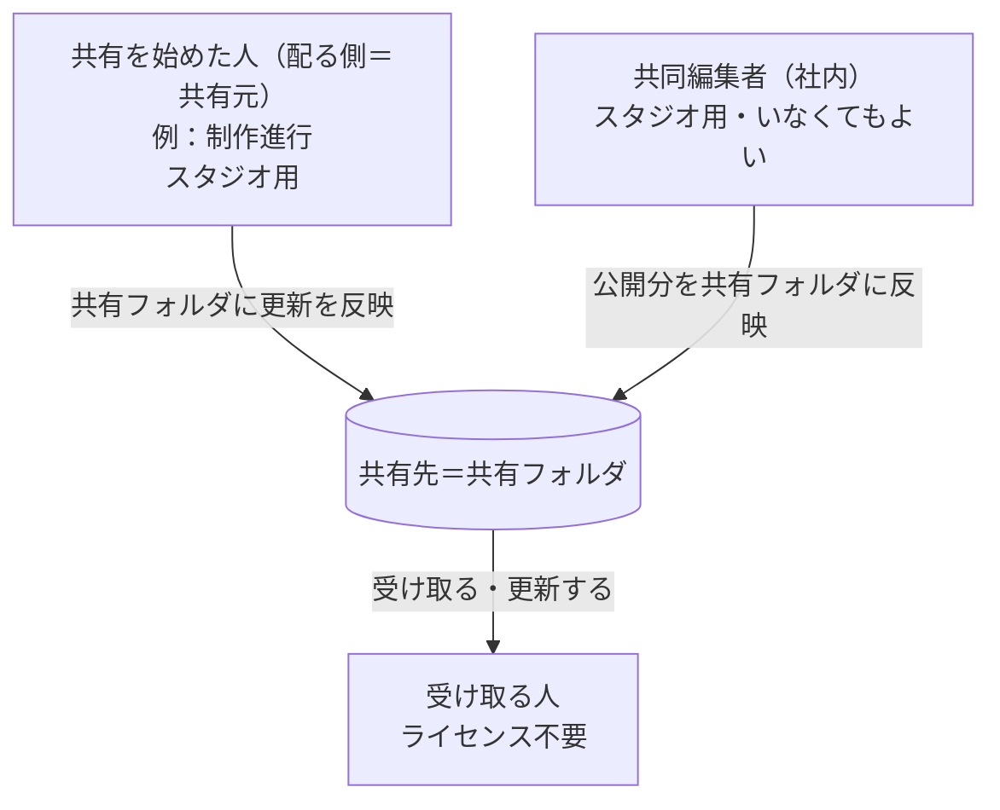

共有を始めた人と共同編集者は、互いの反映も「更新」で取り込みます（§5）。

プロジェクトの切り替えと設定の「プロジェクト」では、プロジェクトの種類を示す印が付きます。ふつうのプロジェクトには印が付きません。

| 印 | どういうプロジェクトか | 公式データ |
|---|---|---|
| **「共有中」** | 自分が共有を始めたプロジェクト | 編集できる |
| **「受け取り」** | 共有フォルダ（または書き出された ZIP）から受け取ったプロジェクト | 読み取り専用（下の「手元で足せるもの」は可） |
| **「共同編集」** | 共同編集者として受け取ったプロジェクト | 編集できる（全員対等） |

共同編集を始めた人のプロジェクトは **「共有中」**、共同編集者として加わった人のプロジェクトは **「共同編集」** の印になります。

印とは別に、覚えている共有フォルダに届かないときは、プロジェクト切替などに **「見つかりません」** と出ます（§7.4）。

共有先には、相手や用途の名前の **ラベル** を付けます（必須）。ラベルは受け取る人にも見えます。受け取ったプロジェクトの設定「プロジェクト」タブには、**「受け取り元: データだけ共有『…』」** のように、どの共有先から受け取ったかが出ます（範囲を指定した共有先なら、末尾に「（範囲指定）」が付きます）。

**受け取ったプロジェクトでも手元で足せるもの**: 公式の切り抜きへの **追加タグ**、自分の **個人の切り抜き・個人のメジャー**、個人ルート。
これらは更新を受け取っても消えません。配られたタグには画面で **「公式」** の印が付き、手元では消せません。

共有元から届いた画像の上なら、分類タグの付け外しもライセンスなしでできます（手元だけに残ります）。対象は、共有元がこの機能のある RefPicker で更新を反映した共有です（[CHANGELOG](CHANGELOG.md)）。

### 1.2 何が配られ、何が配られないか

| もの | 配られる？ |
|---|---|
| 公式ルートのファイルそのもの | ✅ ファイルも共有のときだけ（範囲のファイルを共有フォルダへ複製）。データだけ共有では届かず、受け取る人が元の場所を各自で読みます |
| 公式ルートの切り抜き・タグ・ファイルタグ・メジャー・割り当て | ✅ |
| 3D のアングル・動画のサムネイルに選んだコマ | ✅ |
| プロジェクトの設定（基準メジャー・用紙・配布元（表示ラベル）・プロジェクト名） | ✅ |
| **自由タグのグループ**（自由タグを寄せて見せる棚） | ✅ 受け取る人は直せません。共同編集者は直せます |
| **ルートから外すフォルダ**（ファイルを探さないサブフォルダ） | ✅ 受け取る人の側でもルートから外れます |
| **プロジェクトのカスタム分類軸**（分類軸とその分類の定義） | ✅ 受け取る人は直せません。共同編集者は直せます |
| **アプリの分類軸の非表示**（顔・表情・ショットなどを、このプロジェクトで隠す設定） | ✅ |
| **常に表示する分類軸**（「分類」ペインのタブに出す分類軸のセット） | ❌ 手元だけ（各自が選びます） |
| 個人ルート・受け取る人の追加タグ・個人の切り抜き／メジャー | ❌ 手元だけ |
| **探索から除外**（一覧から一時的に隠す設定） | ❌ 手元だけ。共有先の範囲にも効きません（除外したファイルも、範囲に入れば相手に渡ります） |

### 1.3 共有フォルダの中身

共有フォルダ（共有先）は **ただのフォルダ** です。社内サーバーの共有、Google ドライブ・OneDrive・Dropbox のクラウド同期フォルダ、手元の空フォルダのどれでも構いません。
中身はアプリが書きます。**手で編集しないでください**。

```text
共有フォルダ/
├─ manifest.json          … バージョン番号・プロジェクトの ID・ファイルの一覧（アプリが書いた記録）
├─ roots/<ルート>/         … ルートごとの公式データ（ファイルも共有では、範囲のファイルの複製もここ）
├─ paper/                 … 用紙
├─ range.json             … ファイルも共有と、範囲を指定したデータだけ共有（条件ごとに、範囲に入ったファイルの記録）
├─ coedit.json            … データだけ共有で共同編集中だけ（共有先の一覧など）
└─ coedit/parts/<人>/0001.json …  共同編集者ごとの「公開分」（区切りファイル。データだけ共有だけ）
```

ファイルも共有の共有フォルダには、**範囲で切った写し** だけが入ります。範囲の外のファイルの切り抜き・タグの記録や、共同編集者の公開分は入りません。

受け取る側は `manifest.json` のバージョンが手元より新しいと「更新あり」と判断します。

### 1.4 更新の知らせ方（共有先の種類によらず共通）

- **バックグラウンドの検知**（約 60 秒ごと）: フォルダから受け取ったプロジェクトをまとめて確かめ、プロジェクト切替に **更新バッジ** を付けます。
- **メイン画面に戻ったとき**: **トースト**（「更新」「後で」）。「後で」はその起動中は出ません。文は、バージョンが上がったときは「共有元から更新があります（版 N）」、共同編集者の公開分だけが届いたときは「共有の更新があります（共同編集者の公開分：PC2）」と、誰の分かが出ます。ファイルも共有の共有先から受け取った人には、配る側か共同編集者が反映したときに「共有元から更新があります」と出ます。共有フォルダの公開分を読めなかったときは「共有の更新を確かめられませんでした（共有フォルダの公開分を読めません）」と出ます。
- トーストの見出しには、プロジェクトの印［共有中］［受け取り］［共同編集］と、どの共有先から来たかの印〔渡し方・共有先のラベル〕が付きます（例「サンプルスタジオ / サンプル作品［受け取り］〔データだけ共有・第1話〕」）。同じ名前のプロジェクトを2つの共有先から受け取っても、1台に配る側と受け取りの両方があっても見分けられます。
- **設定「プロジェクト」タブ**: 新しいバージョンがあると **「更新（新しいバージョンを取り込む）」** が出ます。

勝手には取り込みません。いつも利用者が押したときだけです。取り込む前にプロジェクトのデータを自動で退避します。例外はデータだけ共有でのサーバーのファイルの変化で、各自がサーバーを直接見ているので、知らせを出さずに裏で合わせます（データを削除したファイルが手元から消える、など）。

---

## 2. データだけ共有（ファイルは運ばない）

社内サーバーにファイルが置いてある現場向けです。**ファイルは複製せず、サーバーの元のファイルをそのまま各自が読みます**（容量は増えません）。

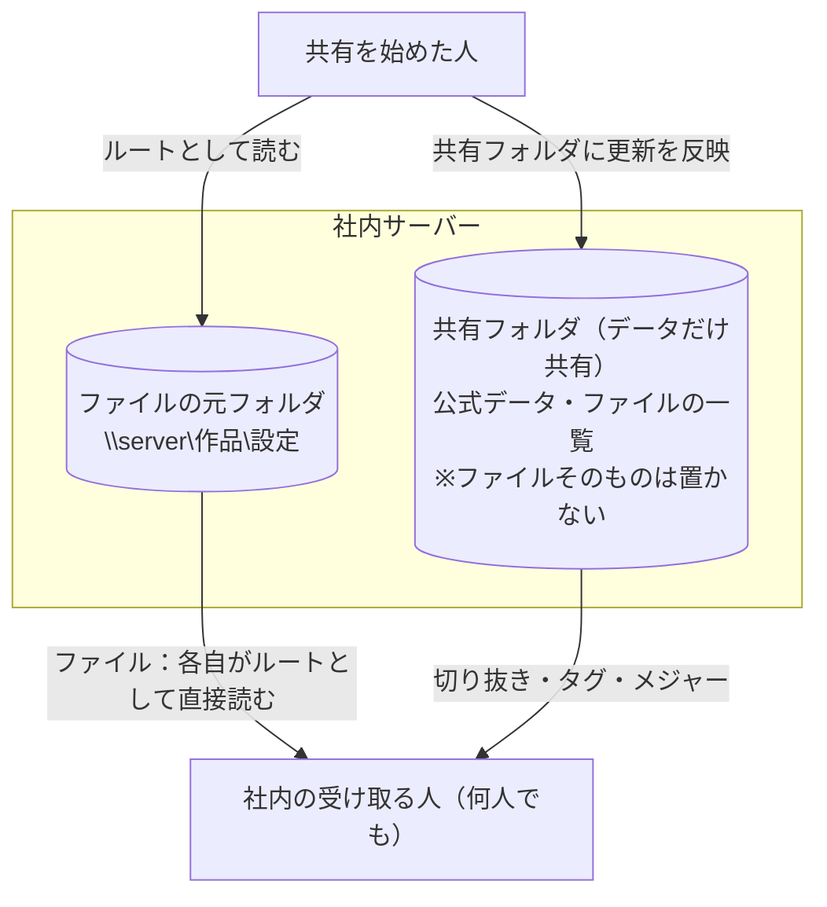

### 2.1 始める（配る側）

1. 設定 → **「ルート」** タブで、サーバー上のフォルダ（例 `\\server\作品\設定`）を **「ルートを追加」** で登録し、スキャンを待ちます。共有を始めるプロジェクトで登録したルートは **公式ルート** になります。
2. 切り抜き・タグ・メジャーを整えます。
3. 「プロジェクト」タブの「共有」の枠で **「共有を始める…」** を押します。**「配布元の表示名」**（スタジオ名など）が空か、プロジェクト名が「既定プロジェクト」のままなら、先に入れるよう求められます（受け取った人の一覧に出る名前です）。
4. サーバー上の **ファイルとは別の空フォルダ** を選びます。
5. 種類は **データだけ共有** を選び、**「この種類で追加」** を押します。種類は置き場から推しません。毎回、目的で選びます。
6. **ラベル**（用途の名前など。必須）を入れて **「保存」** を押します。
7. 範囲を確かめます。「共有先」の欄でその共有先を選び、右の中身で範囲が **「全ての範囲」** になっていることを確かめます（データだけ共有は全ての範囲で始まります）。一部だけ並べたいときは §2.5。

> 共有フォルダに、ルートの中やルートを含む親フォルダは選べません（片付けで元のファイルに触れないための守り）。

共有を始めると、枠の見出しが **「共有中」** になり、横にバージョン（「版 N」）が出ます。

### 2.2 受け取る（受け取る人）

1. メイン画面の **プロジェクト** メニューの **「共有プロジェクトを読み込み…」** を選ぶと、設定の「プロジェクト」タブが開きます。「受け取る」の段の **「共有プロジェクトを読み込み…」** を押し、サーバー上の共有フォルダを選びます。
2. 受け取り範囲（使うフォルダ）を選びます（初めはすべてが選ばれています）。データだけ共有では「索引に入れるフォルダ」になります。左のフォルダツリーにも、選んだ範囲だけが出ます。あとから **「受け取り範囲を変更…」** で変えられます。範囲を狭めるときは、一覧から外れるファイルと切り抜きの数を出して確かめます。外れるフォルダに自分で作った切り抜きがあると、その数も出ます（自分の切り抜きは、範囲を戻しても戻りません）。
3. 新しい受け取りプロジェクトが作られます。ルートは **手がかりの場所**（`\\server\…` の形のパス）で自動につながり、数件のファイルで「同じファイルか」を確かめます。

範囲を指定した共有先から受け取るときは、受け取り範囲を聞かれません（§2.5）。

### 2.3 ふだんの流れ

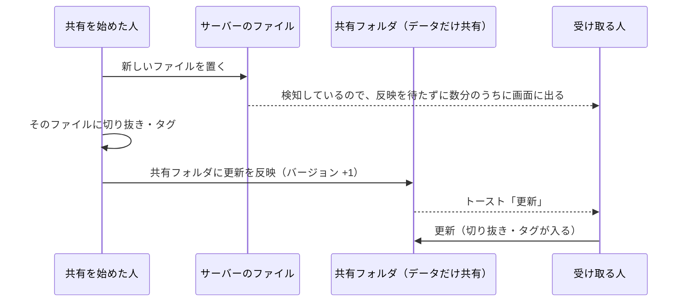

- **ファイルを置く・差し替える** と、反映を待たずに **数分のうちに** 全員の画面に出ます（各自がサーバーを直接読んでいるため）。サーバーのある PC ではすぐに、別の PC では検知の知らせが届かず数分かかることがあります。すぐ見たいときは、設定 → ルート の **「再スキャン」**。
- サーバーのファイルの **名前を変えた・別のフォルダへ動かした** ときは、**各自の RefPicker が自分の読み込みで** 同じファイルとしてつなぎ直します（受け取っただけの人も含む・付けたタグや切り抜きもそのまま）。サーバーで起きたことなので、**反映は要らず、誰の公開分にもなりません**。
- サーバーからファイルが消えたときは、全員の画面で「見つかりません」になります。戻せば元どおりです。本当に要らなければ、共有元か共同編集者が設定 → ルート の **「見つからないファイルのデータを削除…」** をすると、全員の手元から消えます。
- **切り抜き・タグ・メジャー** は「共有フォルダに更新を反映」で届きます。
- まだ反映していない変更があると、「共有中」の枠に **「未反映の変更 … 件」** が出ます。開くと、変更が「ファイル名：変更の中身」の形で1行ずつ並びます。
- サーバーが遅いと、共有フォルダを読み書きする操作に時間がかかります。そのあいだもアプリは止まらず、プロジェクトのタブに今していることが1行で出ます。

### 2.4 サーバーに届かないとき（リンク切れ → 再リンク）

ドライブ文字の違いや VPN の切断などで手がかりの場所に届かないと、そのルートは **「リンク切れ」** になります。
設定 → **「ルート」** の **「再リンク…」** で、この PC から見える同じフォルダを選んでください（同じファイルか確かめてからつなぎます）。受け取った公式ルートでも、届かないときだけ「再リンク…」が出ます（削除はできません）。

### 2.5 範囲を指定する（一部だけ並べたい）

社内でも、班ごとに使うものだけを並べたいとき（例：背景班に背景だけ）は、データだけ共有の範囲を **「フィルタで範囲を指定」** にします。条件の作り方は、ファイルも共有と同じです（§3.1、§3.2 の手順 3）。

- 受け取る人のアプリには、条件に一致したファイルだけが並びます。あとからサーバーに置いた範囲外のファイルも並びません。範囲を狭めると、外れたファイルはアプリから外れます。その上に受け取った人が作った個人の切り抜きがあれば、件数を知らせます。
- 受け取る人には受け取り範囲を聞きません（範囲は配る側が決めているため）。
- **目隠しにはなりません**。元のフォルダを開けば範囲外のファイルも見られます。見せたくないファイルがある相手には、ファイルも共有を使ってください。
- 範囲を指定した共有先からは、共同編集者になれません。また、**共同編集をしている共有先は範囲を指定できません**（共同編集者が公式の一部しか見えなくなるため）。一部だけ並べたいときは、別の共有先を作ってください。
- 範囲が効くのは、受け取る人の RefPicker が、範囲を指定できるようになったバージョン以降のときです。それより前のバージョンで受け取ると、範囲が効かず、元のフォルダの全部が並びます。範囲を使うときは、受け取る人も最新のバージョンに更新してください（§9.2）。

### 2.6 Google ドライブをデータだけ共有の置き場にする

社内の全員が同じ Google ドライブ（Google ドライブ for desktop）を使っているなら、サーバーの代わりにドライブ上のフォルダをファイルの置き場（ルート）と共有フォルダにして、データだけ共有で回せます。ファイルは複製せず、各自が自分の PC のドライブから読みます。

1. ファイルのフォルダをドライブに置き、設定 → **「ルート」** で登録します（ドライブで気をつけることは [3.5](#35-google-ドライブで気をつけること)）。
2. **「共有を始める…」** で、ドライブ上のファイルとは別の空フォルダを選びます。種類は **データだけ共有** を選びます。
3. 受け取る人も、自分の PC のドライブからその共有フォルダを選んで受け取ります。

- ドライブの文字（`G:` など）は PC ごとに違うことがあります。違うと、受け取った側でルートが **「リンク切れ」** になります。そのときは [2.4](#24-サーバーに届かないときリンク切れ--再リンク) のとおり **「再リンク…」** で、その PC のドライブ上の同じフォルダを選びます。全員のドライブの文字をそろえておけば、再リンクは要りません。

---

## 3. ファイルも共有（範囲のファイルを共有フォルダへ複製）

社外のスタッフや協力会社に、Google ドライブなどのクラウド同期フォルダで渡すパターンです。
範囲が **全ての範囲** なら全部を、**フィルタで範囲を指定** なら反映のたびに **範囲の条件** を当て直して、**条件に一致したファイルだけ** を共有フォルダへ複製します。受け取る人はサーバーに届かなくても使えます。

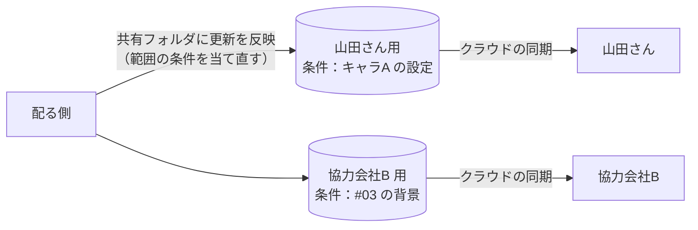

### 3.1 範囲の条件

- 範囲は、設定 → プロジェクト の「共有先」の欄で共有先を選び、右の中身の上で **「全ての範囲」** か **「フィルタで範囲を指定」** を選びます。全ての範囲なら、全部の公式のファイルが範囲になります。全ての範囲に切り替えても条件は消えず、フィルタに戻すとまた効きます。以下はフィルタのときの話です。
- 範囲は **絞り込みの条件** で覚えます。語句（テキスト・ファイル名・フォルダ・`#タグ`）と、分類ペインで選んだ分類の、普段の絞り込みと同じ組み方です。
- 1つの共有先は、**名前つきの条件をいくつでも** 持てます。範囲は、どれかの条件に一致したファイルです（「キャラA の設定すべて」と「#03 の背景だけ」のように、組み方の違うものを並べられます）。
- 条件は反映のたびに当て直します。あとから条件に合うファイルを足せば自動で届き、タグを変えれば届く物が変わります。反映の結果に、**共有先ごと・条件ごとの増えた・減った件数** が出ます。
- **基準メジャーのファイル** は、条件に関わらず届きます。
- 日時（最近N日）・切り抜きの有無・ピン・選択は条件に入りません。
- 範囲は、配る側の手元の **探索から除外** を見ません。除外したファイルも、条件に一致すれば範囲に入り、相手に渡ります。
- 新しく作ったファイルも共有は、「フィルタで範囲を指定」・条件なしで始まります。条件が無いあいだは、反映してもこの共有先は飛ばされ、結果に「条件がまだありません」と出ます。

### 3.2 始める（配る側）

1. [Google ドライブ for desktop](https://www.google.com/drive/download/) などで、相手と共有する **クラウド同期フォルダの中に下位フォルダを1つ作ります**（例 `G:\マイ ドライブ\山田さん受け渡し\RefPicker`）。
   受け渡しフォルダに作画ファイル（PSD・clip など）があっても、片付けで消すのはアプリが書いた物だけです。ただ、`manifest.json`・`roots/` などと名前がぶつからないよう、下位フォルダを共有先にします。
2. **「共有を始める…」**（共有中なら **「共有先を追加…」**）→ そのフォルダを選び、種類は **ファイルも共有** を選びます。続けて **ラベル**（相手の名前など。必須）を入れます。ラベルは受け取る人の画面にも「受け取り元」として出ます。この時点ではまだ何も書きません。
3. 範囲を決めます。
   - 全部を渡すなら、「共有先」の欄でその共有先を選び、右の中身で **「全ての範囲」** を選びます。
   - 一部だけ渡すなら、メイン画面で、渡したい範囲を **いつもどおり絞り込みます**。設定 → プロジェクト の「共有先」の欄でその共有先を選び、右の中身で範囲が **「フィルタで範囲を指定」** になっていることを確かめて、**「今の絞り込みを条件に足す…」** → 条件に名前をつけて足します。ボタンの上に、メイン画面の今の絞り込みと、それに一致する件数（**「当たるファイル … 件」**）が出ます。必要なだけ繰り返します。
4. **「共有フォルダに更新を反映」**。範囲のファイルだけが書かれます。
5. そのフォルダを相手と共有します（Google ドライブの共有機能で）。

件数の下に **「探索から除外している画像はこの件数に入りません。範囲には入るので、相手に渡ります。」** と出ることがあります。手元で探索から除外していても、範囲からは外れません。相手に渡したくないファイルは、条件で外してください。

条件の一覧は、共有先を選んだ右の中身の **「範囲の条件」** に出ます（「フィルタで範囲を指定」のとき）。**「名前を変更…」**・**「外す」** ができます。条件を組み直したいときは、メイン画面で絞り込み直して足し、古い条件を外します。
範囲を切り替えた・条件を足した・外したときは、**「共有フォルダに更新を反映」** で相手に届きます。

### 3.3 受け取る（相手）

1. Google ドライブの共有フォルダを **ドライブに追加** し、同期が終わるのを待ちます（エクスプローラーで `manifest.json` が見えればよい）。
2. メイン画面の **プロジェクト** メニューの **「共有プロジェクトを読み込み…」** を選ぶと、設定の「プロジェクト」タブが開きます。「受け取る」の段の **「共有プロジェクトを読み込み…」** を押し、**自分の PC 上の** そのフォルダ（`G:\…` などのパス。ブラウザの URL ではない）を選びます。
   パスの文字列は配る側と違って構いません。
3. 「全ての範囲」の共有先なら、受け取り範囲を選び、**「作成して取り込む」** を押します。初めはすべてが選ばれています。ファイルも共有では「複製するフォルダ」になり、選ばなかったフォルダのファイルは手元にコピーされません。全部受け取るなら **「すべて選択」**。
   「フィルタで範囲を指定」の共有先なら、受け取り範囲は聞かれません（範囲は配る側が決めているため、すべて受け取ります）。
4. ファイルも共有の共有先からは、共同編集者にはなれません（受け取るだけです）。

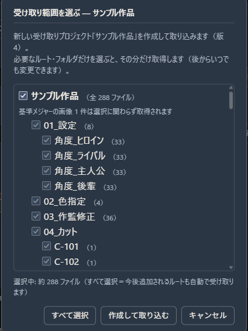

<sub>「全ての範囲」の共有先から受け取るときは、取り込む前に、どのフォルダを受け取るかを選べます。範囲はあとから「受け取り範囲を変更…」で選び直せます。</sub>

### 3.4 ふだんの流れ

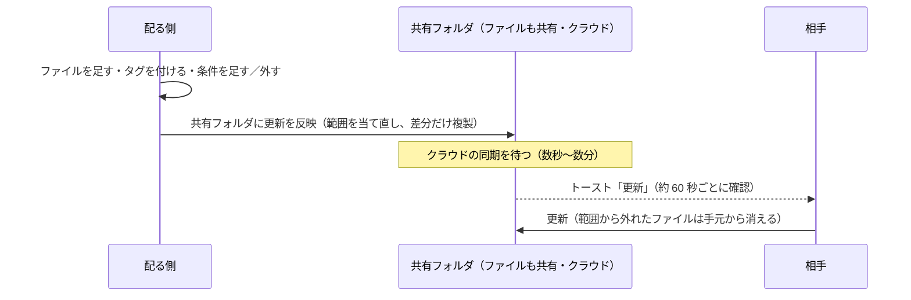

- 範囲が狭まって外れたファイルは、受け取った人の手元から消えます。そのファイルの上に受け取った人の個人の切り抜きがあったときは、件数が知らされます。手元の追加タグ・範囲に残ったファイルの個人の切り抜きは残ります。
- 写しを書くのは **反映した人** です。共同編集者が反映したときも、その人の PC から届くファイルも共有の共有先に写しを書きます。範囲を指定したデータだけ共有の共有先には、写しではなく範囲の記録を書きます（ファイルは複製しません）。届かない共有先は飛ばし、結果に出ます。
- サーバーのファイルの名前の変更・上書き・消えたことは、次に誰かが反映したときに写しへ入ります。上書きされたファイルに自分の切り抜きがあると、受け取った人の画面に **「画像の更新を検知しました。更新された画像にあなたの切り抜きがあり、ずれている可能性があります」** と出ます。

### 3.5 Google ドライブで気をつけること

データだけ共有（[2.6](#26-google-ドライブをデータだけ共有の置き場にする)）・ファイルも共有のどちらでも同じです。

- **ルートに置く**: ドライブ上のフォルダは、そのままルートとして登録できます。ほかの PC での追加・削除・上書きは、ドライブの同期のあと数秒〜十数秒で一覧に出ます。
- **はじめの読み込み**: ルートを登録したとき、RefPicker がファイルを1件ずつ読むので、ストリーミングの設定でも全部がこの PC にダウンロードされます。ファイルの量に応じた時間と、ドライブのキャッシュの空き容量が要ります。
- **ショートカット**: ドライブのショートカットは、ルートの中に置いてもたどりません。読みたいフォルダは、行き先のフォルダそのものを登録します。
- **同期の遅れ**: `manifest.json` やファイルが届くまで数秒〜数分かかります。
- **片方の PC にだけファイルが無い**: Google ドライブの同期状態のアイコンを確かめます。共有フォルダが受け取る人のアカウントで **ドライブに追加** されているか、オフライン・容量不足でないかも見てください。
- **ストリーミング** の設定では、ファイルが手元に無いことがあります。共有フォルダは「オフラインで使用可能」にしておくと確実です。
- OneDrive・Dropbox も手順は同じです。

---

## 4. 共有先を複数持つ

1つのプロジェクトは **共有先をいくつでも** 持てます。**「共有フォルダに更新を反映」を1回押すと、すべての共有先に同じバージョンが書かれます**。
データだけ共有の共有先どうしは同じ中身で、ファイルも共有の共有先は、それぞれの範囲で切った写しです。共有先ごとにバージョンがずれることはありません。

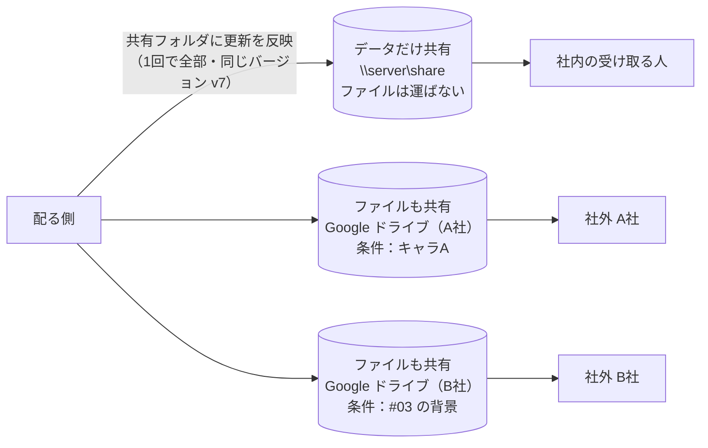

### 4.1 共有先を追加する

共有中のプロジェクトで、「共有先」の欄の **「共有先を追加…」** → フォルダを選び、種類（データだけ共有／ファイルも共有）を選び、ラベル（相手や用途の名前など。必須）を入れます。
データだけ共有なら、足したその場で今のバージョンが書かれます。ファイルも共有は「フィルタで範囲を指定」・条件なしで始まるので、条件を足すか「全ての範囲」に切り替えてから反映したときに書かれます（§3.1）。

### 4.2 共有先ごとの見え方

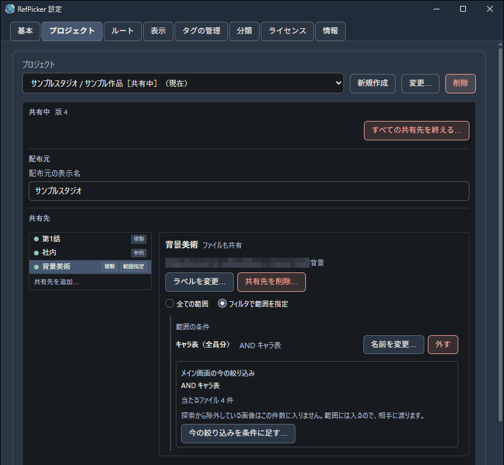

<sub>左の一覧で共有先を選ぶと、右にその中身が出ます。「共有先を追加…」で足し、右の「共有先を削除…」でやめられます。</sub>

- 「共有先」の欄は2列です。左に共有先が1行ずつ（状態の点・ラベル・種類の札「参照」か「複製」、範囲を指定していれば札「範囲指定」）並びます。選んだ共有先の種類・場所・範囲が右に出ます。状態は、問題があるときだけ右に出ます（見つからないときは **「見つかりません」**）。
- ラベルは右の **「ラベルを変更…」** で変えられます。届く共有フォルダにはその場で反映されます（バージョンは上がりません）。
- 受け取る人は、どれか1つの共有先から受け取ります。「全ての範囲」の共有先では、何を使うかを各自の **受け取り範囲** で選びます。「フィルタで範囲を指定」の共有先では、配る側が範囲を決めています。
- 受け取る人が、受け取る共有先を別のものに替えるときは、受け取りプロジェクトを開いたまま **「共有プロジェクトを読み込み…」** で新しい共有先の共有フォルダを選びます。「共有先を切り替えました」と出て、受け取ったものはそのまま使えます。

---

## 5. 共同編集（社内の何人かで公式を作る）

公式データを何人かで手分けして作るパターンです。各自が自分の PC で編集し、
自分の変更を「**公開分**」として共有フォルダに置き、互いの公開分を取り込み合います。

- 共同編集は **データだけ共有・全ての範囲** の共有先の上で行います。範囲を指定した共有先や、ファイルも共有の共有先から受け取った人は、受け取るだけです（**「共同編集者として受け取る…」** で選ぶと断られ、理由が出ます）。
- 共同編集者は、その共有先に届く **社内の人だけ** です。**全員にスタジオ用ライセンスが要ります**。
- 共同編集者は受け取り範囲を持たず、**すべて受け取ります**（設定に「共同編集者はすべて受け取ります」と出ます）。
- 全員対等です。「配る役」はいません（誰が抜けても続けられます）。

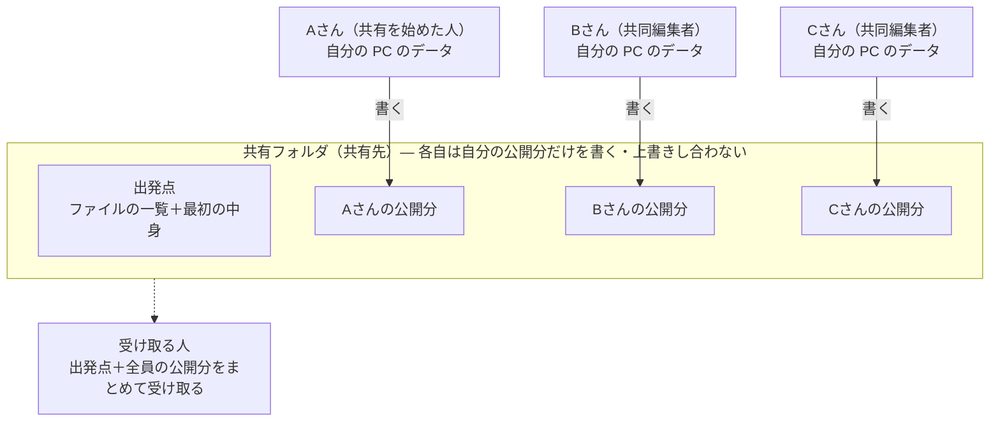

各自は **自分の公開分だけ** を書き、ほかの人の公開分は「更新」で取り込みます（Aさんは Bさん・Cさんの分を、Bさんは Aさん・Cさんの分を…）。

### 5.1 始める

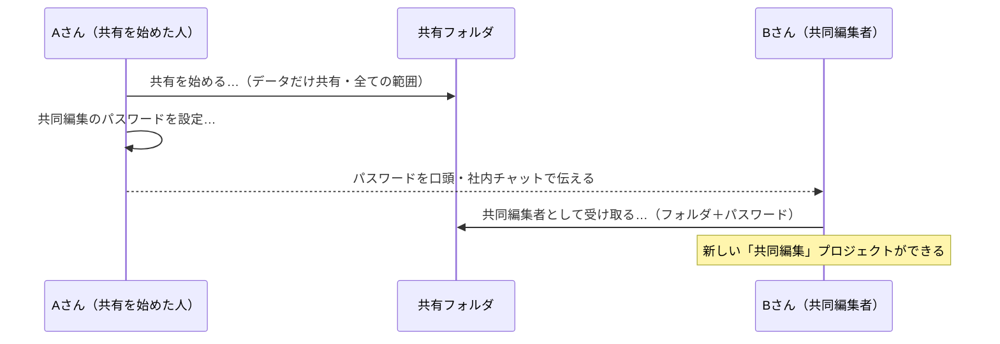

1. **Aさん**: **「共有を始める…」** で、データだけ共有の共有を始めます（範囲は初めから全ての範囲です。「共有先」の欄で、範囲が **「全ての範囲」** になっていることを確かめます）。「共有中」の枠の **「共同編集のパスワードを設定…」** でパスワードを決めます（スタジオが決める合言葉）。パスワードを入れて **「次へ」** を押すと、続けて **「編集者名（あなたの名前）」** の入力が出ます。自分の編集者名を入れて **「設定」** を押します。
2. Aさんは、共同編集者にパスワードを伝えます。
3. **Bさん**: **「共同編集者として受け取る…」** → 共有フォルダとパスワードを入れます。編集者名（**この PC で編集するあなた自身の名前**。共同編集者の一覧と、あなたが反映した変更に出ます。必須）も決めます。違うパスワードは、入れた直後に断られて入れ直せます。
   いつも **新しいプロジェクト** として受け取ります（手元の既存プロジェクトを途中で共同編集に切り替える操作はありません）。

> 共有先が複数ある共有では、Bさんの PC で見つからない共有先があると **「場所を選ぶ…」** で指定を求められます。

### 5.2 ふだんの流れ

1. 各自が自分の PC で編集します（タグ・切り抜き・メジャー・ファイルタグ・ルートの追加・プロジェクトの設定）。
2. 終わったら **「公開分を共有フォルダに反映」**（Aさんの画面では **「共有フォルダに更新を反映」**）。**すべての共有先** に自分の公開分が書かれます。
3. 他の人には「共有の更新があります（共同編集者の公開分：〈名前〉）」のトーストが出て、「**更新**」で取り込みます。受け取る人にも同じように届きます。反映した人の画面には「公開分を反映しました（N 件）」と出て、「未反映の変更 … 件」の表示が消えます（Aさんも同じ）。

まだ反映していない変更は、**「未反映の変更 … 件」**（Aさんは「共有中」の枠、加わった人は「共同編集中」の欄）を開くと1行ずつ並びます。

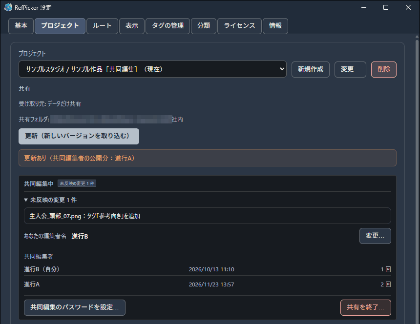

<sub>共同編集者の一覧には、編集者名と最後に反映した日時が出ます。</sub>

「共同編集中」の欄には **共同編集者の一覧**（編集者名・最後に反映した日時）が出ます。抜けた人の公開分も残ります。

### 5.3 2人が同じものをいじったとき

変更には時刻が付いていて、**後から変えた方で上書きされます**。誰がどの順で取り込んでも、全員が同じ結果になります。

| 対象 | 決まり |
|---|---|
| 自由タグ・ファイルタグ | **足し合わせ**。Aさんが「走り」、Bさんが「横」を足せば両方残る。同じタグの付ける／外すが重なったら、後の操作で上書きされる |
| 分類タグ（ショットサイズなど、1つだけ付ける分類軸） | **（切り抜き, 軸）ごとに、後から付けた分類で上書き**。1つの軸に分類が2つ並ぶことはない |
| 分類タグ（部位と、付け方が **「複数可」** のカスタム分類軸） | 自由タグと同じく **足し合わせ** |
| 切り抜きの形・メジャー・割り当て・プロジェクトの設定 | **項目ごとに、後から変えた方で上書き** |
| 消す と 変える | **消す方が優先される**。消された切り抜きに付けたタグも消え、件数で知らせる |
| メジャーの親子が輪になる付け替え | 当てずに捨て、件数で知らせる |

後から変えた方で上書きされるので、先に変えた側の変更は黙って消えます。**範囲を分けて手分けする**（Aさんは第1話、Bさんは第2話など）と、ほとんど起きません。

### 5.4 共同編集者がルートを足したとき

ルートは共同編集者の誰でも足せます。足した人が反映すると、他の全員に自動でつながります。

ルートの **削除** も、共同編集者の誰でもできます（始めた人と同じ）。削除して反映すると、全員の登録からそのルートが外れます（サーバー上のファイルは消えません。ファイルも共有で受け取った人の手元の複製は、次の反映で消えます）。足し直すと別のルートとして扱われます。古いバージョンの RefPicker を使っている人には、削除を含む公開分を取り込むときに「新しいバージョンに更新してください」と出ます。

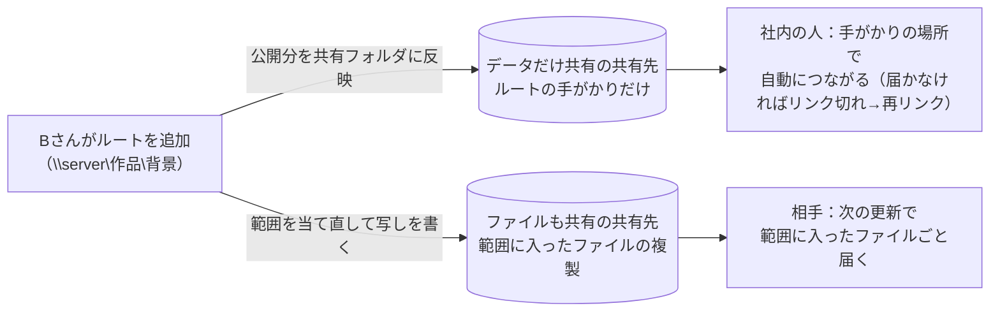

ファイルも共有の共有先への写しは、**反映した人の PC が** 書きます（その人から届く共有先だけ）。足したルートのファイルは、その共有先の範囲に入ったものだけが入ります。データだけ共有の人は参照するので複製されません。

### 5.5 編集者名を変更する

共同編集を始めたあとでも、自分の編集者名は変えられます（スタジオ用）。

1. 設定の「プロジェクト」タブで、「共同編集中」の欄の「あなたの編集者名」の横の **「変更…」** を押します（マウスを載せると「編集者名を変更…」と出ます）。
2. 今の名前が入った入力欄が出ます。新しい名前を入れて **「変更」** を押します。

- 変えられるのは自分の名前だけです。ほかの共同編集者と同じ名前にはできません。
- 変えるとすぐ、共有先にある自分の公開分の名前が書き換わり、ほかの人の画面でも、これまでの分を含めて新しい名前で出ます。共有先の一部に書けなかったときはそう知らせ、次に反映するとそろいます。
- 古いバージョンの RefPicker を使っている人の画面では、前の名前のまま出ることがあります。

---

## 6. 選んで書き出す・重ねて取り込む（USB・メールで手渡し）

その場で選んだものを、一回きりで手渡すパターンです。共有先としては覚えず、ZIP を1つ作ります（ファイルも入れる）。同じ相手に続けて更新を届けたいときは、§3 のファイルも共有を使います。RefPicker を持たない人へファイルそのものを渡すときは、**「ファイルを書き出す…」**（[ユーザーガイド 5.2](USER_GUIDE.md#52-ファイルを書き出す)）を使います。

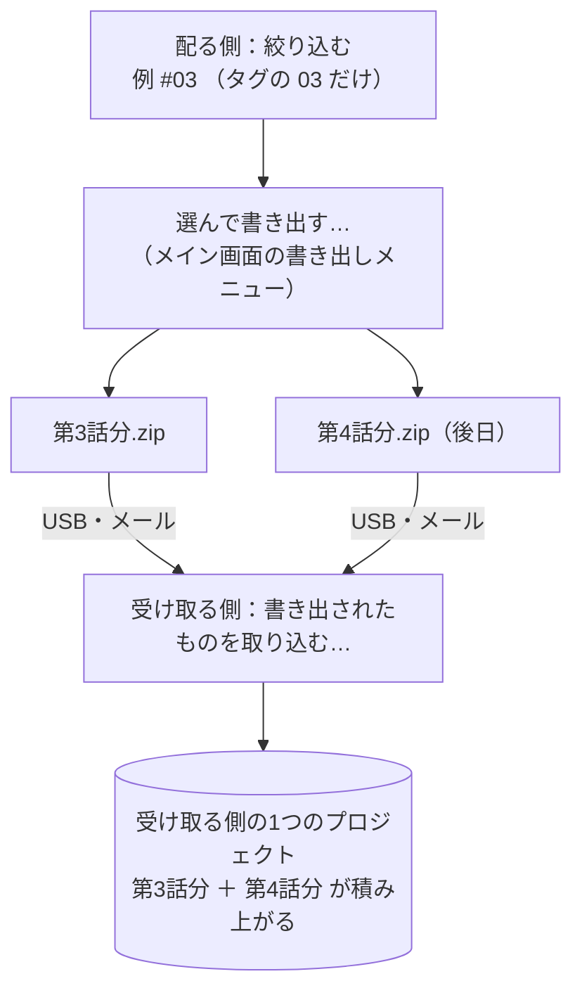

### 6.1 書き出す（配る側・スタジオ用）

1. メイン画面で、渡したいファイルを絞り込みます（またはファイル表示で選びます）。
   **`#03` のように `#` を付けた語句はタグにだけ一致し**、パスには一致しません。話数タグで的確に選べます（`-#03` で「03 のタグが無いもの」）。
2. メイン画面の **書き出し** メニューの **「選んで書き出す…」** を選びます（読み込みが終わっていないルートがあるあいだは、「書き出せません」と出て書き出せません）。
   選択があれば選択したファイル、無ければ絞り込みの結果が対象です。件数を確かめて保存先を選びます。
   受け取ったプロジェクトを開いているときと、一覧が0件のときは押せません。押せないときは項目が薄くなり、マウスを乗せると理由が出ます。

   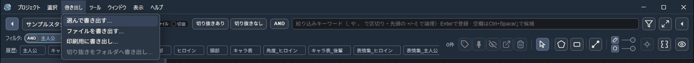

3. そのファイルと、その上の切り抜き・タグ・ファイルタグ・メジャー（割り当てと親）だけが ZIP に入ります。

### 6.2 取り込む（受け取る側）

1. 設定「プロジェクト」タブの **「書き出されたものを取り込む…」** → ZIP を選びます。
2. 配る側（共有元）のプロジェクトで照合し、**初めてなら新しい受け取りプロジェクトを作り、2回目からはそこへ重ねます**。

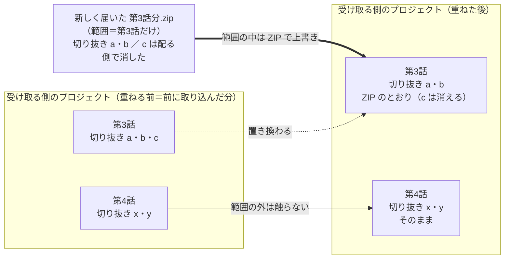

- **書き出された範囲の中は上書き、範囲の外には触りません**。受け取る側で足した追加タグ・個人の切り抜きは残ります。
- 長いシリーズで要らなくなった話数などは、設定 → プロジェクト の **「受け取り範囲を変更…」** でフォルダ単位で手元から外せます（手元にある物から選ぶ・外すだけ）。外した物も、それを含む ZIP をもう一度取り込めば戻ります。
- 共有フォルダから受け取って更新を検知しているプロジェクトには重ねません（次の更新で上書きされてしまうため）。その場合は新しいプロジェクトができます。

---

## 7. 共有の終わらせ方

### 7.1 共有先を1つ削除する／共有を終了する

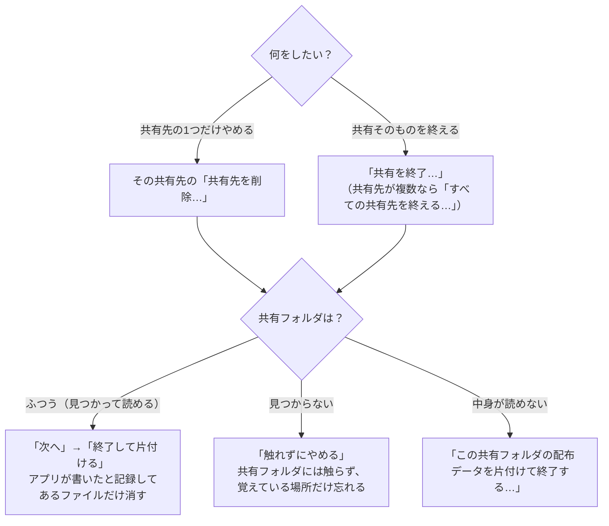

- ふつうは、2回確かめたあと **必ず片付けます**（片付けずにやめる選択はありません）。共有フォルダが見つからないときだけ「触れずにやめる」、中身が読めないときだけ「この共有フォルダの配布データを片付けて終了する…」になります。
- 片付けで消すのは、**アプリが共有フォルダに書いたと記録してあるもの** だけです。共有フォルダに人が置いた別のファイルや、データだけ共有で参照しているサーバーの元のファイルは消えません。
- 共同編集中なら「共同編集者 N 人の公開分も片付けます」と確認が出ます。
- **終わらせられるのは、共有を始めた人か共同編集者の誰か** です。始めた人が抜けても、残った共同編集者が片付けられます。

### 7.2 終わったあと

| 人 | どうなるか |
|---|---|
| 受け取る人 | **配られたファイルの複製と公式のデータ（公式ルート・切り抜き・タグ・設定）が手元から消える**。個人ルートとその上の作業は残る。「共有元がこの共有を終了しました…片付けました」と知らせが出る |
| 共同編集者 | 受け取る人と同じく公式が手元から消え、共同編集も外れる（共同編集者は個人ルートを持たないので、ほぼ空になる。不要ならプロジェクトを削除） |
| 共有を始めた人 | 手元のプロジェクトは何も消えない。共同編集だけが外れ、ふつうのプロジェクトに戻る。「共有を始める…」すれば新しい共有として共有し直せる（共同編集はパスワードを設定し直したときに始まる） |

- 「終わった」と判断するのは、共有フォルダに終わった印（`share-ended.json`）があるときと、同じ場所が別の共有に置き換わったときだけです。**共有フォルダが見つからない・読めないだけでは何も消えません**（§7.4）。
- データだけ共有の共有先から受け取っていても、**サーバーのファイルには触れません**。消すのは受け取った人の PC のデータ置き場の中の物だけです。
- **「ファイルを書き出す…」**（[ユーザーガイド 5.2](USER_GUIDE.md#52-ファイルを書き出す)）で書き出した先も、共有を終えても消えません。

### 7.3 中身を作り直したい・壊れたとき（共有し直す）

「リセット」の操作はありません。**「共有を終了…」（片付けて）→ 同じ場所で「共有を始める…」** で作り直します。
受け取る側では前の共有が終わったと判断され、公式が手元から消えます（§7.2）。**新しい共有はもう一度受け取ってもらいます**（共同編集者はパスワードで加わり直す）。前の受け取りプロジェクトとは別のプロジェクトになります。
`manifest.json` が壊れて読めないときも、終了の片付けで（確認のうえ）管理ファイルを消してから共有し直せます。

### 7.4 共有フォルダが見つからないとき

覚えている共有フォルダに届かないと、プロジェクト切替などに **「見つかりません」** と出ます（配る側では、「共有先」の欄の状態の点と、右の中身にも出ます）。

- 移動・名前変更しただけなら、元の場所に戻すか、配る側が新しい場所で共有し直します。
- 受け取る側でもう使わないなら、**プロジェクトを削除** します（ただの受け取りに「共有を終了…」はありません）。

---

## 8. データルートは PC ごとに1つ

RefPicker のデータ（データベース・設定）の置き場＝**データルート** は、PC ごとに分けます。サーバー上に置いた同じデータルートを2台で開くことはできません。

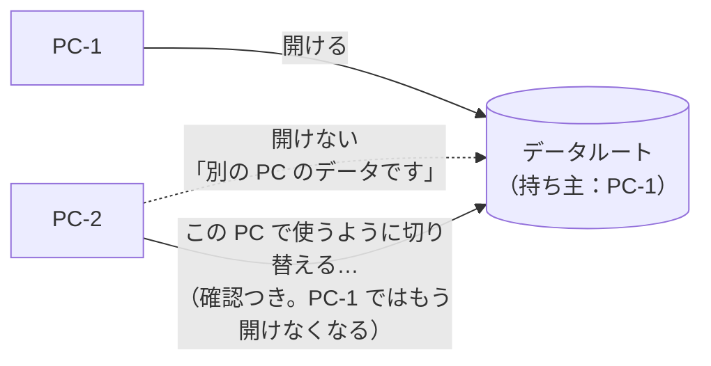

- 別の PC のデータルートを開こうとすると、起動したときに **「別の PC のデータです」** の画面が出ます。PC の買い替えなど、正当に持ち主が替わるときだけ、この画面で **「この PC で使うように切り替える…」** を選びます（データのコピーや移動はしません）。
  別の場所にしたいときは、同じ画面の **「別の保存先を選ぶ…」**。
- 複数の人で同じ公式データを使いたいときは、データルートを共有するのではなく、§2〜§5 の共有・共同編集を使ってください。
- ルートのスキャンは、RefPicker の共有フォルダ（`manifest.json` や `coedit/` があるもの）とデータルートを中まで飛ばします。
  同じサーバーに別作品の RefPicker のデータが置いてあっても、共有の操作をしない限り読み込まれません。

---

## 9. RefPicker を新しいバージョンにするとき

共有の機能を使うときは、配る側も受け取る人も、RefPicker を最新のバージョンに更新してください。
共有先の渡し方と範囲、動画・3D・PSD・PSB・.clip・TGA を扱えるようになったバージョン（[CHANGELOG](CHANGELOG.md)）より前の RefPicker を、この章では **前のバージョン** と書きます。前のバージョンのままだと起きることは §9.2 にあります。

どのバージョンで何が増えたかは [CHANGELOG](CHANGELOG.md) にあります。

### 9.1 新しいバージョンが出たことを知る

- RefPicker は起動したときに1回、新しいバージョンが出ていないかを確かめます。出ていれば、メイン画面の上に **「新しいバージョン … が出ています（いまのバージョンは …）」** の知らせが出ます。
  - **「ダウンロードのページを開く」** を押すと、配布ページがブラウザで開きます。
  - **「このバージョンの通知は今後表示しない」** を押すと、同じバージョンのあいだは起動しても出ません。それより新しいバージョンが出たら、また出ます。
  - **「後で」** を押すと、次に RefPicker を起動するまで出ません。
- 設定の **「情報」** タブでも、最新のバージョンか、新しいバージョンが出ているかを確かめられます（起動したときに確かめた結果を見せるだけです）。
- 知らせるだけです。RefPicker が勝手に入れ替えたり、作業中に再起動したりはしません。
  ネットに出られない PC では何も出ません。
- 入れ替えは、今までどおり手で行います（手順は [QUICKSTART](QUICKSTART.md)）。
- **前のバージョンには、この知らせがありません**。前のバージョンを使っている相手には、新しいバージョンが出たことを今までどおり伝えてください。

### 9.2 前のバージョンのままだと起きること

- 前のバージョンの受け取る人では、次のことが効きません。
  - **範囲を指定したデータだけ共有**：範囲が効かず、元のフォルダの全部が並びます（§2.5）。
  - **新しい種類のファイルに付けたタグや切り抜き**：更新が「索引にないファイルです: …」で止まり続けます。最新のバージョンに更新すれば、止まっていた分をまとめて取り込めます（§9.3）。
- 共同編集で前のバージョンの人がいると、公開分の取り込みは止まりませんが、新しい種類のファイルへの変更や、3D のアングル・動画のサムネイルのコマはその人に届きません。
  範囲を指定したファイルも共有の共有先があると、前のバージョンの共同編集者が反映したとき、範囲の外のファイルまで書くことがあります。今あるファイルも共有の共有先は、更新すると全ての範囲に移っています。
- 更新したあとは、設定 → ルート で **「再スキャン」** してください。動画・3D・PSD・PSB・.clip・TGA が一覧に入ります（更新しただけでは入りません）。

### 9.3 受け取りが止まったとき

配る側が新しいバージョンで動画・PSD にタグを付け、受け取る人が前のバージョンのままだった例です。

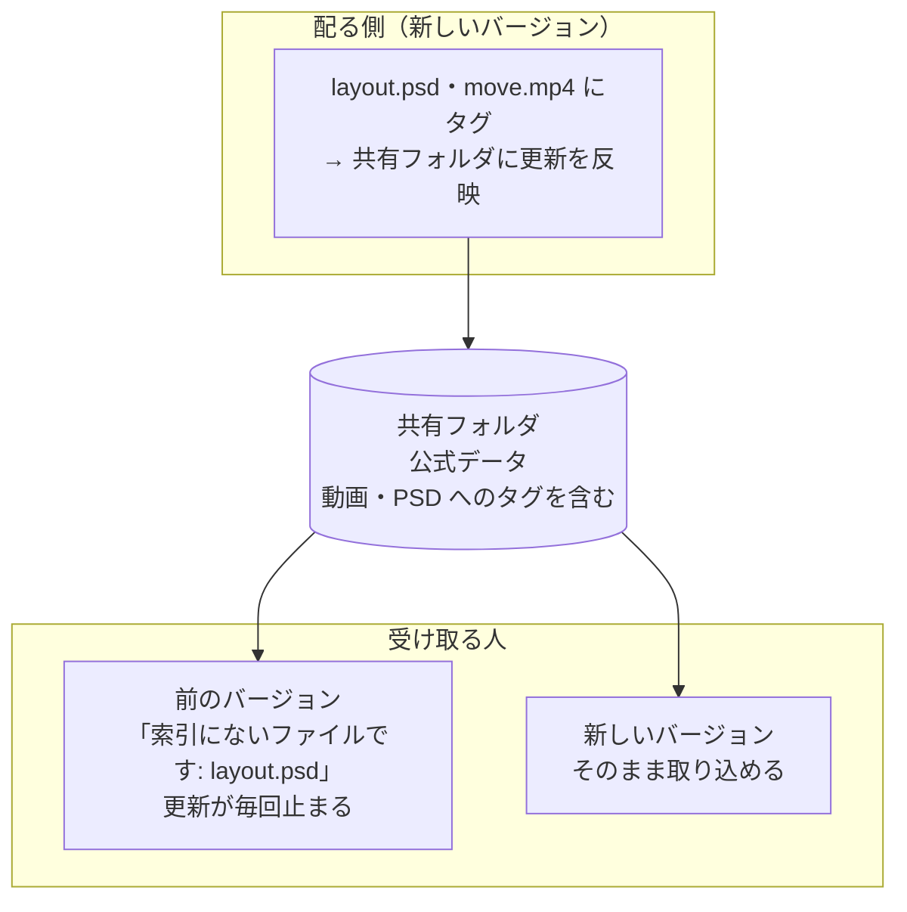

| 受け取る人のバージョン | 起きること | どうするか |
|---|---|---|
| **前のバージョン** | 更新を押すたびに「索引にないファイルです: …」で止まる。バージョンは進まない。前に取り込んだ分はそのまま見られる | 受け取る人が新しいバージョンに更新する。起動すると「共有元から更新があります」が出るので、「更新」を押す。止まっていた間の分（動画・PSD のタグも）がまとめて入る |
| 新しいバージョン | そのまま取り込める | — |

**新しいバージョンどうしなら、止まる前に知らせます**。この先、さらに新しいバージョンの配る側が、手元のバージョンでは読めない形の共有を作ったとします。
そのとき受け取りは **取り込まずに止まり**、次のように知らせます。

- 更新を押すと **「この共有は新しいバージョンの RefPicker で作られています。」** で始まるダイアログが出ます。**「ダウンロードのページを開く」** ボタンも出ます。
- プロジェクト切替などに **「更新が必要」** と出て、設定「プロジェクト」タブにも同じ理由とボタンが出ます。
- 「更新があります」のトーストは出ません。前に取り込んだ分は、今までどおり見られます。
- 画像だけにタグを付けた共有では止まりません。必要のない人まで止めないためです。

> 前のバージョンはこの仕組みを持たないので、上の表のとおり「索引にないファイルです: …」で止まります。

---

## 10. 試してみる（1台で）

共有フォルダの代わりに、手元の空フォルダで流れを確かめられます。

1. 空フォルダ `D:\RefPickerTest\第1話` を作ります（ルートの中やルートを含む親は選べません）。
2. 配る側のプロジェクトで公式ルートを登録 → **「共有を始める…」** で上のフォルダを選びます（種類はファイルも共有）。この時点ではまだ何も書かれません。
3. 「共有先」の欄でその共有先を選び、右の中身で範囲を **「全ての範囲」** にします（ファイルも共有は、条件が無いままでは書かれません）。
4. **「共有フォルダに更新を反映」** を押します。全部のファイルが上のフォルダに書かれます。
5. 別のプロジェクトに切り替え、**「共有プロジェクトを読み込み…」** で同じフォルダを選ぶと、受け取りプロジェクトができます。
6. 配る側に戻ってタグを変え → **「共有フォルダに更新を反映」**。
7. 受け取りプロジェクトでバッジ／トースト → **「更新」**。

同じ PC では検知まで最大約 60 秒です。すぐ試すときは、一度ほかのアプリに切り替えてメイン画面に戻るとトーストが出ます。
共同編集（パスワード・2人分の公開分）は、データルートを分けた2台で試してください（§8）。

---

## 11. うまくいかないとき

| 症状 | 確かめること |
|---|---|
| 更新バッジが付かない | そのプロジェクトはフォルダから受け取ったか（選んで書き出した ZIP は検知しない）。受け取りプロジェクトの「共有フォルダ: …」に出る場所が、配る側の共有先と同じフォルダを指しているか。共有フォルダに `manifest.json` があり、バージョンが手元より新しいか。クラウドの同期が終わっているか |
| 更新を反映できない（配る側・共同編集者） | **「見つからないファイルが…件あります」** と出たら、見つからないファイルがあるあいだは反映が止まります。ファイルを元の場所に戻すか、設定 → ルート の **「見つからないファイルのデータを削除…」** で消してから、もう一度反映します。「公開できません」と出て「まだ読み込みが終わっていない」と言われたら、そのルートの読み込みが終わるのを待ってから反映します（[ユーザーガイド 1.5](USER_GUIDE.md#15-読み込みに時間がかかるとき中断して続きから)） |
| ファイルも共有の共有先が飛ばされ、「条件がまだありません」と出る | 範囲が「フィルタで範囲を指定」で、条件が1つも無い。条件を足すか、「全ての範囲」に切り替える（§3.1） |
| 更新を適用できない（受け取る人） | 共有フォルダの中身が届ききっているか（クラウドの同期の途中でないか、`roots` 以下のファイルがそろっているか）。そろっていなければ、配る側に反映し直してもらいます。手元の共有フォルダの中身だけを手で差し替えていないか |
| 更新のたびに「索引にないファイルです: …」 | 配る側が新しいバージョンで動画・3D・PSD などにタグを付け、受け取る側が前のバージョン（§9.3）。受け取る側を新しいバージョンに更新する |
| **「この共有は新しいバージョンの RefPicker で作られています。」**・**「更新が必要」** と出る | §9.3。RefPicker を新しいバージョンに更新する（前に取り込んだ分は見られる） |
| **「…の購読先 (…) が一致しません」**／**「発行元プロジェクトには取り込めません」** | 別のプロジェクトの共有フォルダを、別の共有を受け取っているプロジェクトへ当てようとしていないか。受け取りプロジェクトは共有ごとに分かれます（初回は自動で新しく作られます）。自分が共有を始めたプロジェクトには取り込めません（共有元のデータが上書きされることはありません） |
| **「共有元がこの共有を終了しました」** と出る | 共有元が共有を終えました。配られたファイルの複製と公式のデータは、受け取った人と共同編集者の手元から消えています。自分で追加した個人ルートの分は残ります（§7.2）。不要ならプロジェクトを削除してください。同じ場所で共有し直されたら、もう一度 **「共有プロジェクトを読み込み…」** で受け取ります（共同編集者は **「共同編集者として受け取る…」**） |
| **「共有元が共有を終了した可能性があります」** と出る | 共有フォルダに配布データも終了の印も見つからないとき（共有フォルダごと消された場合など）に出ます。共有元に確かめてください |
| **「このフォルダの共有は共有元が終了しています」** と出る | 終わった共有のフォルダを読み込もうとしています。この共有フォルダからは受け取れません |
| 別のプロジェクトを更新しても、今の一覧は変わりません | 画面の左上のプロジェクト切替の一覧の「更新」で、開いていないプロジェクトを更新したときは、いま開いているプロジェクトは切り替わらず、一覧も変わりません。そのプロジェクトのバッジが消えれば取り込み済みです |
| トーストを「後で」にしたあと、また出したい | 「後で」はその起動中は出ません。RefPicker を起動し直すと、まだ取り込んでいない更新があればもう一度出ます。設定「プロジェクト」タブの **「更新（新しいバージョンを取り込む）」** からも取り込めます |
| データだけ共有でファイルが出ない | 設定 → ルートが **「リンク切れ」** なら「再リンク…」。この PC からサーバーが見えるか |
| ファイルも共有で片方の PC にだけファイルが無い | §3.5 |
| **「共有フォルダが見つかりません」** | §7.4 |
| 共有フォルダに選べない | ルートの中、またはルートを含む親を選んでいないか |
| 起動すると **「別の PC のデータです」** と出る | §8。データルートを2台で共有していないか |
| 共同編集者として受け取れない | データだけ共有・全ての範囲の共有先か（ファイルも共有・範囲指定の共有先からはなれない）。スタジオ用ライセンスか。パスワードが合っているか。配る側がパスワードを設定済みか |
| 自分の変更が他の人に届かない | 「公開分を共有フォルダに反映」を押したか。同じものを後から別の人が変えていないか（§5.3） |
| 選んで書き出した ZIP の取り込みが重ならず新しいプロジェクトになった | 同じ共有をフォルダから受け取って更新を検知しているプロジェクトには重ねません（§6.2） |

---

## 12. 早見表

| 操作 | 場所 |
|---|---|
| 共有を始める… | 設定 → プロジェクト →「共有」の枠 |
| 共有プロジェクトを読み込み… ／ 書き出されたものを取り込む… ／ 共同編集者として受け取る… | 設定 → プロジェクト →「受け取る」の段 |
| 共有先を追加… ／ ラベルを変更… ／ 共有先を削除… ／ 共有を終了… ／ 共同編集のパスワードを設定… ／ 共同編集者の一覧 | 設定 → プロジェクト →「共有中」の枠 |
| 全ての範囲 ／ フィルタで範囲を指定 ／ 今の絞り込みを条件に足す… ／ 条件の名前を変更… ／ 外す | 設定 → プロジェクト → 「共有先」の欄（共有先を選んだ右の中身） |
| 共有フォルダに更新を反映 ／ 公開分を共有フォルダに反映 ／ 更新（新しいバージョンを取り込む） | 設定 → プロジェクト |
| 受け取り範囲を変更… | 設定 → プロジェクト（受け取りプロジェクト） |
| 公式ルートの登録（ルートを追加） ／ 再リンク… ／ 再スキャン | 設定 → ルート |
| 選んで書き出す… | メイン画面の書き出しメニュー（§6.1） |
| 更新のトースト（更新・後で）／ 新しいバージョンの知らせ | メイン画面の上 |
| プロジェクト切替・更新バッジ | メイン画面の左上 |

> **共有と移行は別物です**。プロジェクトを丸ごと別の PC へ持っていって続きを編集するときは、設定「プロジェクト」タブの「別の PC へ移す」の段の **「プロジェクトを書き出し…」**／**「プロジェクトを読み込み…」**（移行）を使います。
> [ユーザーガイド §7 プロジェクトの移行](USER_GUIDE.md#7-プロジェクトの移行) を見てください。

---

## 13. 関連

- [README.md](README.md) — RefPicker の概要・ダウンロード・ライセンス
- [QUICKSTART.md](QUICKSTART.md) — 起動から最初の絞り込みまで
- [USER_GUIDE.md](USER_GUIDE.md) — 画面全体・フィルタ・切り抜き
- [SUPPORT.md](SUPPORT.md) — 問い合わせ・よくある質問
- [CHANGELOG.md](CHANGELOG.md) — バージョンごとの変更
