# RefPicker 共有ガイド

プロジェクトの **公式データ**（ルートの画像・切り抜き・タグ・メジャー・プロジェクトの設定）を、配る側（共有元）から受け取る人へ配り、
更新を届け、必要なら複数の人で一緒に編集するまでを、**配り方のパターンごとに図で** 説明します。

- 対象 OS: Windows
- 共有の操作は、すべて設定ウィンドウの **「プロジェクト」** タブ（上の「共有する／受け取る／別の PC へ移す」の段と、「共有」の欄）から行います。**「選んで書き出す…」** だけは、メイン画面のツールバーのアイコンのボタンです（§6.1）。
- 関連: [ユーザーガイド](USER_GUIDE.md)（画面全体の操作）

> **ライセンスについて**
> **受け取る人はライセンス認証が要りません。** 受け取る件数の制限もありません。
> **共有を始める・共有先を足す・選んで書き出すには、スタジオ用のライセンスが必要です。**
> **共同編集者は例外で、全員にスタジオ用のライセンスが必要です**（§5）。
> 詳しくは [スタジオ用ライセンスのご案内](https://animtools.github.io/RefPicker/landing/buy/studio.html)。

> 図は Mermaid で描いています。GitHub ではそのまま図になります。VS Code のプレビューで見るときは拡張機能「Markdown Preview Mermaid Support」を入れてください。
> アプリのスクリーンショットはすべて、デモ用に生成した **架空の設定資料** で撮影しています。

---

## 0. どのパターンを読めばいいか

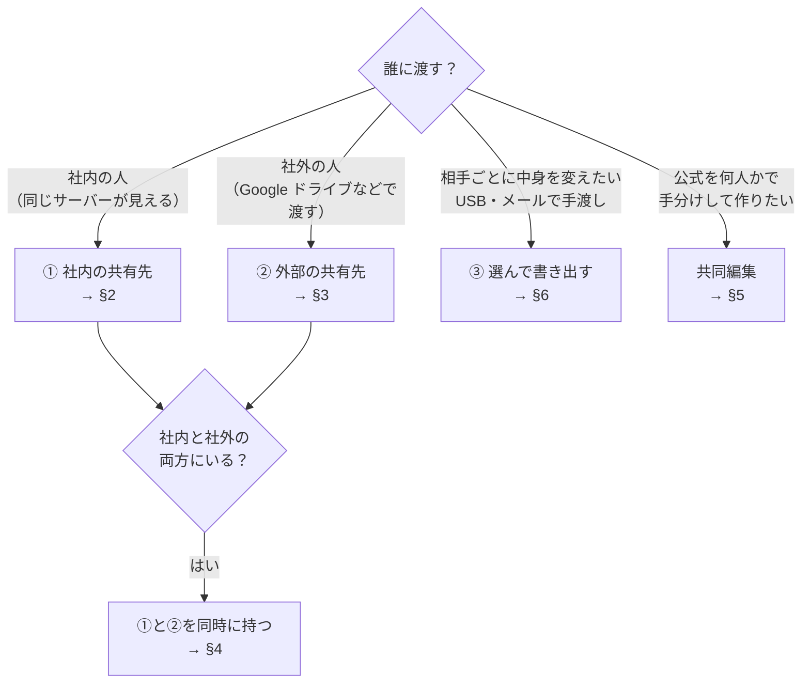

| パターン | 画像の運び方 | 更新の届き方 | 節 |
|---|---|---|---|
| ① 社内の共有先 | **参照**（複製しない。サーバーの元画像を各自が読む） | 自動で知らせる（トースト・バッジ） | §2 |
| ② 外部の共有先 | **同梱**（共有フォルダに画像を複製） | 自動で知らせる | §3 |
| ①＋② を同時に | 共有先ごとに上のとおり。**バージョンは1つ** | 自動で知らせる | §4 |
| 共同編集 | ①②のどちらでも | 全員の分を互いに知らせる | §5 |
| ③ 選んで書き出す | ZIP に同梱 | 次の書き出しを取り込んだとき | §6 |

共有の終わらせ方は §7、データルート（RefPicker のデータの置き場）と PC の関係は §8 です。

---

## 1. 共通の考え方

### 1.1 登場する人と、プロジェクトの種類

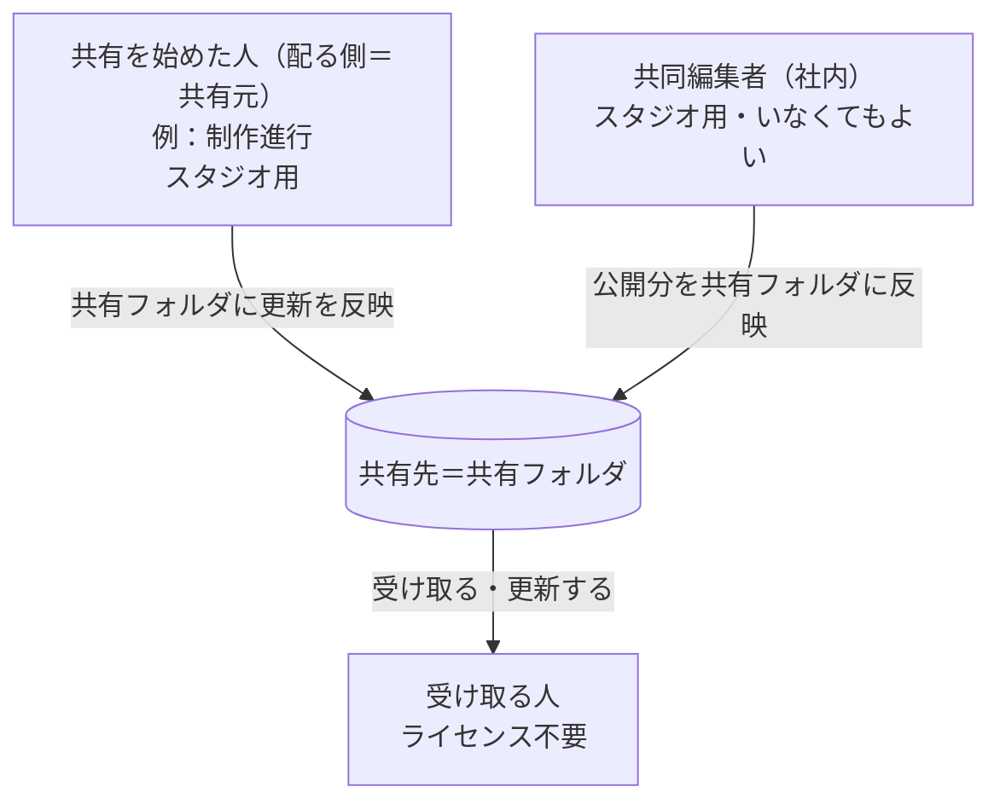

共有を始めた人と共同編集者は、互いの反映も「更新」で取り込みます（§5）。

設定の「プロジェクト」では、プロジェクトの種類を示す札が付きます。ふつうのプロジェクトには札が付きません。

| 札 | どういうプロジェクトか | 公式データ |
|---|---|---|
| **「共有中」** | 自分が共有を始めたプロジェクト | 編集できる |
| **「受け取り」** | 共有フォルダ（または書き出された ZIP）から受け取ったプロジェクト | 読み取り専用（下の「手元で足せるもの」は可） |
| **「共同編集」** | 共同編集者として受け取ったプロジェクト | 編集できる（全員対等） |

札とは別に、覚えている共有フォルダに届かないときは、プロジェクト切替などに **「見つかりません」** と出ます（§7.4）。

**受け取ったプロジェクトでも手元で足せるもの**: 公式の切り抜きへの **追加タグ**、自分の **個人の切り抜き・個人のメジャー**、個人ルート。
これらは更新を受け取っても消えません。配られたタグには画面で **「公式」** の印が付き、手元では消せません。

共有元から届いた画像の上なら、分類タグの付け外しもライセンスなしでできます（手元だけに残ります）。対象は、共有元がこの機能のある RefPicker で更新を反映した共有です（[CHANGELOG](CHANGELOG.md)）。

### 1.2 何が配られ、何が配られないか

| もの | 配られる？ |
|---|---|
| 公式ルートの画像・切り抜き・タグ・画像タグ・メジャー・割り当て | ✅ |
| プロジェクトの設定（基準メジャー・用紙・タググループ・配布元（表示ラベル）・プロジェクト名） | ✅ |
| 個人ルート・受け取る人の追加タグ・個人の切り抜き／メジャー | ❌ 手元だけ |

### 1.3 共有フォルダの中身

共有フォルダ（共有先）は **ただのフォルダ** です。社内サーバーの共有、Google ドライブ・OneDrive・Dropbox のクラウド同期フォルダ、手元の空フォルダのどれでも構いません。
中身はアプリが書きます。**手で編集しないでください。**

```text
共有フォルダ/
├─ manifest.json          … バージョン番号・プロジェクトの ID・ファイルの一覧（アプリが書いた記録）
├─ roots/<ルート>/         … ルートごとの公式データ（②では画像の複製もここ）
├─ paper/                 … 用紙
├─ coedit.json            … 共同編集中だけ（共有先の一覧など）
└─ coedit/parts/<人>/0001.json …  共同編集者ごとの「公開分」（区切りファイル）
```

受け取る側は `manifest.json` のバージョンが手元より新しいと「更新あり」と判断します。

### 1.4 更新の知らせ方（①②共通）

- **バックグラウンドの検知**（約 60 秒ごと）: フォルダから受け取ったプロジェクトをまとめて確かめ、プロジェクト切替に **更新バッジ** を付けます。
- **メイン画面に戻ったとき**: **トースト**（「更新」「後で」）。「後で」はその起動中は出ません。文は、バージョンが上がったときは「共有元から更新があります（版 N）」、共同編集者の公開分だけが届いたときは「共有の更新があります（共同編集者の公開分：PC2）」と、誰の分かが出ます。② 外部で受け取った人には、サーバーの画像が変わったとき「共有の更新があります（画像の変化）」と出ます（誰の名前も付きません）。
- トーストの見出しには、プロジェクトの札［共有中］［受け取り］［共同編集］と、どの共有先から来たかの印〔種類・共有フォルダの名前〕が付きます（例「サンプルスタジオ / サンプル作品［受け取り］〔社内・第1話〕」）。同じ名前のプロジェクトを社内と外部の両方で受け取っても、1台に配る側と受け取りの両方があっても見分けられます。
- **設定「プロジェクト」タブ**: 新しいバージョンがあると **「更新（新版を取り込む）」** が出ます。

勝手には取り込みません。いつも利用者が押したときだけです。取り込む前にプロジェクトのデータを自動で退避します。例外は ① 社内でのサーバーの画像の変化で、各自がサーバーを直接見ているので、知らせを出さずに裏で合わせます（データを削除した画像が手元から消える、など）。

---

## 2. ① 社内の共有先（画像は運ばない）

社内サーバーに画像が置いてある現場向けです。**画像は複製せず、サーバーの元画像をそのまま各自が読みます**（容量は増えません）。

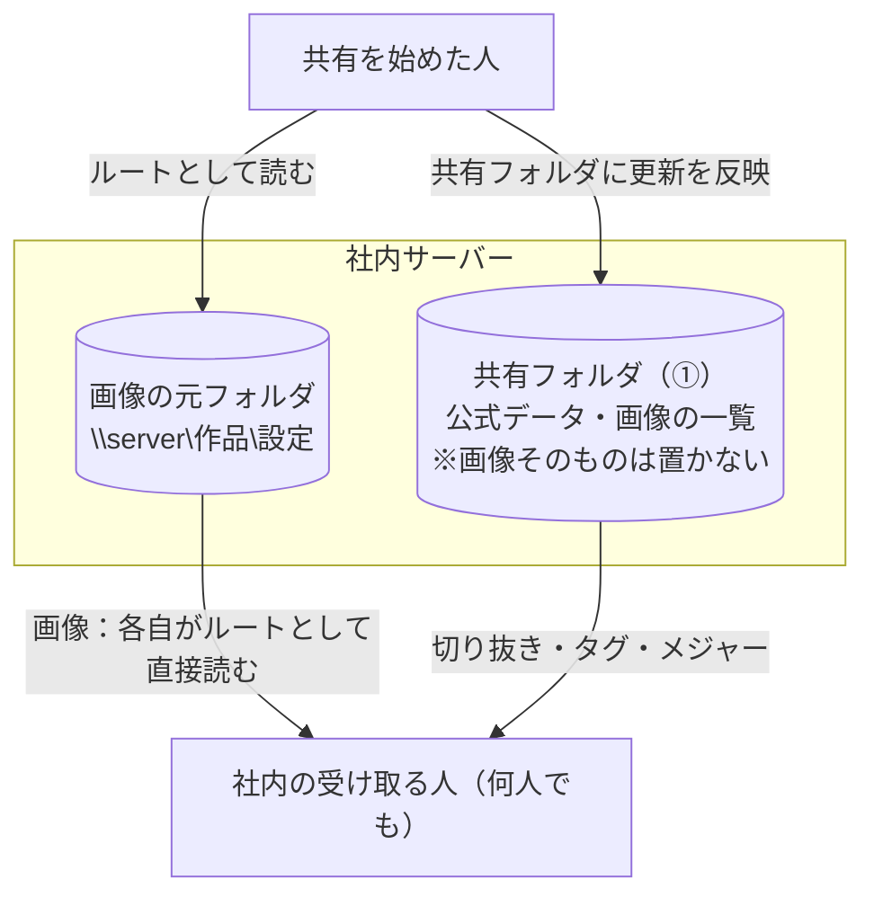

### 2.1 始める（配る側）

1. 設定 → **「ルート」** タブで、サーバー上の画像フォルダ（例 `\\server\作品\設定`）を **「ルートを追加」** で登録し、スキャンを待ちます。共有を始めるプロジェクトで登録したルートは **公式ルート** になります。
2. 切り抜き・タグ・メジャーを整えます。
3. 「プロジェクト」タブの **「共有用に設定…」** を押します。**「配布元」**（表示ラベル。スタジオ名など）が空か、プロジェクト名が「既定プロジェクト」のままなら、先に入れるよう求められます（受け取った人の一覧に出る名前です）。
4. サーバー上の **画像とは別の空フォルダ** を選びます。種類は **「社内（社内サーバー・画像は運ばない）」** です。置き場から自動で推した方が先頭に出ます（`\\サーバー\…` やネットワークドライブなら社内）。違っていれば選び直せます。

> 共有フォルダに、ルートの中やルートを含む親フォルダは選べません（片付けで元画像に触れないための守り）。

### 2.2 受け取る（受け取る人）

1. **「共有プロジェクトを読み込み…」** → サーバー上の共有フォルダを選びます。
2. 受け取り範囲（使うフォルダ）を選びます。①では「索引に入れるフォルダ」になります。あとから **「受け取り範囲を変更…」** で変えられます。
3. 新しい受け取りプロジェクトが作られます。ルートは **手がかりの場所**（`\\server\…` の形のパス）で自動につながり、数枚の画像で「同じ画像か」を確かめます。

### 2.3 ふだんの流れ

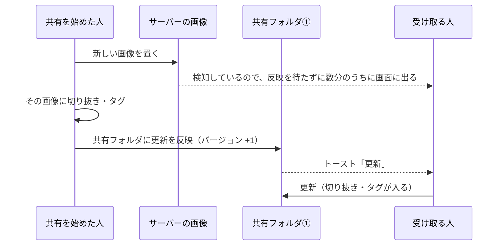

- **画像を置く・差し替える** と、反映を待たずに **数分のうちに** 全員の画面に出ます（各自がサーバーを直接読んでいるため）。サーバーのある PC ではすぐに、別の PC では検知の知らせが届かず数分かかることがあります。すぐ見たいときは、設定 → ルート の **「再スキャン」**。
- サーバーの画像の **名前を変えた・別のフォルダへ動かした** ときは、**各自の RefPicker が自分の読み込みで** 同じ画像としてつなぎ直します（受け取っただけの人も含む・付けたタグや切り抜きもそのまま）。サーバーで起きたことなので、**反映は要らず、誰の公開分にもなりません。**
- サーバーから画像が消えたときは、全員の画面で「見つかりません」になります。戻せば元どおりです。本当に要らなければ、共有元か共同編集者が設定 → ルート の **「見つからない画像のデータを削除…」** をすると、全員の手元から消えます。
- **切り抜き・タグ・メジャー** は「共有フォルダに更新を反映」で届きます。

### 2.4 サーバーに届かないとき（リンク切れ → 再リンク）

ドライブ文字の違いや VPN の切断などで手がかりの場所に届かないと、そのルートは **「リンク切れ」** になります。
設定 → **「ルート」** の **「再リンク…」** で、この PC から見える同じフォルダを選んでください（同じ画像か確かめてからつなぎます）。受け取った公式ルートでも、届かないときだけ「再リンク…」が出ます（削除はできません）。

---

## 3. ② 外部の共有先（画像も入れる）

社外の人に Google ドライブなどのクラウド同期フォルダで渡すパターンです。**画像は共有フォルダへ複製** されるので、受け取る人はサーバーに届かなくても使えます。

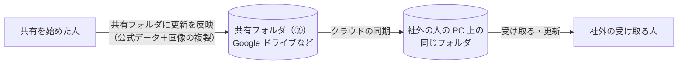

### 3.1 始める（配る側）

1. 公式ルートを登録し、切り抜き・タグ・メジャーを整えます。
2. [Google ドライブ for desktop](https://www.google.com/drive/download/) などで、**同期される空フォルダ** を用意します（例 `G:\マイ ドライブ\作品_第1話`）。
3. **「共有用に設定…」** → そのフォルダを選びます。種類は **「外部（Google ドライブなど・画像も入れる）」** です（手元のディスクやクラウド同期フォルダなら外部が先頭に出ます）。
4. そのフォルダを相手と共有します（Google ドライブの共有機能で）。

### 3.2 受け取る（社外の受け取る人）

1. Google ドライブの共有フォルダを **ドライブに追加** し、同期が終わるのを待ちます（エクスプローラーで `manifest.json` が見えればよい）。
2. **「共有プロジェクトを読み込み…」** → **自分の PC 上の** そのフォルダ（`G:\…` などのパス。ブラウザの URL ではない）を選びます。
   パスの文字列は配る側と違って構いません。
3. 受け取り範囲を選び、**「作成して取り込む」** を押します。②では「複製するフォルダ」になり、選ばなかったフォルダの画像は手元にコピーされません。全部受け取るなら **「すべて選択」**。

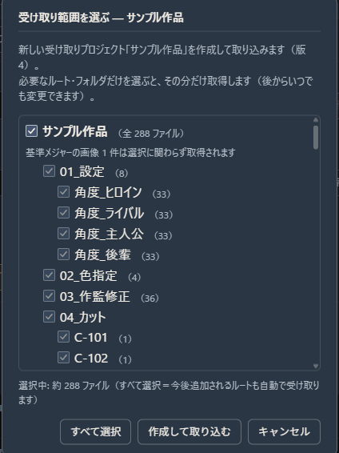

<sub>取り込む前に、どのフォルダを受け取るかを選べます。範囲はあとから「受け取り範囲を変更…」で選び直せます。</sub>

### 3.3 ふだんの流れ

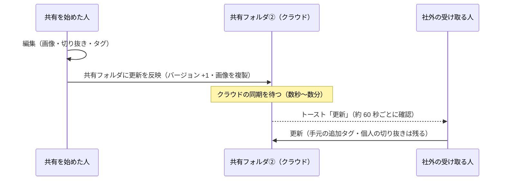

- **共同編集中** は、サーバーの画像の名前の変更・上書き・消えたことを、サーバーが見える PC の RefPicker が **自動で** 共有先の「画像の一覧」に書きます（誰の名前も付きません・反映は要りません）。共有先の複製は、名前の変更なら共有先の中で名前が変わるだけで容量は増えません。上書きなら差し替わり、消えた画像は複製を残したまま「見つからない」の印が付きます。
- 社外の受け取る人には「共有の更新があります（画像の変化）」と出て、「更新」で手元に入ります。上書きされた画像に自分の切り抜きがあると「画像の更新を検知しました。更新された画像にあなたの切り抜きがあり、ずれている可能性があります」と出ます。消えた画像は手元でも「見つかりません」になり、共有元か共同編集者が「見つからない画像のデータを削除…」をしたときに手元から消えます。

### 3.4 Google ドライブで気をつけること

- **同期の遅れ**: `manifest.json` や画像が届くまで数秒〜数分かかります。
- **片方の PC にだけファイルが無い**: Google ドライブの同期状態のアイコンを確かめます。共有フォルダが受け取る人のアカウントで **ドライブに追加** されているか、オフライン・容量不足でないかも見てください。
- **ストリーミング** の設定では、ファイルが手元に無いことがあります。共有フォルダは「オフラインで使用可能」にしておくと確実です。
- OneDrive・Dropbox も手順は同じです。

---

## 4. ①と②を同時に持つ（社内と社外の両方に配る）

1つのプロジェクトは **共有先をいくつでも** 持てます。**「共有フォルダに更新を反映」を1回押すと、すべての共有先に同じバージョンが書かれます。**
社内と社外でバージョンがずれることはありません。

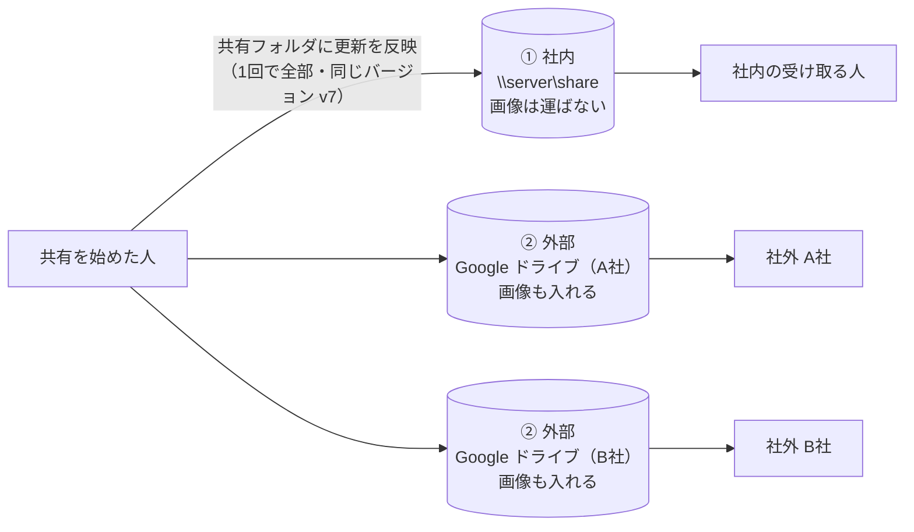

### 4.1 共有先を追加する

共有中のプロジェクトで、「共有」の欄の **「共有先を追加…」** → フォルダを選び、種類（社内／外部）を確かめます。
足したその場で、今のバージョンがその共有先へ書かれます。

### 4.2 共有先ごとの見え方

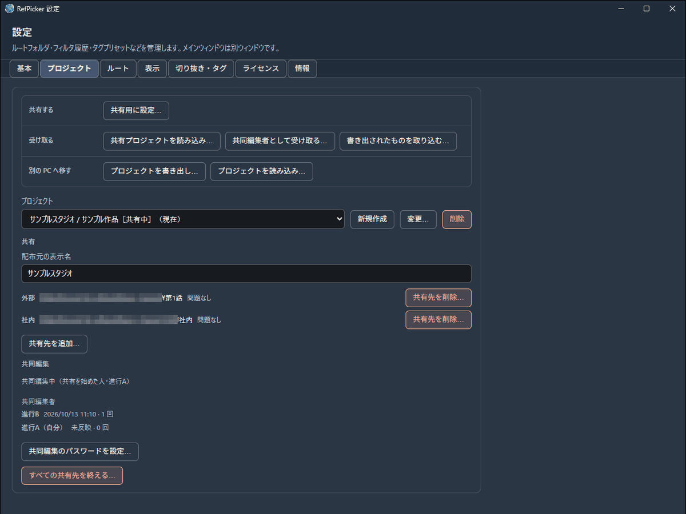

<sub>共有先は1行ずつ並びます。「共有先を追加…」で足し、行ごとに「共有先を削除…」でやめられます。</sub>

- 「共有」の欄に共有先が1行ずつ並び、種類・場所・状態（見つからないときは **「見つかりません」**）が出ます。
- 受け取る人は、どれか1つの共有先から受け取ります（社内の人は①、社外の人は②）。何を使うかは各自の **受け取り範囲** で選びます。
  配る側で「この相手にはこれだけ」と絞ることはしません。相手ごとに中身を変えたいときは ③（§6）を使います。

---

## 5. 共同編集（社内の何人かで公式を作る）

公式データを何人かで手分けして作るパターンです。各自が自分の PC で編集し、
自分の変更を「**公開分**」として共有フォルダに置き、互いの公開分を取り込み合います。

- 共同編集者は **社内の人だけ**（すべての共有先に届く人）。**全員にスタジオ用ライセンスが要ります。** 社外の人は②で受け取るだけです。
- 全員対等です。「配る役」はいません（誰が抜けても続けられます）。

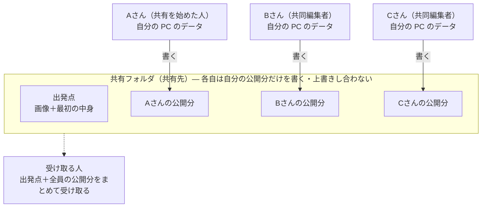

各自は **自分の公開分だけ** を書き、ほかの人の公開分は「更新」で取り込みます（Aさんは Bさん・Cさんの分を、Bさんは Aさん・Cさんの分を…）。

### 5.1 始める

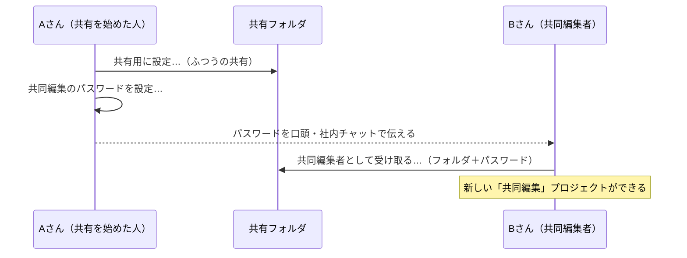

1. **Aさん**: ふつうに **「共有用に設定…」** で共有を始め、「共有」の欄の **「共同編集のパスワードを設定…」** でパスワードを決めます（スタジオが決める合言葉）。
2. Aさんは、共同編集者にパスワードを伝えます。
3. **Bさん**: **「共同編集者として受け取る…」** → 共有フォルダとパスワードを入れます。**「編集者名」**（一覧に出る名前・必須）も決めます。違うパスワードは、入れた直後に断られて入れ直せます。
   いつも **新しいプロジェクト** として受け取ります（手元の既存プロジェクトを途中で共同編集に切り替える操作はありません）。

> 共有先が複数ある共有では、Bさんの PC で見つからない共有先があると **「場所を選ぶ…」** で指定を求められます。

### 5.2 ふだんの流れ

1. 各自が自分の PC で編集します（タグ・切り抜き・メジャー・画像タグ・ルートの追加・プロジェクトの設定）。
2. 終わったら **「公開分を共有フォルダに反映」**（Aさんの画面では **「共有フォルダに更新を反映」**）。**すべての共有先** に自分の公開分が書かれます。
3. 他の人には「共有の更新があります（共同編集者の公開分：〈名前〉）」のトーストが出て、「**更新**」で取り込みます。受け取る人にも同じように届きます。反映した人の画面には「公開分を反映しました（N 件）」と出て、未公開の変更の数が 0 に戻ります（Aさんも同じ。共同編集中は出発点の「未公開の変更」の一覧は出ません）。

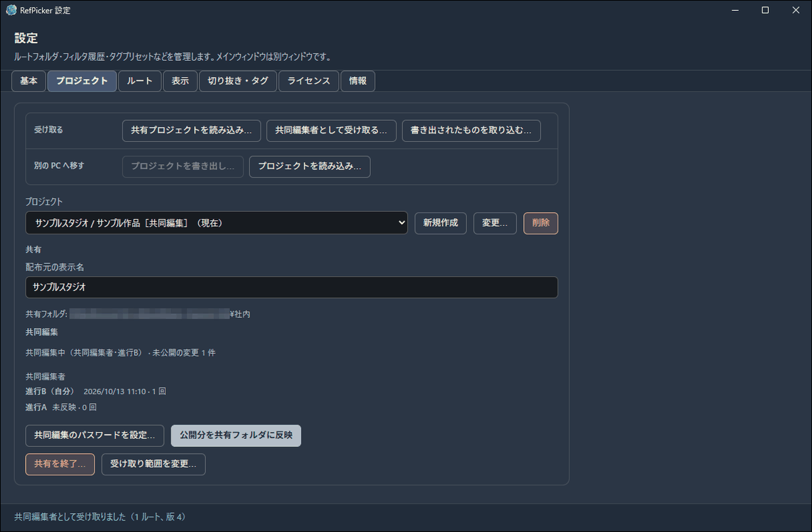

<sub>共同編集者の一覧には、編集者名と最後に反映した日時が出ます。</sub>

「共有」の欄には **共同編集者の一覧**（編集者名・最後に反映した日時）が出ます。抜けた人の公開分も残ります。

### 5.3 2人が同じものをいじったとき

変更には時刻が付いていて、**後から変えた方が勝ちます。** 誰がどの順で取り込んでも、全員が同じ結果になります。

| 対象 | 決まり |
|---|---|
| 自由タグ・画像タグ | **足し合わせ**。Aさんが「走り」、Bさんが「横」を足せば両方残る。同じタグの付ける／外すが重なったら後の操作が勝つ |
| 分類タグ（ショットサイズなど1軸1値のもの） | **（切り抜き, 軸）ごとに後勝ち**。1つの軸に値が2つ並ぶことはない |
| 切り抜きの形・メジャー・割り当て・プロジェクトの設定 | **項目ごとに後勝ち** |
| 消す と 変える | **消す方が勝つ**。消された切り抜きに付けたタグも消え、件数で知らせる |
| メジャーの親子が輪になる付け替え | 当てずに捨て、件数で知らせる |

後勝ちなので、負けた側の変更は黙って上書きされます。**範囲を分けて手分けする**（Aさんは第1話、Bさんは第2話など）と、ほとんど起きません。

### 5.4 共同編集者がルートを足したとき

ルートは共同編集者の誰でも足せます。足した人が反映すると、他の全員に自動でつながります。

ルートの **削除** も、共同編集者の誰でもできます（始めた人と同じ）。削除して反映すると、全員の登録からそのルートが外れます（サーバー上の画像は消えません。② 外部で受け取った人の手元の複製は消えます）。足し直すと別のルートとして扱われます。古いバージョンの RefPicker を使っている人には、削除を含む公開分を取り込むときに「RefPicker を新しい版に更新してください」と出ます。

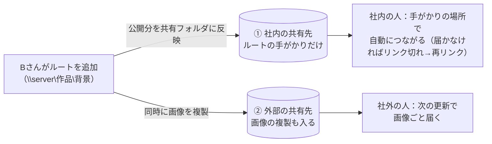

②（外部）の共有先への画像の複製は、**サーバーが見える PC の RefPicker が自動で** 行います（画像の一覧と一緒に・誰の公開分でもない）。社内の人は①で参照するので複製されません。

---

## 6. ③ 選んで書き出す・重ねて取り込む（USB・メールで手渡し）

相手ごとに渡すものを変えたいときのパターンです。共有先としては覚えず、その場で ZIP を1つ作ります（画像も入れる）。

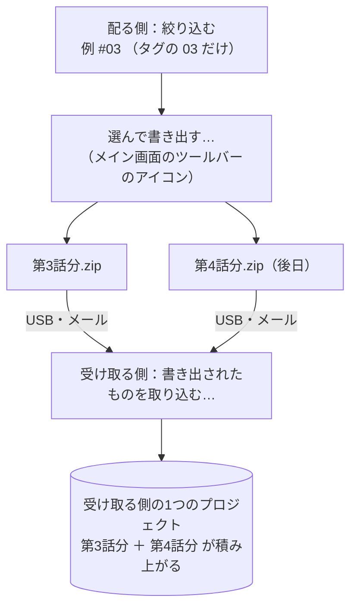

### 6.1 書き出す（配る側・スタジオ用）

1. メイン画面で、渡したい画像を絞り込みます（またはファイル表示で選びます）。
   **`#03` のように `#` を付けた語句はタグにだけ一致し**、パスには一致しません。話数タグで的確に選べます（`-#03` で「03 のタグが無いもの」）。
2. メイン画面の上のツールバーの **「選んで書き出す…」** を押します。文字の無いアイコンだけのボタンで、マウスを載せると名前が出ます。
   選択まわりのボタン（ピン・削除）のすぐ右、印刷用に書き出すボタン（プリンターの絵）のすぐ左にあります。

   　← この絵のボタン

   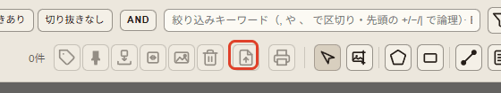

   選択があれば選択した画像、無ければ絞り込みの結果が対象です。件数を確かめて保存先を選びます。
   受け取ったプロジェクトを開いているときと、一覧が0件のときは押せません。
3. その画像と、その上の切り抜き・タグ・画像タグ・メジャー（割り当てと親）だけが ZIP に入ります。

### 6.2 取り込む（受け取る側）

1. 設定「プロジェクト」タブの **「書き出されたものを取り込む…」** → ZIP を選びます。
2. 配り元のプロジェクトで照合し、**初めてなら新しい受け取りプロジェクトを作り、2回目からはそこへ重ねます。**

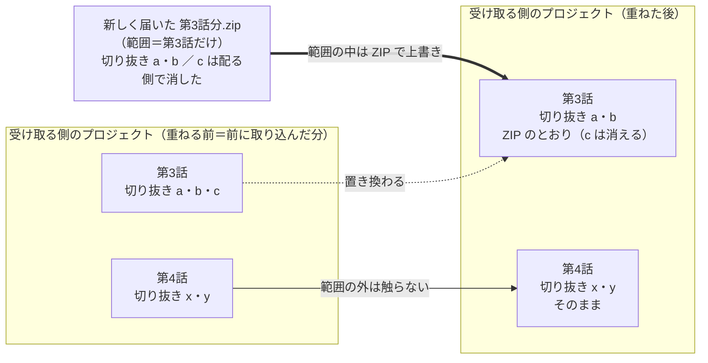

- **書き出された範囲の中は上書き、範囲の外には触りません。** 受け取る側で足した追加タグ・個人の切り抜きは残ります。
- 長いシリーズで要らなくなった話数などは、設定 → プロジェクト の **「受け取り範囲を変更…」** でフォルダ単位で手元から外せます（手元にある物から選ぶ・外すだけ）。外した物も、それを含む ZIP をもう一度取り込めば戻ります。
- 共有フォルダから受け取って更新を検知しているプロジェクトには重ねません（次の更新で上書きされてしまうため）。その場合は新しいプロジェクトができます。

---

## 7. 共有の終わらせ方

### 7.1 共有先を1つ削除する／共有を終了する

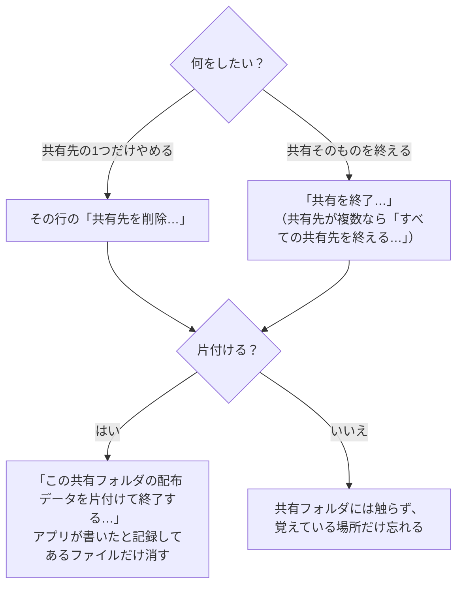

- 片付けで消すのは、**アプリが共有フォルダに書いたと記録してあるもの** だけです。共有フォルダに人が置いた別のファイルや、①で参照しているサーバーの元画像は消えません。
- 共同編集中なら「共同編集者 N 人の公開分も片付けます」と確認が出ます。
- **終わらせられるのは、共有を始めた人か共同編集者の誰か** です。始めた人が抜けても、残った共同編集者が片付けられます。

### 7.2 終わったあと

| 人 | どうなるか |
|---|---|
| 受け取る人 | **配られた画像の複製と公式のデータ（公式ルート・切り抜き・タグ・設定）が手元から消える**。個人ルートとその上の作業は残る。「共有元がこの共有を終了しました…片付けました」と知らせが出る |
| 共同編集者 | 受け取る人と同じく公式が手元から消え、共同編集も外れる（共同編集者は個人ルートを持たないので、ほぼ空になる。不要ならプロジェクトを削除） |
| 共有を始めた人 | 手元のプロジェクトは何も消えない。共同編集だけが外れ、ふつうのプロジェクトに戻る。「共有用に設定…」すれば新しい共有として共有し直せる（共同編集はパスワードを設定し直したときに始まる） |

- 「終わった」と判断するのは、共有フォルダに終わった印（`share-ended.json`）があるときと、同じ場所が別の共有に置き換わったときだけです。**共有フォルダが見つからない・読めないだけでは何も消えません**（§7.4）。
- ① 社内の共有先から受け取っていても、**サーバーの画像には触れません。** 消すのは受け取った人の PC のデータ置き場の中の物だけです。

### 7.3 中身を作り直したい・壊れたとき（共有し直す）

「リセット」の操作はありません。**「共有を終了…」（片付けて）→ 同じ場所で「共有用に設定…」** で作り直します。
受け取る側では前の共有が終わったと判断され、公式が手元から消えます（§7.2）。**新しい共有はもう一度受け取ってもらいます**（共同編集者はパスワードで加わり直す）。前の受け取りプロジェクトとは別のプロジェクトになります。
`manifest.json` が壊れて読めないときも、終了の片付けで（確認のうえ）管理ファイルを消してから共有し直せます。

### 7.4 共有フォルダが見つからないとき

覚えている共有フォルダに届かないと、プロジェクト切替などに **「見つかりません」** と出ます（配る側では「共有」の欄の共有先の行の状態にも出ます）。

- 移動・名前変更しただけなら、元の場所に戻すか、配る側が新しい場所で共有し直します。
- 受け取る側でもう使わないなら、**プロジェクトを削除** します（ただの受け取りに「共有を終了…」はありません）。

---

## 8. データルートは PC ごとに1つ

RefPicker のデータ（データベース・設定）の置き場＝**データルート** は、PC ごとに分けます。サーバー上に置いた同じデータルートを2台で開くことはできません。

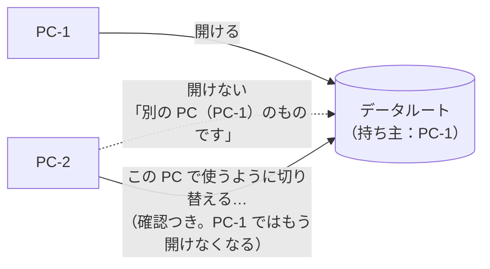

- PC の買い替えなど、正当に持ち主が替わるときだけ **「この PC で使うように切り替える…」** を使います（データのコピーや移動はしません）。
  別の場所にしたいときは **「別の保存先を選ぶ…」**。
- 複数の人で同じ公式データを使いたいときは、データルートを共有するのではなく、§2〜§5 の共有・共同編集を使ってください。
- ルートのスキャンは、RefPicker の共有フォルダ（`manifest.json` や `coedit/` があるもの）とデータルートを中まで飛ばします。
  同じサーバーに別作品の RefPicker のデータが置いてあっても、共有の操作をしない限り読み込まれません。

---

## 9. 試してみる（1台で）

共有フォルダの代わりに、手元の空フォルダで流れを確かめられます。

1. 空フォルダ `D:\RefPickerTest\第1話` を作ります（ルートの中やルートを含む親は選べません）。
2. 配る側のプロジェクトで公式ルートを登録 → **「共有用に設定…」** で上のフォルダを選びます（種類は外部）。
3. 別のプロジェクトに切り替え、**「共有プロジェクトを読み込み…」** で同じフォルダを選ぶと、受け取りプロジェクトができます。
4. 配る側に戻ってタグを変え → **「共有フォルダに更新を反映」**。
5. 受け取りプロジェクトでバッジ／トースト → **「更新」**。

同じ PC では検知まで最大約 60 秒です。すぐ試すときは、一度ほかのアプリに切り替えてメイン画面に戻るとトーストが出ます。
共同編集（パスワード・2人分の公開分）は、データルートを分けた2台で試してください（§8）。

---

## 10. うまくいかないとき

| 症状 | 確かめること |
|---|---|
| 更新バッジが付かない | そのプロジェクトはフォルダから受け取ったか（③の ZIP は検知しない）。受け取りプロジェクトの「共有フォルダ: …」に出る場所が、配る側の共有先と同じフォルダを指しているか。共有フォルダに `manifest.json` があり、バージョンが手元より新しいか。クラウドの同期が終わっているか |
| 更新を反映できない（配る側・共同編集者） | **「見つからない画像が…枚あります」** と出たら、見つからない画像があるあいだは反映が止まります。画像を元の場所に戻すか、設定 → ルート の **「見つからない画像のデータを削除…」** で消してから、もう一度反映します |
| 更新を適用できない（受け取る人） | 共有フォルダの中身が届ききっているか（クラウドの同期の途中でないか、`roots` 以下のファイルがそろっているか）。そろっていなければ、配る側に反映し直してもらいます。手元の共有フォルダの中身だけを手で差し替えていないか |
| **「…の購読先 (…) が一致しません」**／**「発行元プロジェクトには取り込めません」** | 別のプロジェクトの共有フォルダを、別の共有を受け取っているプロジェクトへ当てようとしていないか。受け取りプロジェクトは共有ごとに分かれます（初回は自動で新しく作られます）。自分が共有を始めたプロジェクトには取り込めません（共有元のデータが上書きされることはありません） |
| **「共有元がこの共有を終了しました」** と出る | 共有元が共有を終えました。配られた画像の複製と公式のデータは、受け取った人と共同編集者の手元から消えています。自分で追加した個人ルートの分は残ります（§7.2）。不要ならプロジェクトを削除してください。同じ場所で共有し直されたら、もう一度 **「共有プロジェクトを読み込み…」** で受け取ります（共同編集者は **「共同編集者として受け取る…」**） |
| **「共有元が共有を終了した可能性があります」** と出る | 共有フォルダに配布データも終了の印も見つからないとき（共有フォルダごと消された場合など）に出ます。共有元に確かめてください |
| **「このフォルダの共有は共有元が終了しています」** と出る | 終わった共有のフォルダを読み込もうとしています。この共有フォルダからは受け取れません |
| 別のプロジェクトを更新しても、今の一覧は変わりません | プロジェクト切替のメニューの「更新」で、開いていないプロジェクトを更新したときは、いま開いているプロジェクトは切り替わらず、一覧も変わりません。そのプロジェクトのバッジが消えれば取り込み済みです |
| トーストを「後で」にしたあと、また出したい | 「後で」はその起動中は出ません。RefPicker を起動し直すと、まだ取り込んでいない更新があればもう一度出ます。設定「プロジェクト」タブの **「更新（新版を取り込む）」** からも取り込めます |
| ①で画像が出ない | 設定 → ルートが **「リンク切れ」** なら「再リンク…」。この PC からサーバーが見えるか |
| ②で片方の PC にだけファイルが無い | §3.4 |
| **「共有フォルダが見つかりません」** | §7.4 |
| 共有フォルダに選べない | ルートの中、またはルートを含む親を選んでいないか |
| 「このデータルートは別の PC のものです」 | §8。データルートを2台で共有していないか |
| 共同編集者として受け取れない | スタジオ用ライセンスか。パスワードが合っているか。配る側がパスワードを設定済みか |
| 自分の変更が他の人に届かない | 「公開分を共有フォルダに反映」を押したか。同じものを後から別の人が変えていないか（§5.3） |
| ③の取り込みが重ならず新しいプロジェクトになった | 同じ共有をフォルダから受け取って更新を検知しているプロジェクトには重ねません（§6.2） |

---

## 11. 早見表

| 操作 | 場所 |
|---|---|
| 共有用に設定… ／ 共有プロジェクトを読み込み… ／ 書き出されたものを取り込む… ／ 共同編集者として受け取る… | 設定 → プロジェクト（上の「共有する」「受け取る」の段） |
| 共有先を追加… ／ 共有先を削除… ／ 共有を終了… ／ 共同編集のパスワードを設定… ／ 共同編集者の一覧 | 設定 → プロジェクト →「共有」の欄 |
| 共有フォルダに更新を反映 ／ 公開分を共有フォルダに反映 ／ 更新（新版を取り込む） | 設定 → プロジェクト |
| 受け取り範囲を変更… | 設定 → プロジェクト（受け取りプロジェクト） |
| 公式ルートの登録（ルートを追加） ／ 再リンク… | 設定 → ルート |
| 選んで書き出す… | メイン画面のツールバーのアイコンだけのボタン（マウスを載せると名前が出ます・§6.1） |
| 更新のトースト（更新・後で） | メイン画面の上 |
| プロジェクト切替・更新バッジ | メイン画面の左上 |

> **共有と移行は別物です。** プロジェクトを丸ごと別の PC へ持っていって続きを編集するときは、設定「プロジェクト」タブの「別の PC へ移す」の段の **「プロジェクトを書き出し…」**／**「プロジェクトを読み込み…」**（移行）を使います。
> [ユーザーガイド §7 プロジェクトの移行](USER_GUIDE.md#7-プロジェクトの移行) を見てください。

---

## 12. 関連

- [README.md](README.md) — RefPicker の概要・ダウンロード・ライセンス
- [QUICKSTART.md](QUICKSTART.md) — 起動から最初の絞り込みまで
- [USER_GUIDE.md](USER_GUIDE.md) — 画面全体・フィルタ・切り抜き
- [SUPPORT.md](SUPPORT.md) — 問い合わせ・よくある質問
- [CHANGELOG.md](CHANGELOG.md) — バージョンごとの変更
