# RefPicker ユーザーガイド

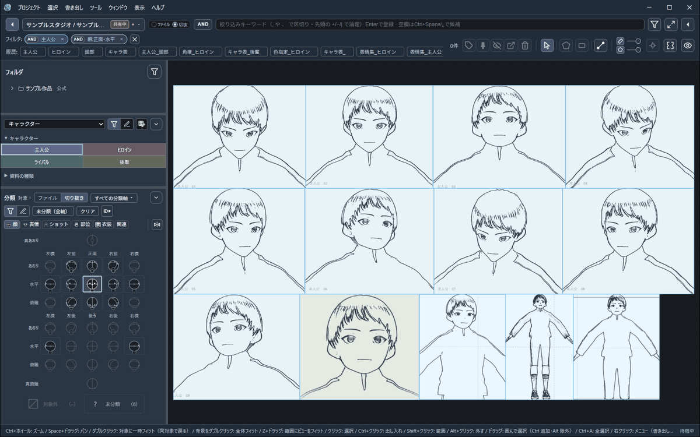

<b>同一キャラの必要な範囲の近いアングルが絞り込まれて並んだ状態</b>

> 画像はすべて、デモ用に生成した**架空の設定資料**で撮影しています。

RefPicker は、資料のフォルダにある画像・動画・3D のファイルを、絞り込んで一覧に並べます。扱えるファイルは [対象範囲](#対象範囲) にあります。

## 目次

- [対象範囲](#対象範囲)
- [用語](#用語)
- [1. はじめに](#1-はじめに)
  - [1.1 設定でルートフォルダを登録する](#11-設定でルートフォルダを登録する)
  - [1.2 フィルタ語を Enter で登録して絞り込む](#12-フィルタ語を-enter-で登録して絞り込む)
  - [1.3 チームで資料を共有するなら](#13-チームで資料を共有するなら)
  - [1.4 ルートの一部のフォルダを外す（ルートから外すフォルダ）](#14-ルートの一部のフォルダを外すルートから外すフォルダ)
  - [1.5 読み込みに時間がかかるとき（中断して続きから）](#15-読み込みに時間がかかるとき中断して続きから)
- [2. メイン画面と設定](#2-メイン画面と設定)
  - [2.1 メイン画面（`main`）](#21-メイン画面main)
  - [2.2 設定ウィンドウ（`settings`）](#22-設定ウィンドウsettings)
  - [2.3 ライセンス認証](#23-ライセンス認証)
- [3. 一覧・フィルタ・履歴](#3-一覧フィルタ履歴)
  - [3.1 表示単位（`ファイル` / `切抜`）](#31-表示単位ファイル--切抜)
  - [3.2 フィルタのマッチ対象と語の組み合わせ](#32-フィルタのマッチ対象と語の組み合わせ)
  - [3.3 フィルタ履歴](#33-フィルタ履歴)
  - [3.4 一覧のページング](#34-一覧のページング)
  - [3.5 フィルタボード（よく使う条件を置いておけるテーブル）](#35-フィルタボードよく使う条件を置いておけるテーブル)
  - [3.6 1件に寄って見る（一時フィット）](#36-1件に寄って見る一時フィット)
  - [3.7 一覧を画面いっぱいに広げる（中央ペインの最大化・全画面表示）](#37-一覧を画面いっぱいに広げる中央ペインの最大化全画面表示)
  - [3.8 動画ファイルを並べて見る](#38-動画ファイルを並べて見る)
  - [3.9 3D を並べて見る](#39-3d-を並べて見る)
- [4. 切り抜き](#4-切り抜き)
  - [4.1 ツールの基本](#41-ツールの基本)
  - [4.2 切り抜きタグ](#42-切り抜きタグ)
  - [4.3 自動切り抜き](#43-自動切り抜き)
  - [4.4 ピンに集めて並べる（ピン表示）](#44-ピンに集めて並べるピン表示)
  - [4.5 ファイルにタグを付ける（ファイルタグ）](#45-ファイルにタグを付けるファイルタグ)
  - [4.6 切り抜きを別の画像へ写す（コピー／貼り付け）](#46-切り抜きを別の画像へ写すコピー貼り付け)
  - [4.7 タブに出す分類軸を選ぶ（常に表示する分類軸）](#47-タブに出す分類軸を選ぶ常に表示する分類軸)
  - [4.8 分類軸を作る（プロジェクトのカスタム分類軸）](#48-分類軸を作るプロジェクトのカスタム分類軸)
  - [4.9 自由タグを整理する（タグの管理・自由タグのグループ）](#49-自由タグを整理するタグの管理自由タグのグループ)
- [5. 書き出し（クリップボード/フォルダ/ドラッグ）](#5-書き出しクリップボードフォルダドラッグ)
  - [5.1 印刷用に書き出す](#51-印刷用に書き出す)
- [6. 一覧から外す（探索から除外・オミット）](#6-一覧から外す探索から除外オミット)
  - [6.1 探索から除外](#61-探索から除外)
  - [6.2 オミット](#62-オミット)
  - [6.3 オミットビュー](#63-オミットビュー)
- [7. プロジェクトの移行](#7-プロジェクトの移行)
- [8. メジャー・正規化 ＜資料を作る側＞](#8-メジャー正規化-資料を作る側)
  - [8.1 メジャーの割り当て（メジャーツール）](#81-メジャーの割り当てメジャーツール)
  - [8.2 切り抜きの正規化ウィンドウ](#82-切り抜きの正規化ウィンドウ)
  - [8.3 メジャー管理ウィンドウ](#83-メジャー管理ウィンドウ)
- [9. 対比表 ＜資料を作る側＞](#9-対比表-資料を作る側)
  - [9.1 作成（対比表エディタ）](#91-作成対比表エディタ)
  - [9.2 ピックアップ（フィルタ／ピン）](#92-ピックアップフィルタピン)
  - [9.3 並べ替えとエントリ編集](#93-並べ替えとエントリ編集)
  - [9.4 目盛り・ラベル・タイトル](#94-目盛りラベルタイトル)
  - [9.5 書き出し・配布](#95-書き出し配布)
  - [ここが押せない場合](#ここが押せない場合)
- [10. データの保存場所](#10-データの保存場所)
  - [10.1 RefPicker を消すとき（アンインストール）](#101-refpicker-を消すときアンインストール)
- [11. よくあるつまずき（トラブルシュート）](#11-よくあるつまずきトラブルシュート)
  - [一覧に何も出ない](#一覧に何も出ない)
  - [「切り抜きの新規作成」ができない](#切り抜きの新規作成ができない)
  - [クリップボードへコピーしたのに貼り付けできない](#クリップボードへコピーしたのに貼り付けできない)
  - [別のプロジェクトを更新しても、今の一覧は変わりません](#別のプロジェクトを更新しても今の一覧は変わりません)
  - [取り込みが「購読先 (…) が一致しません」で拒否される](#取り込みが購読先--が一致しませんで拒否される)
  - [更新バッジが付くが、更新できない](#更新バッジが付くが更新できない)
  - [公開・書き出しが「読み込みが終わっていない」で断られる](#公開書き出しが読み込みが終わっていないで断られる)
  - [PSD が取り込めない（合成画像が無い）](#psd-が取り込めない合成画像が無い)
  - [更新したのに動画・3D・PSD が一覧に出ない（再スキャン）](#更新したのに動画3dpsd-が一覧に出ない再スキャン)
  - [「新しいバージョンの RefPicker で作られています」と出て受け取れない](#新しいバージョンの-refpicker-で作られていますと出て受け取れない)

## 対象範囲

このドキュメントは全部を読む必要はありません。**立場によって読む範囲が違います。**

| 立場 | 読むところ |
|---|---|
| **資料を見ながら描く**（原画・動画・作画監督） | **§1〜§7**（＋困ったら §11） |
| **資料を受け取る**（チームで配られている） | 上記 ＋ **§1.3** ＋ [共有ガイド](SYNC_GUIDE.md) |
| **資料を配る・共有の設定をする**（制作進行など） | **§1〜§7** ＋ [共有ガイド](SYNC_GUIDE.md) |
| **資料を作って配る**（設定制作・キャラデザ・総作監） | 上記すべて ＋ **§8・§9** |

**§7 の後に区切りがあります。**そこから先（メジャー・対比表）は**資料を作る側**の作業なので、
受け取って使うだけなら飛ばして構いません。

- 探しているものが見つからないときは [11. よくあるつまずき](#11-よくあるつまずきトラブルシュート) へ。

**扱えるファイル:**

| 種類 | 拡張子 | 一覧での見え方 |
|---|---|---|
| 画像 | jpg・jpeg・png・gif・webp・bmp・tif・tiff・tga・psd・psb・CLIP STUDIO（.clip） | PSD・PSB は合成画像を、.clip はファイルの中のプレビューを並べます |
| 動画ファイル | mp4・m4v・mov・avi・mkv・webm・wmv | サムネイルと長さが並びます。一覧の中で再生できます（[3.8](#38-動画ファイルを並べて見る)） |
| 3D | glb・gltf | アプリが描いたサムネイルが並びます。一覧の中で回して見られます（[3.9](#39-3d-を並べて見る)） |
| 3D | fbx・obj・stl・ply・3mf・dae・blend・ma・mb・max・c4d・3ds・vrm | Windows が作るサムネイルか、名前のカードが並びます |

切り抜きを作れるのは画像だけです。

## 用語

対象OS: Windows。

- **ルート**: 索引対象として登録した資料のフォルダ（配下のフォルダを再帰的に探索）
- **ルートから外すフォルダ**: ルートの中で、ファイルを探さないサブフォルダ（[1.4](#14-ルートの一部のフォルダを外すルートから外すフォルダ)）
- **読み込み途中のルート**: 読み込みを中断して、まだ最後まで読み終えていないルート。次に開いたとき続きから読みます（[1.5](#15-読み込みに時間がかかるとき中断して続きから)）
- **ファイル**: 一覧に並ぶ1件。種類は画像・動画・3D の3つです
- **フィルタ語**: 上部の「絞り込みキーワード」に Enter で登録した語句（複数可）
- **切り抜き**: 画像上に作った多角形/矩形の領域
- **ピン**: 右サイドバーのピングループに集めておく切り抜きまたはファイル（ファイルのピンは**ファイルピン**）。ほしい組み合わせをキープして中央に並べられるほか（[4.4](#44-ピンに集めて並べるピン表示)）、切り抜きのピンは正規化・対比表の材料にもなります
- **ファイルタグ**: ファイルそのものに付けるタグ。画像なら、その上の切り抜きに引き継がれます（[4.5](#45-ファイルにタグを付けるファイルタグ)）
- **自由タグのグループ**: 自由タグを見出しごとにまとめて並べる棚。設定の「タグの管理」タブで作ります（[4.9](#49-自由タグを整理するタグの管理自由タグのグループ)）
- **共有先の種類**: 共有先を足すときに選ぶ渡し方。**データだけ共有**（ファイルは元の場所を各自が読む）と **ファイルも共有**（範囲のファイルを共有フォルダへ複製して渡す）の2つです。渡す範囲は **全ての範囲** か **フィルタで範囲を指定** から選びます（[1.3](#13-チームで資料を共有するなら)）
- **メジャー**: 「この絵のこの線を、比べるときの基準にする」という宣言。全身なら頭の先から足先まで、など
- **正規化**: メジャーを軸に、**別々の用紙・別々の縮尺で描かれた絵を同じ大きさへ揃える**こと
- **対比表**: 正規化した切り抜きを1枚に並べ、目盛りと名前を焼き込んだ配布用の PNG（「キャラ対比」の表）
- **配布元（表示ラベル）**: プロジェクトの表示用ラベル（例: スタジオ名）。プロジェクトの境界ではなく、見分けるためのラベルです。配る側の人を指す**共有元**とは別のものです
- **プロジェクト（案件）**: 索引と共有設定の単位。複数を並行して持てます

## 1. はじめに

### 1.1 設定でルートフォルダを登録する

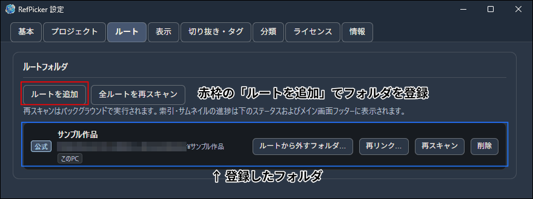

指定したフォルダ自体は<b>移動もコピーもしません</b>。索引用のデータベースとサムネイルだけが作られます。

1. メイン画面右上の **「設定を開く」**（歯車）を押します。
2. 設定ウィンドウの「ルート」タブで **「ルートを追加」** を押し、資料のフォルダを選びます。
3. フォルダを選ぶと、その中のサブフォルダが一覧で出ます。ルートから外すフォルダがあればチェックを付け、**「追加」** を押します（チェックが無ければ全部読み込みます）。詳しくは [1.4](#14-ルートの一部のフォルダを外すルートから外すフォルダ)。
4. RefPicker がバックグラウンドで読み込みを始めます。進捗は設定ウィンドウ下部とメイン画面のステータスに出ます。読み終えると、件数と、段階ごとにかかった時間（数え上げ・照合・サムネイル・後始末）が1行で出ます。読み込みに時間がかかるときは [1.5](#15-読み込みに時間がかかるとき中断して続きから)。

「ルート」タブは2列です。左にルートの一覧、右に選んだルートの詳細が出ます。

- 左の一覧の点は、問題が無ければ緑、確かめることがあれば黄、フォルダやファイルが見つからなければ赤です
- 右には、フルパス・公式か個人か・置き場所の印と、**「ルートから外すフォルダ…」**・**「再スキャン」**・**「削除」** などのボタンが出ます

補足:

- ルートを削除しても **ルートフォルダのフォルダ/ファイルには影響はありません**（索引から外れるだけです）。
- 「全ルートを再スキャン」「再スキャン」は、索引/サムネの同期をやり直す操作です。RefPicker を新しいバージョンにしたあと、新しく扱えるようになった種類のファイルを一覧に入れるときにも使います（[11](#更新したのに動画3dpsd-が一覧に出ない再スキャン)）。

### 1.2 フィルタ語を Enter で登録して絞り込む

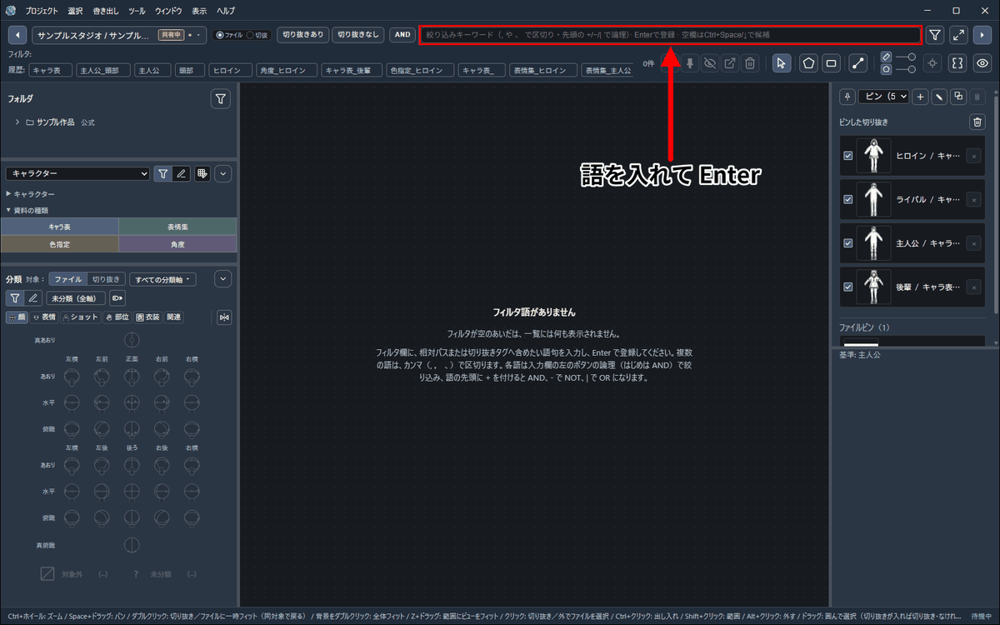

索引ができていても、<b>絞り込み用の文字列を入れるまで一覧は空</b>です。

メイン画面上部の入力欄（プレースホルダ: **「絞り込みキーワード（, や 、 で区切り・先頭の +/−/| で論理）· Enterで登録 · 空欄はCtrl+Space/↓で候補」**）に語句を入力し、**Enter** を押します。

- フィルタ語が **空の間は一覧は表示されません**
- 複数の語は **カンマ（`,` `，` `、`）** で区切ります。はじめは **すべての語に一致するもの（AND）** に絞り込みます（例: `主人公, ヒロイン` → 両方に一致するもの）。OR・NOT の使い方は [3.2](#32-フィルタのマッチ対象と語の組み合わせ) を参照してください。**スペースや中黒では区切られません。**
- 入力中の文字は **まだ条件に反映されていません**。Enter で登録したときに反映されます。
- 入力中の語に一致するタグが、件数付きで候補に出ます。空欄のときは `Ctrl+Space` か `↓` で、よく使うタグの一覧を開けます。

### 1.3 チームで資料を共有するなら

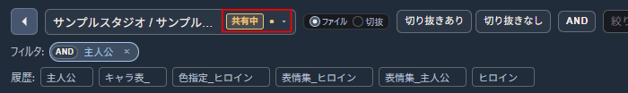

プロジェクトの切り替えは画面の左上だけで行います。開いていないプロジェクトに更新が来ると、<b> ● が付きます</b>。

RefPicker は **プロジェクト単位** で索引と同期を管理します。配る側が整備した公式の設定データを、受け取る人が自分の PC で使う——という流れを、専用のサーバーを用意せずに、いつもの共有フォルダを通して運用できます。配るのは制作進行・設定制作・作監・外部のスタジオなど、誰でも構いません。

プロジェクトには、共有の状態に応じて **「共有中」**（配っている）・**「受け取り」**（受け取った）・**「共同編集」**（共同編集者として加わった）の印が**自動的に付きます**。共有していないプロジェクトには印は付きません（[7](#7-プロジェクトの移行)）。

| | 配る側（共有元） | 受け取る人 |
|---|---|---|
| すること | ルートを登録して整備 → 設定の「プロジェクト」タブの **「共有を始める…」** → 以後は **「共有フォルダに更新を反映」** | **「共有プロジェクトを読み込み…」** → 更新が来たら **「更新」** で取り込む |
| ライセンス | **スタジオ用ライセンスが必要** | **ライセンス認証不要** |

配る先の場所（**共有先**）は、1つのプロジェクトに複数持てます。共有先を足すときに、渡し方を次の2つから選びます。

| 渡し方 | 中身 | 向いている相手 |
|---|---|---|
| **データだけ共有** | ファイルは複製しません。受け取る人が、元の場所（社内のサーバーなど）のファイルを各自で読みます | 元の場所に届く人（社内など） |
| **ファイルも共有** | 範囲のファイルを、共有フォルダへ複製して渡します | 元の場所に届かない人（社外など） |

渡す範囲は、共有先ごとに **全ての範囲** か **フィルタで範囲を指定**（絞り込みの条件で決める）から選びます。範囲はあとから切り替えられます。共有先には、相手を見分けるラベルを付けます。ラベルは受け取る人にも見えます。

社内の何人かで公式のデータを一緒に作るときは **共同編集** を使います（共同編集をする人は、**全員にスタジオ用ライセンスが必要**です）。共同編集は、データだけ共有で全ての範囲の共有先の上でだけ使えます。

受け取った資料（**公式**）の切り抜きの形状や、元から付いているタグは変更・削除できません。タグを足すことと、自分の切り抜きを作ることはできます。共有元から届いたファイルの上なら、**分類タグ**（[4.2](#42-切り抜きタグ)）もライセンスなしで付け外しできます。自分で追加したフォルダ（**個人ルート**）は自由に扱えます。

詳しくは [共有ガイド](SYNC_GUIDE.md) にあります。

- 渡し方と範囲の選び方: [0. どのパターンを読めばいいか](SYNC_GUIDE.md#0-どのパターンを読めばいいか)
- データだけ共有の手順: [2. データだけ共有](SYNC_GUIDE.md#2-データだけ共有ファイルは運ばない)
- ファイルも共有の手順: [3. ファイルも共有](SYNC_GUIDE.md#3-ファイルも共有範囲のファイルを共有フォルダへ複製)
- 相手ごとに共有先を分けるとき: [4. 共有先を複数持つ](SYNC_GUIDE.md#4-共有先を複数持つ)
- 何人かで一緒に作るとき: [5. 共同編集](SYNC_GUIDE.md#5-共同編集社内の何人かで公式を作る)
- 一回きりで手渡すとき: [6. 選んで書き出す](SYNC_GUIDE.md#6-選んで書き出す重ねて取り込むusbメールで手渡し)
- RefPicker を新しいバージョンにするとき: [共有ガイド 9](SYNC_GUIDE.md#9-refpicker-を新しいバージョンにするとき)

### 1.4 ルートの一部のフォルダを外す（ルートから外すフォルダ）

フォルダの形がそろっていないサーバーでは、ルートにしたいフォルダの中に、要らないサブフォルダが混ざっていることがあります。そのサブフォルダを **ルートから外す** と、中のファイルを探さず、サムネイルも作りません。

- **ルートを足すとき**：フォルダを選ぶと出るサブフォルダの一覧で、ルートから外すフォルダにチェックを付けます。サブフォルダは開いたときだけ読むので、遅いサーバーでも待たされません。
- **あとから変えるとき**：設定の「ルート」タブの左の一覧でルートを選び、右の **「ルートから外すフォルダ…」** を押します（設定済みなら「ルートから外すフォルダ（N件）」と出ます）。左のツリーでフォルダを右クリックし、**「このフォルダをルートから外す…」** を押しても付けられます。
- ルートから外したフォルダは、左のツリーに薄い文字の行で残ります。右クリックの **「このフォルダをルートに含める」** で戻せます。
- すでに読み込んであるフォルダをルートから外すと、そのファイルと、付いている切り抜き・ファイルタグ・オミットは消えます。消える件数を出して確かめてから消します。戻すとファイルは読み直しますが、切り抜きは戻りません。
- 共有すると、受け取る人の側でも同じフォルダがルートから外れます。受け取った資料（公式）のルートには付けられないので、受け取る人が一覧に出すフォルダを狭めたいときは受け取り範囲（全ての範囲の共有先から受け取ったとき）を使います（[共有ガイド 2.2](SYNC_GUIDE.md#22-受け取る受け取る人)）。
- 読み込んだまま一覧から一時的に隠したいだけなら、ルートから外すフォルダではなく **探索から除外**（[6.1](#61-探索から除外)）を使います。

### 1.5 読み込みに時間がかかるとき（中断して続きから）

ファイルの多いサーバーでは、ルートを足したときの読み込みに時間がかかります。途中でやめたいときは、アプリを閉じます。

- 読み込み中に閉じようとすると、確認が出ます。**「中断して閉じる」** を押すと、読み込みを中断して閉じます。読めた分のファイルはそのまま使えます。
- 次にアプリを開いたとき、またはそのプロジェクトを開いたときに、**続きから**読み込みます。
- 読み終えていないルートは、設定の「ルート」タブの左の一覧で点が黄色になり、右の詳細に印が出ます（読んでいる最中は「読み込み中」、途中でやめたものは「読み込み途中」）。
- 読み終えていないルートがあるあいだは、共有フォルダへの反映（公開）・プロジェクトの移行の書き出し・選んで書き出す、はできません。押すと「公開できません」「書き出せません」と知らせます。読み終えてから行ってください。

## 2. メイン画面と設定

### 2.1 メイン画面（`main`）

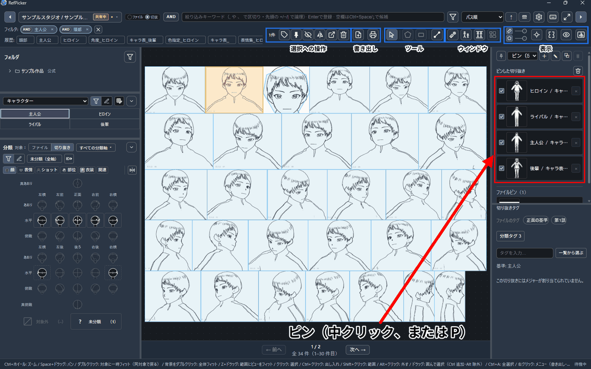

左が「どこにあるか」、中央が「何があるか」、右が「ピンしているもの」です。

- 上部:
  - **プロジェクト切替**（左上）: プロジェクトの切り替え、更新バッジ、開いていないプロジェクトの **「更新」**
  - **一覧の表示単位**: `ファイル` / `切抜`
  - **フィルタ入力欄**（Enter で登録）。左のボタンで、次に入れる語の論理（AND / OR / NOT）を選べます
  - **「フィルタ:」** の行（登録した語のチップ）。右端のボタン（**「絞り込みをすべて外す」**）で、チップをまとめて外せます。外す前の組み合わせはフィルタ履歴から戻せます
  - **履歴**（クリックで復元、×で削除）
  - ツールバー（2段目）。ボタンはアイコンだけです。マウスを載せると「名前（キー）」が出ます。画面共有で指すときのために、並びに次の名前を付けています（画面には出ません）。左から:
    - **選択への操作**: 選んだ切り抜きへの操作。件数・タグ（T キー）・ピン（P キー）・オミット（[6.2](#62-オミット)）・左右反転（H キー）・ドラッグで渡す・削除（Delete キー）。何も選んでいないと押せません。ファイルを選んでいるときは、選んだファイルへの操作に変わります（[4.5](#45-ファイルにタグを付けるファイルタグ)）
    - **書き出し**: **「選んで書き出す…」**（選んだファイルとその上のデータを ZIP に書き出して渡す。スタジオ用。[共有ガイド 6](SYNC_GUIDE.md#6-選んで書き出す重ねて取り込むusbメールで手渡し)）・**「印刷用に書き出し…」**（用紙に並べて PDF／PNG に書き出す。[5.1](#51-印刷用に書き出す)）
    - **ツール**: 選択ツール（切り抜きの上なら切り抜き、それ以外はファイルを選びます。[4.1](#41-ツールの基本)）｜多角形ツール・矩形ツール｜メジャー編集（[8.1](#81-メジャーの割り当てメジャーツール)）。押すとモードが切り替わります
    - **ウィンドウ**: メジャー管理・対比表・切り抜きの正規化・自動切り抜き。押すと別のウィンドウが開きます。メジャー編集・メジャー管理・対比表・切り抜きの正規化のボタンは、メジャーの機能を表示しているときだけ出ます（[8](#8-メジャー正規化-資料を作る側)）
    - **表示**: 描画の表示切替・選択にフィット・全体表示（フィット）・オミットビュー（[6.3](#63-オミットビュー)）・ビュー全体の左右反転
    - ズーム（スライダー、Ctrl+ホイール）
    - 右サイドバー切替
    - 中央ペインの最大化（`Tab`・[3.7](#37-一覧を画面いっぱいに広げる中央ペインの最大化全画面表示)）
    - （ページング有効かつ 2 ページ以上のとき）中央ペイン下部のページ送り（前へ / 次へ、PageUp / PageDown）
- 中央:
  - 一覧グリッド（ファイル単位または切り抜きBBox単位）
  - ズームでスクロール可能なとき、右下にミニマップ（レイアウト全体の縮図＋黄色枠で現在の表示範囲）。クリックまたはドラッグでその位置へパン
- 右:
  - メジャー・ピン関連のサイドバー（ツールバーから表示切替）

### 2.2 設定ウィンドウ（`settings`）

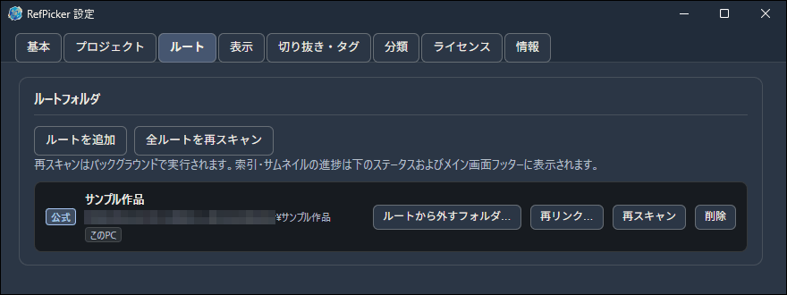

「ルート」タブでは、<b>左にルートの一覧、右に選んだルートの詳細</b>が並びます。

ウィンドウの上に **8 つのタブ** があります。初めて開いたときは「基本」タブが開きます。2 回目以降は前回開いていたタブが開きます。操作結果のメッセージはウィンドウ下部のステータス行に表示されます。

| タブ | 内容 |
|------|------|
| **基本** | **「データ保存先」**（ライブラリの置き場）と、**「メジャー（定規）の機能」** の **「表示する」**（[8](#8-メジャー正規化-資料を作る側)） |
| **プロジェクト** | 上から、プロジェクトの選択・新規作成・変更・削除／「共有」の枠（まだ共有していなければ **「共有を始める…」**。共有を始めると見出しが「共有中」になり、**「共有フォルダに更新を反映」**・**「共有を終了…」**・「配布元」の欄の **「配布元の表示名」**・「共有先」の欄（共有先の一覧と **「共有先を追加…」**）・「共同編集」の欄、未反映の変更の一覧。受け取ったプロジェクトでは、受け取り元と **「受け取り範囲を変更…」** など）／**「受け取る」** の段（**「共有プロジェクトを読み込み…」**・**「共同編集者として受け取る…」**・**「書き出されたものを取り込む…」**）／**「別の PC へ移す」** の段（**「プロジェクトを書き出し…」**・**「プロジェクトを読み込み…」**） |
| **ルート** | 左にルートの一覧（状態の点）と **「ルートを追加」**・**「全ルートを再スキャン」**。右に選んだルートの詳細（フルパス・公式／個人・置き場所の印 **「サーバー」**／**「このPC」**・🔒 共有元管理）と、**「ルートから外すフォルダ…」**・**「再スキャン」**・**「削除」** など（[1.1](#11-設定でルートフォルダを登録する)） |
| **表示** | 左に項目名、右に操作が並びます。**「見た目」**（**「テーマ」**：**「自動（OS に従う）」**／**「ライト」**／**「ダーク」**）・**「メイン画面の一覧」**（ウィンドウの大きさを変えたときのズーム・ページ分割など）・**「右サイドバー」**（ピンの大きさ）・**「切り抜きの正規化」**（キャンバス余白。メジャーの機能を表示しているときだけ） |
| **タグの管理** | 自由タグの名前の変更・まとめる・削除と、**自由タグのグループ**（[4.9](#49-自由タグを整理するタグの管理自由タグのグループ)） |
| **分類** | **「常に表示する分類軸」**（タブに出す分類軸のセット）と **「プロジェクトの分類軸」**（[4.7](#47-タブに出す分類軸を選ぶ常に表示する分類軸) / [4.8](#48-分類軸を作るプロジェクトのカスタム分類軸)） |
| **ライセンス** | 認証の状態と「ライセンス認証…」（[2.3](#23-ライセンス認証)） |
| **情報** | バージョン・「最新バージョン」（起動したときに確かめた、最新のバージョンか・新しいバージョンが出ているか）・ビルド時刻・著作権 |

> プロジェクトの共有の状態（**「共有中」**／**「受け取り」**／**「共同編集」**／印なし）は、**データから自動的に判定されます**（[1.3](#13-チームで資料を共有するなら) / [共有ガイド](SYNC_GUIDE.md)）。

### 2.3 ライセンス認証

ライセンスキーは設定ウィンドウから入れます。

1. 設定の **ライセンス** タブで **「ライセンス認証…」** を押します。
2. 開いた画面にキーを入れ、**「認証する」** を押します。
3. 認証できると **「認証に成功しました。」** と表示され、タブの「現在:」の行が **「個人ライセンス（認証済み）」** または **「スタジオ用ライセンス（認証済み）」** に変わります。

認証したあとは、同じ画面で次の操作ができます。

- **「別のキーに置き換える…」**: 別のキーに入れ替えます
- **「解除」**: この PC での認証を外します
- **「再検証」**: 認証の状態を確かめ直します（下の「使えなくなったとき」でも押せます）
- **「サブスク・請求の管理（カスタマーポータル）」**: 購読の管理ページを開きます

認証の状態はデータ保存先に含まれません。別の PC では、その PC で認証してください（[10](#10-データの保存場所)）。

#### 使えなくなったとき

認証したあとで使えなくなることがあります。ライセンス画面の一番上に、何が起きているかが出ます。

| 一番上に出る文 | 何が起きているか | 次の一手 |
|---|---|---|
| **「ライセンスの再確認が必要です」** | しばらくネットにつながらず、確かめ直せていません | インターネットにつないで **「再検証」** を押します |
| **「ライセンスの期限が切れています」** | キーに付いていた期限が過ぎました（下の「期限のあるキー」） | キーを受け取った窓口（販売元）に延長を頼み、延長されたら **「再検証」** を押します |
| **「ライセンスが有効ではありません」** | 解約・返金などで、キーが有効でなくなりました | 購入時のメールから、購入・購読の状態をご確認ください |

**「再検証」** は、この3つの状態でも押せます。延長・再契約・ネットへの再接続がアプリの外で済んだあと、**アプリを開き直さなくてもその場で戻ります**。

#### 期限のあるキー

期限付きのキーを受け取ったときは、ライセンス画面のキーの行に **「（○年○月○日まで）」** が出ます。期限の無いキーには何も出ません。

期限が過ぎると **「キーの期限（○月○日）が切れました。続けて使うには、配布元に延長を頼んでください。」** と出て、そのライセンスで開いていた機能は使えなくなります。この文の「配布元」は、キーを受け取った窓口のことです。延長してもらったら **「再検証」** を押すと戻ります。**キーを貼り直す必要はありません。**

## 3. 一覧・フィルタ・履歴

### 3.1 表示単位（`ファイル` / `切抜`）

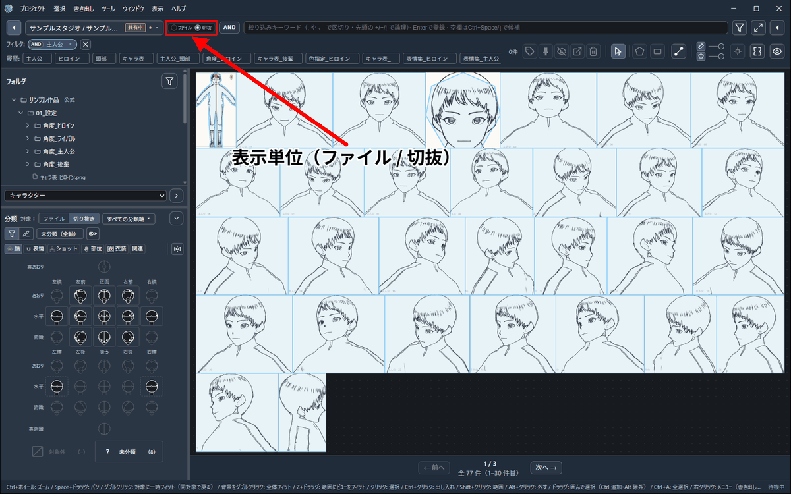

「切抜」にすると、<b>ファイルではなく切り抜きが1件</b>として並びます。1ページの件数は設定で変えられます。

- **ファイル**: ファイル単位（画像・動画・3D）で一覧します。ここで切り抜きを新規作成します。
- **切抜**: 切り抜きのバウンディングボックス（BBox）単位で一覧します。フィルタ語に一致する切り抜きだけを残す用途に向きます。

注意:

- 切り抜きの新規作成は `ファイル` 表示でのみ行えます（`切抜` 表示では作れません）。

### 3.2 フィルタのマッチ対象と語の組み合わせ

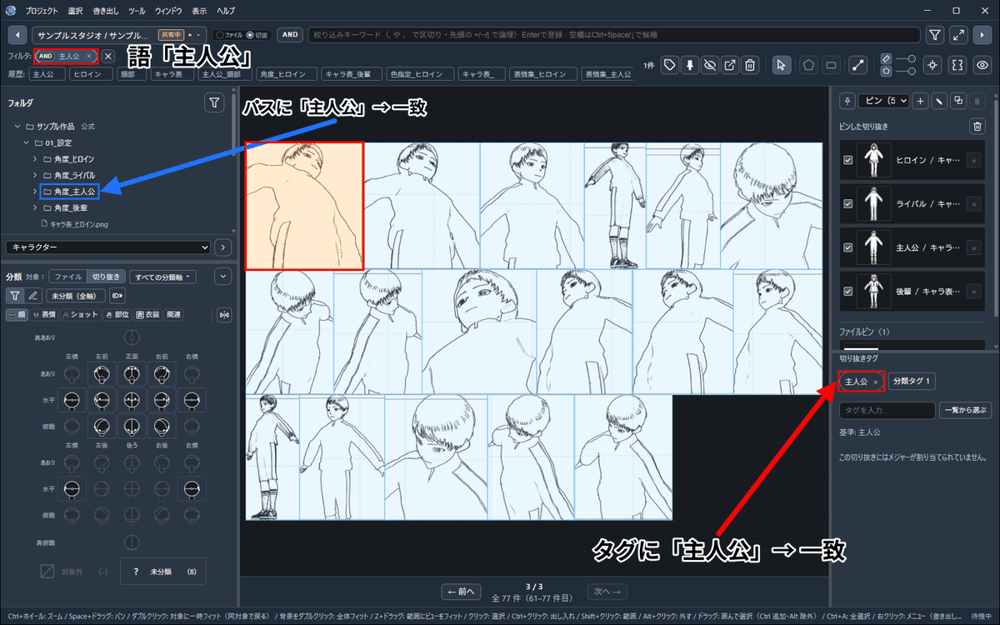

1つの語が、<b>パスとタグのどちらに一致しても</b>一覧に出ます。

フィルタ語は次に **部分一致**でマッチします。

- ファイルの **相対パス**
- 切り抜きに付けた **タグ**
- ファイルに付けた **ファイルタグ**（[4.5](#45-ファイルにタグを付けるファイルタグ)）。`切抜` 表示では、画像から切り抜きへ引き継いだ分も一致します

語の先頭に `#` を付けると、**タグにだけ**一致します。`#03` は、タグに「03」を含むものだけを出します。フォルダ名やファイル名に「03」があるだけのものは出ません。

**語の組み合わせ:**

- 複数の語は **カンマ（`,` `，` `、`）** で区切ります。語ごとに **AND**（すべての語に一致）／**OR**（どれかの語に一致）／**NOT**（除外）を持ちます。
- はじめは **AND** です。入力欄の左のボタンを押すと、次に入れる語の既定が AND → OR → NOT と切り替わります。
- 語の先頭に `+` を付けると AND、`-` で NOT、`|` で OR になります（その語だけ）
- 登録した語の論理は、チップ左端の印を押すと切り替わります
- `+` は語の区切りではありません。`主人公+頭部` は `主人公` と `+頭部` の 2 語です。

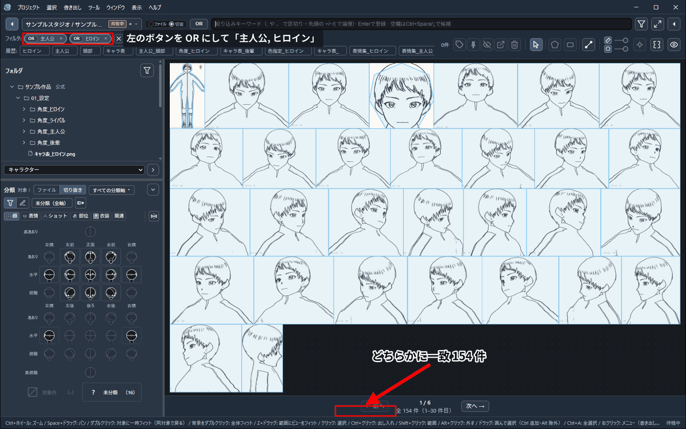

OR の語は、<b>どれかに一致する</b>ものが並びます。

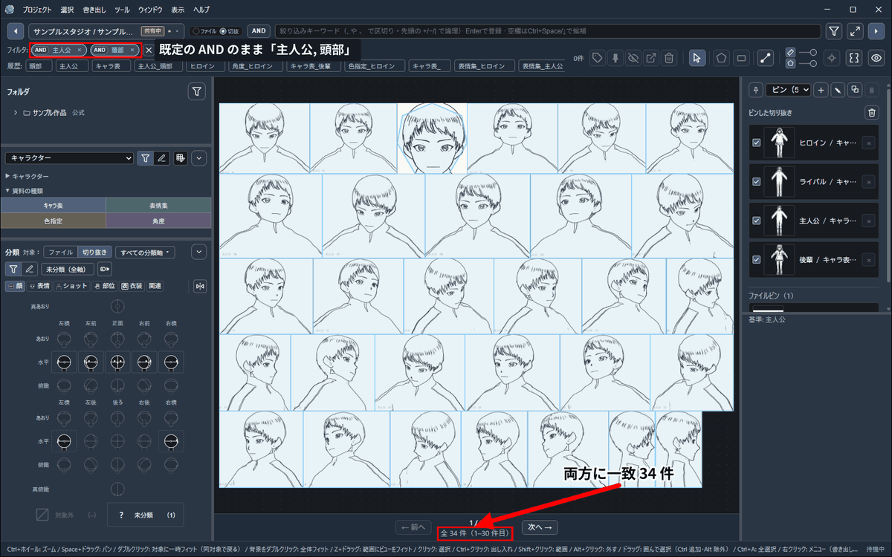

AND の語は、<b>すべてに一致する</b>ものだけに絞れます。

**種類・拡張子・日時で絞る:**

入力欄の横のボタン（**「種類・拡張子・日時で絞り込む」**）を押すと、パネルが開きます。行は上から **「種類」**・**「拡張子」**・**「追加日」**・**「更新日」** です。押したボタンは点灯します。押してもパネルは閉じません（外をクリックするか `Esc` で閉じます）。

- **種類**: 画像・動画・3D のうち、いまの結果にあるものが件数付きで並びます。複数選ぶと、どれかに一致するものが出ます
- **拡張子**: いまの結果にある拡張子が、件数の多い順に並びます（例「PNG 120」「PSD 30」）。種類を選んでいるときは、その種類の拡張子だけが並びます
- 種類と拡張子の両方を選ぶと、両方に一致するものだけが出ます
- **追加日**（このプロジェクトにファイルが入った日時）と **更新日**（ファイルの更新日時）は、今日・3日・7日・30日・日数を指定… から選びます。点灯しているボタンをもう一度押すと外れます
- 選んだ条件は **「フィルタ:」** の行にチップで並びます（例「種類 画像・3D」「拡張子 PNG・PSD」）。パネルの下の **「すべて外す」** で、パネルの条件だけをまとめて外せます
- どれもフィルタ語と AND で効き、履歴には残りません。`切抜` 表示では、一致したファイルの切り抜きが出ます

### 3.3 フィルタ履歴

- フィルタを適用すると履歴に保存されます。
- 履歴のボタンを押すと、その条件に戻せます。
- × で履歴から削除できます（保持件数は設定で変更）。

### 3.4 一覧のページング
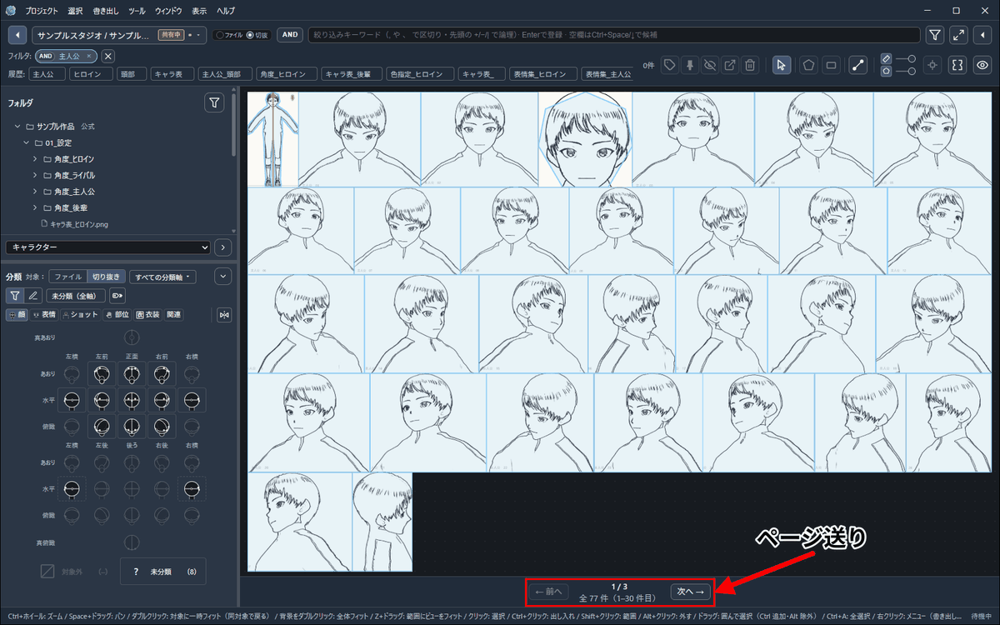

件数が多いときは<b>ページで区切って</b>表示できます。

設定の「表示」タブの **「メイン画面の一覧」** で **「ページ分割」** がオンだと、RefPicker がフィルタ結果を **1 ページあたり N 件**（既定 30、12〜120）に分けて表示します。

- 2 ページ以上あるとき、中央ペイン下部に **前へ / 次へ** とページ番号が表示されます
- **PageUp** / **PageDown** でもページを切り替えられます（入力欄にフォーカスがあるときは無効）
- ページを切り替えると **選択はクリア**され、そのページの内容に **全体フィット**します
- フィルタ変更・表示単位の切替・1 ページあたり件数の変更では **1 ページ目** に戻ります

### 3.5 フィルタボード（よく使う条件を置いておけるテーブル）

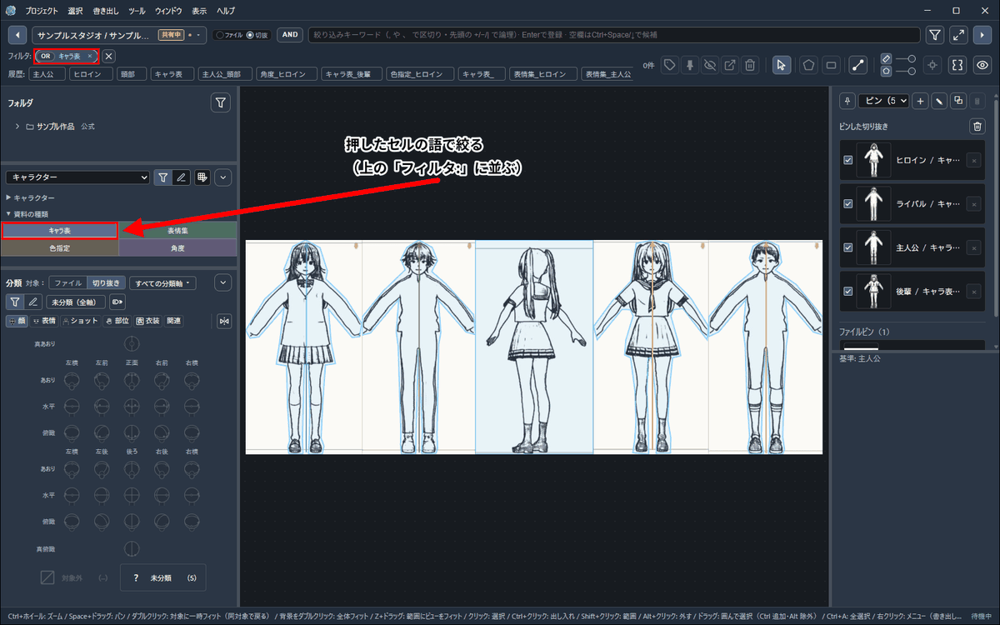

押したセルの語が<b>「フィルタ:」の行にチップで入ります</b>。チップを外すと、セルの押された表示も消えます。

**作業のあいだ何度も使う絞り込み条件**は、履歴のように流れていかない場所へ固定できます。

左ペインの **フォルダツリーと「分類」の間** にある格子が **フィルタボード** です。**既定では閉じている**ので、見出しの `∨` で開いてください。

**ボードを作る・切り替える:**

- ボードが1枚も無いときは、開いたペインの **「新規作成」**（空のボード）か **「CSV取り込み」**（表から作る）を押します
- 2枚目からは、見出しの **「モーダルで編集」** で編集画面を開き、左の **ボード** の列のボタン（**「追加」**・**「取り込む…」**・**「書き出す…」**・**「複製」**・**「削除…」**）を使います。ボードの名前は、ダブルクリックで直せます
- ボードが複数あるときは、見出しの選択欄（**「フィルタボードを切り替える」**）で切り替えます
- 見出しの2つのボタンで、セルに文字を入れる **「編集モード」** と、セルを押して絞り込む **「ボタンモード（絞り込み）」** を切り替えます

**1つのボードに複数のテーブルを置く:**

- 1つのボードの中に、テーブル（表）をいくつも置けます。キャラ用と背景用のように分けておけます
- 編集画面の、ボードの下のテーブルの一覧で **「テーブルを追加」** を押して足します。テーブルにはラベル（名前）が要ります
- テーブルの一覧では、つまみのドラッグで並べ替え、目のアイコンで表示／非表示を切り替えます。名前の変更と削除は、右クリックのメニューから行います
- 左ペインでは、テーブルが2つ以上あると、各テーブルの頭にラベルの見出しが出ます。見出しを押すと、そのテーブルを畳んだり開いたりできます
- 表示／非表示と畳んだ状態は、その PC だけに残ります

**押して絞り込む:**

- セルには**フィルタ語句になる文字列**を自分で並べます
- **クリック** = そのセルの語句だけに切り替え／**Ctrl+クリック** = OR で足す／**Shift+クリック**・**右クリック** = AND で足す／**Alt+クリック**・**中クリック** = NOT で足す（同じ論理で入っていれば外す）
- **上端・左端の見出し帯**を押すと、その行／列のマスをまとめて適用します
- セルには**色**を付けられます（赤・橙・黄・緑・青・紫）

**1つのセルに複数の条件を書く:**

- `A、B` — 区切った語は、押し方の論理になります（クリック・Ctrl+クリックなら **OR**＝どちらかに部分一致、Shift+クリックなら AND、Alt+クリックなら NOT）
- `A+B` — **AND**（両方に部分一致）
- 語の先頭の `-`（NOT）・`|`（OR）も、入力欄と同じように使えます（[3.2](#32-フィルタのマッチ対象と語の組み合わせ)）

**セルを編集する（編集モードと編集画面）:**

- クリックはセルを選ぶだけです。そのまま字を打つと、中身を置き換えて入力が始まります。続きから直すときは、ダブルクリック・`F2`・`Enter` を使います。入力中の `Esc` で元の中身に戻ります
- 矢印・`Tab`・`Enter` で、選ぶセルが動きます
- ドラッグ・`Shift`＋クリック・`Shift`＋矢印で範囲を選べます（`Ctrl+A` ですべて）。行・列の見出しを押すと、その行・列をまるごと選びます。色は選んだ範囲にまとめて塗れます
- `Ctrl+C`／`Ctrl+X`／`Ctrl+V` で、コピー・切り取り・貼り付けができます（右クリックからも）。Excel などの表とも、文字でやり取りできます
- 選んだ範囲の縁をドラッグすると移動します。`Ctrl` を押しながらだとコピーです
- `Ctrl+Z` で元に戻し、`Ctrl+Y` でやり直します
- セルの右クリックの **「今のフィルタを入れる」**・**「タグを選んで入れる…」**・**「分類から入れる…」** で、いまの絞り込みの条件・自由タグ・分類の値をセルに入れられます。文字のあるセルでは、置き換えるか後ろに足すかを選びます

**表から取り込む:**

- **「CSV取り込み」** か編集画面の **「取り込む…」** から、Excel などで作った表（CSV・TSV・テキスト）をファイル選択または**貼り付け**で取り込めます（Excel 由来の Shift_JIS も読めます）。取り込んだ表は新しいボードになります
- ペインに**ファイルをドロップ**しても取り込めます
- 作ったボードは編集画面の **「書き出す…」** で **`.refboard`** に書き出せます。別の PC では、同じ **「取り込む…」**（ボードが無いときは **「CSV取り込み」**）でそのファイルを選ぶと、同じボードが新しく作られます。書き出した `.refboard` は、テーブルに対応する前のバージョンの RefPicker では取り込めません

> **ボードは1枚まで無料です。** 編集・保存・削除・切り替えはずっと無料のまま、**2枚目を作る・取り込む・複製する**ときと、**1つのボードに2つ目のテーブルを足す**ときだけライセンス認証が要ります（案内が出ます）。

### 3.6 1件に寄って見る（一時フィット）

一覧の切り抜きやファイルを **ダブルクリック** すると、その1件が中央のペインいっぱいに表示されます（**一時フィット**）。同じものをもう一度ダブルクリックすると、寄る前の表示に戻ります。

- ダブルクリックは寄るだけです。切り抜きの形の編集には入りません。形を直すときは、切り抜きを選んで `Enter` を押します（[4.1](#41-ツールの基本)）
- 寄っている間は **←** / **→** で、前後の切り抜き（ファイルに寄っているときは前後のファイル）へ寄り直します。ページの端では次（前）のページへ進みます
- 寄った1件は選択された状態になるので、そのままタグを付けたりピンしたりできます
- 背景（切り抜きもファイルも無いところ）をダブルクリックすると、全体表示に戻ります
- 寄っている間に中央ペインの大きさが変わっても（中央ペインの最大化・全画面表示・ペインの開閉・ウィンドウの大きさの変更）、新しい大きさで同じ1件に寄り直します。設定の「表示」タブの **「ウィンドウの大きさを変えたときのズーム」** には左右されません。このあとや、ページをまたいで寄り直したあとは、もう一度ダブルクリックして戻る先が全体表示になります

### 3.7 一覧を画面いっぱいに広げる（中央ペインの最大化・全画面表示）

タイルを大きく見たいとき、狭い画面で作業するとき、人に画面を見せるときに使います。

- **`Tab`**（またはツールバーの **「中央ペインを最大化（Tab）」**）を押すと、上部のツールバー・左右のペイン・ステータス行が隠れ、中央ペインが広がります（**中央ペインの最大化**）。ページ送りとミニマップは残り、キー操作もそのまま使えます
- もう一度 **`Tab`** を押すか、右上の **「元に戻す」** で元の画面に戻ります。左ペインの開閉や幅は、最大化する前のままです。`Esc` では戻りません
- **`F11`** を押すと、タイトルバーとタスクバーも消してウィンドウを画面全体に広げます（**全画面表示**）。もう一度 `F11` で戻ります。中央ペインの最大化と一緒に使うと、一覧が画面全体になります
- 最大化中の **「元に戻す」** は、中央ペインの最大化と全画面表示を両方とも解除します
- どちらも、次に起動したときは元の画面で始まります
- 文字を入力している間、ダイアログ（**「連続付与」** など）を開いている間、メジャーの端点を選んでいる間は、`Tab` は中央ペインの最大化に使われません

> Windows のウィンドウの最大化（タイトルバーのボタンでウィンドウを画面いっぱいにすること）とは別のものです。

### 3.8 動画ファイルを並べて見る

動画のファイルも、画像と同じ一覧に並びます。タイルには Windows が作るサムネイルが出て、隅に長さ（例「0:03」）が出ます。サムネイルを作れない形式は、種類のアイコンと名前のカードで並びます。

- 対応する形式は mp4・m4v・mov・avi・mkv・webm・wmv です
- 動画を1つ選んで `Enter` を押すと、そのタイルの中で再生の操作に入ります。選んだタイルの隅の ▶ のボタンや、右クリックの **「再生」** でも入れます。一覧に1件だけ出ているときは、選ばなくても `Enter` で入れます
- 入ると、止まったまま操作の帯が出ます。`K` で再生／一時停止、`,` で1コマ戻す、`.` で1コマ進める、`M` で音の切り替えです。はじめは音が出ません
- コマ送りは、mp4・m4v・mov だけで使えます
- `Esc` を押すか、タイルの外をクリックすると抜けます。選択はそのまま残ります
- 操作の帯の **「このコマをサムネイルに」** で、いま映っているコマを一覧のサムネイルにできます。**「最初のサムネイル」** で元に戻ります
- 共有元が選んだコマは、受け取る人のサムネイルにもなります。受け取った人が選んだコマは、その人の手元だけです
- アプリの中で再生できない形式では、「アプリ内では再生できない形式です」と出ます。右クリックの **「既定のアプリで開く」** で、Windows の既定のアプリで開けます。このメニューはどの種類のファイルにも出ます
- タグ・ピン・オミット・絞り込みは、画像と同じように使えます。切り抜き・自動切り抜き・切り抜きの正規化・メジャー・印刷用書き出しは、動画には使えません

### 3.9 3D を並べて見る

3D のファイルも一覧に並びます。タイルの隅に「3D」の印が付きます。アニメーションのあるものには ▶ の印も付きます。

- **glb・gltf** は、アプリがサムネイルを描きます。地は透明で、一覧の地がそのまま見えます。描き終わるまでは名前のカードで並びます
- **fbx・obj・stl・ply・3mf・dae・blend・ma・mb・max・c4d・3ds・vrm** は、Windows がサムネイルを作れればそれを、作れなければ名前のカードを並べます。アプリの中では回せません
- glb・gltf を1つ選んで `Enter` を押すと、そのタイルの中で回して見られます。右クリックの **「3D の操作」** でも入れます。ドラッグで回転、右ドラッグで移動、ホイールで寄ります。アニメーションはこの中でだけ動きます
- 中では **「このアングルをサムネイルに」** で、いまの向きを一覧のサムネイルにできます。**「最初の向き」** で元の向きに戻ります
- 共有元が決めたアングルは、受け取る人にも届きます。共同編集者どうしでも届きます。受け取った人が決めたアングルは、その人の手元だけです
- `Esc` を押すか、タイルの外をクリックすると抜けます
- 動画と同じく、タグ・ピン・オミット・絞り込みは使えます。切り抜き・自動切り抜き・切り抜きの正規化・メジャー・印刷用書き出しは、3D には使えません。右クリックの **「既定のアプリで開く」** で、Windows の既定のアプリで開けます

## 4. 切り抜き

### 4.1 ツールの基本

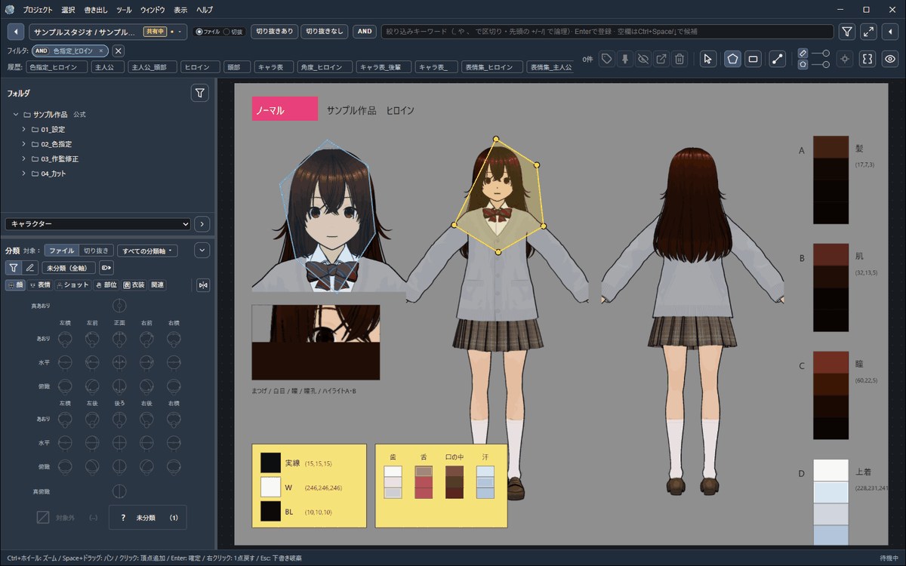

クリックで頂点を置き、Enter で確定します。<b>元の画像には一切書き込みません</b>。

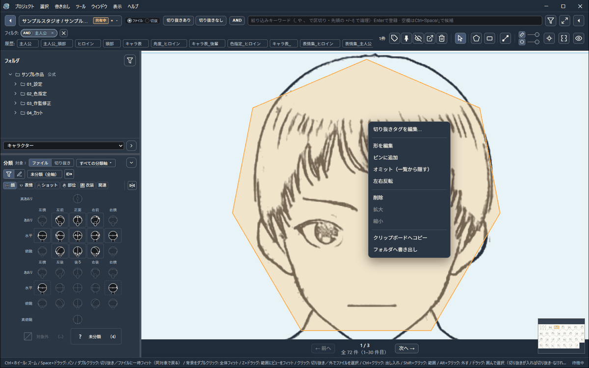

作った切り抜きへの操作は、右クリックのメニューとツールバーから行います。<b>クリップボードへコピーすれば、そのまま作画ソフトに貼れます</b>。

（`ファイル` 表示のとき）

- **選択ツール**:
  - 押した所で、選ぶものが決まります。切り抜きの上なら**切り抜き**、それ以外（切り抜きの外・動画・3D・切り抜きの無い画像）なら**ファイル**を選びます。
  - クリックで選択します。`Shift`＋クリックで範囲、`Ctrl`＋クリックで出し入れ、`Alt`＋クリックで外します。
  - 一度に選べるのは1種類だけです。切り抜きを選んでいるときにファイルを押すと、選択はファイルに切り替わります。
  - ドラッグで囲んで選択します（切り抜きの上からも囲めます）。囲みに切り抜きが1つでも入れば切り抜きを、入らなければファイルを選びます。切り抜きのある画像をファイルとして囲むときは、`Shift`＋`Alt`＋ドラッグを使います。
  - 表示の移動は `Space`＋ドラッグです。選んだものに寄るときは、ツールバーの選択にフィット（`Shift+0`）を使います。
  - 右クリックでメニュー（書き出し・削除など）
  - 形を直すときは、切り抜きを1つ選んで `Enter` か、右クリックの **「形を編集」** を使います。編集中は多角形の内側をドラッグで移動でき、**離すと保存**します。
  - **Ctrl+Z** で元に戻す
  - 選んだ切り抜きへの操作（タグ・ピン・オミット・左右反転・ドラッグで渡す・削除）は、ツールバーの選択ツールの左にまとまっています。ファイルを選んでいるときは、ファイルへの操作に変わります
- **多角形ツール**:
  - クリックで頂点追加
  - **Enter** で確定
  - 右クリックで **1点戻す**
- **矩形ツール**:
  - ドラッグで矩形、離すと確定

**ピンのトグル（`ファイル`／`切抜` どちらの表示でも）:**

- 切り抜きを **中クリック（マウスホイールのクリック）** すると、その切り抜き1件だけピンのオン/オフを切り替えられます。`ファイル` 表示ではピン済みの切り抜きに金色のピン印が付きます。
- **P** キーで、選択中の切り抜きのピンをまとめてトグルできます（選択ツール）。
- 右クリックメニューの **ピンに追加** でも同じことができます。
- ファイルのピンと、ピンしたものだけを並べる表示は [4.4](#44-ピンに集めて並べるピン表示) を参照してください。

**左右反転（表示だけ）:**

- 選んだ切り抜きは **H** キーか、ツールバーの **「左右反転（H）」** で左右反転して表示します
- 一覧全体は、ツールバーの **「ビュー全体を左右反転」**（**Shift+H**・表示のみ）で反転します
- 反転するのは表示だけです。切り抜きの形・メジャー・書き出す PNG は元の向きのままです。選んだものの反転は、フィルタを変えたときや RefPicker を起動し直したときに元に戻ります

> 主なキーボード・マウス操作は、上部ツールバーの **設定ボタン右隣のキーボードアイコン**（**操作一覧**）からいつでも確認できます。

### 4.2 切り抜きタグ

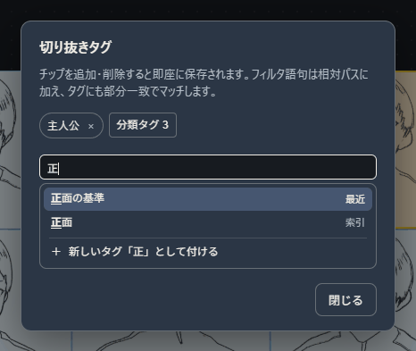

自由タグはここで付けます。<b>候補は既に使った語から出る</b>ので、表記ゆれが増えにくくなっています。

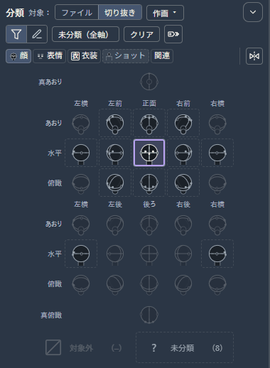

顔の向きは<b>あらかじめ用意された一覧から選択できます</b>。

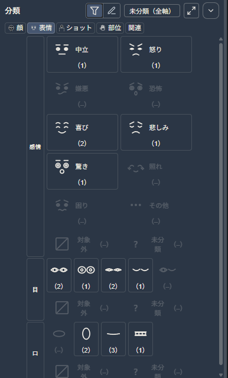

表情は<b>感情・目・口の3つを別々に</b>選びます。軸ごとに排他なので、1つの切り抜きに矛盾する値は入りません。

切り抜きにタグを付けると、フィルタ語のマッチ対象になります（相対パスに加えてタグにも部分一致）。

タグには**2種類**あります。

| | **分類タグ** | **自由タグ** |
|---|---|---|
| 付け方 | 左ペインの **「分類」** から、**分類軸ごとに用意された値を選んで**付ける | 自由タグのピッカーかタグの入力欄で、**自由に**付ける |
| 語彙 | 分類軸の値だけ（手入力はできません）。顔・表情・ショット・部位はアプリが持ち、ほかの分類軸はプロジェクトで作れます（[4.8](#48-分類軸を作るプロジェクトのカスタム分類軸)） | 自由。使った語が候補として入力補完されます |
| 目的 | 汎用的な分類を迷いなく行う | 現場・個人ごとに柔軟に管理する |
| ライセンス | **編集に認証が要ります**（受け取ったプロジェクトで、共有元から届いたファイルの上なら不要） | **ライセンス認証不要** |

> **絞り込み**の機能にライセンスによる制限はありません。

**「分類」ペインの使い方:**

- タブには、**常に表示する分類軸**（はじめは **「すべての分類軸」**＝このプロジェクトで非表示にしていない、すべての分類軸）と、最後に **関連** が並びます。どの分類軸を出すかは、見出しのセットのボタンで切り替えます（[4.7](#47-タブに出す分類軸を選ぶ常に表示する分類軸)）
- 常に表示していない分類軸でも、いまの結果に値が付いていれば、そのタブが**点線の枠**で一時的に出ます。押して絞り込むことも、付与モードで付けることもできます
- 分類軸のタブの値のボタンを押して付けます
- 見出しの **「対象」** で、分類タグを付ける・数える相手を **「ファイル」** か **「切り抜き」** に切り替えます。表示単位を変えると対象もそろいます（`ファイル` ならファイル、`切抜` なら切り抜き。[3.1](#31-表示単位ファイル--切抜)）
- **関連** タブは、**いま絞り込まれている切り抜きに付けられた自由タグ**（ファイルから引き継いだファイルタグも含みます。[4.5](#45-ファイルにタグを付けるファイルタグ)）を件数付きで並べます。
  選択してさらに絞りこむことができます
- **関連** タブは、自由タグのグループ（[4.9](#49-自由タグを整理するタグの管理自由タグのグループ)）があれば、グループの見出しごとに並びます。付与モードでは、グループに置いたまだ付いていない語も件数 0 で出て、押すと付きます
- ペインには **付与モード**（タグを付ける）と **絞り込みモード**（タグで引く）があります
- 絞り込みモードでは、クリックで AND、右クリックで置き換え、`Ctrl`＋クリックで OR、`Alt`＋クリックか中クリックで NOT を足します。選んだ値は **「フィルタ:」** の行にチップで並びます。
- 件数は、いまのフィルタ全体で数えます。足すと 0 件になる値は破線の枠、どう押しても 0 件になる値は薄く表示されます。
- **未分類** を選ぶと、その軸のタグが1つも付いていないもの（対象がファイルならファイル、切り抜きなら切り抜き）だけを表示することができます
- 各軸の値の下に **「対象外」** と **「未分類」** が並びます。顔の写っていない切り抜きなどに対象外を付けると、未分類に出なくなります。
- 絞り込みモードの **「未分類（全軸）」** は、すべての軸の未分類をまとめて選びます。付け忘れを探すときに使います
- 絞り込みモードの顔タブで **「左右反転を含める」** を押しておくと、選んだ顔の向きと左右が逆の向きも一緒に出ます

**自由タグの使い方:**

- 切り抜き上で右クリック → **「切り抜きタグを編集…」**（複数選択時は件数付き）
- 選択ツール中に **T** キー（入力欄にフォーカスがあるときは無効）
- ツールバーの選択中の切り抜きの操作にある、タグのボタン（選択ツール時）
- 右サイドバーのタグの入力欄の右の **「一覧から選ぶ」**

**自由タグのピッカー:**

上の入口からは、**自由タグのピッカー** が開きます。上に検索欄、左に切替（**「すべて」**・**「最近使った」**・自由タグのグループ・**「グループなし」**）、右に自由タグが件数付きで並びます。

- タグを押すと付きます。付いているタグは色が塗られていて、押すと外れます。変更はすぐ保存されます
- 複数の切り抜きを選んでいて、一部にだけ付いているタグは、押すと全部に付きます
- 検索欄に打つと、一致するタグに絞られます。同じ名前のタグが無いときは、**「新しいタグ「…」として付ける」** が出ます
- キーだけでも付けられます。↓ で並びへ移り、矢印で動き、Enter で付け外しします。Tab で切替を移り、Esc で閉じます
- 右上のピンで、開いたままにできます。開いたままのときは、メイン画面で選び直すと、付ける先も新しい選択に替わります。見出しをドラッグして動かせ、右下で大きさを変えられます
- 公式のタグと、ファイルから引き継いだタグには錠前の印が付きます。ここでは外せません
- 分類タグ（∠ で始まる語）は、ここでは付けられません

**入力欄（右サイドバー）:**

- 右サイドバーのインスペクタに、タグの入力欄が出ます（選択ツールで切り抜きを選んだとき）。チップでタグを追加・削除します。変更は即座に保存されます
- 入力欄の下に、候補が1列の一覧で出ます。入力欄が空のときは **「最近使ったタグ」**、打つと最近 → 索引の順に、打った字で始まるものを上にして並びます。行の右に出どころが出ます
- 打った字と同じ候補が無いときは、一覧の一番下に **「新しいタグ「…」として付ける」** が出ます
- 打った語に `:`・`/`・空白が入っていると、一覧の先頭に「2つのタグ「ハル」「制服」として付ける」のような候補が出ます。選ぶと、2つのタグに分けて付けます。1つのタグのまま付けるときは、ほかの行を選びます。自由タグのピッカーの検索欄でも同じです
- ↑↓ で行を選び、Enter で付けます（打った直後は先頭の候補が選ばれています）。Esc で一覧を閉じます。候補は7行まで出し、残りは「ほか n 件」と出ます
- 複数の切り抜きを選んでいるときは、チップは和集合で表示され、追加・削除は選択中の切り抜きすべてに適用されます

**連続付与（1件ずつ送りながら分類タグを付ける）:**

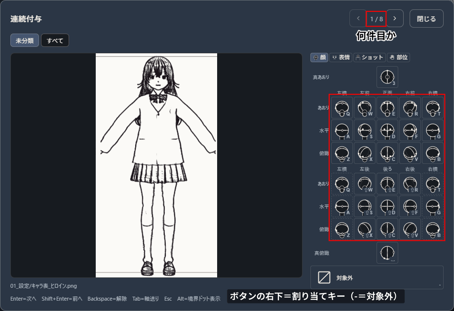

ボタンの右下の文字が、<b>そのボタンを押すキー</b>です。

- 「分類」ペインの見出しのボタン（**「連続付与」**）で開きます。開いたときのフィルタ結果の**全件**が対象です。表示単位が `切抜` なら切り抜きを、`ファイル` なら画像を1枚ずつ送ります
- タブは分類軸ごとに並び、`Tab` で切り替えます
- 値はクリックか、ボタンの右下に出ているキーで付けます。顔とショットは、付けると次の切り抜きへ進みます。部位は複数付けられるので、`Enter` で次へ送ります。表情タブは、最後の口を付けたときに進みます
- `-` で対象外を付け、`Backspace` でそのタブの値を外します。`←` / `→`（またはホイール）で前後へ移ります
- 上の **「未分類」** / **「すべて」** で、まだ付いていないものだけを回るか、全件を回るかを選べます（はじめは **「未分類」**）
- 付けるのは分類タグなので、ライセンスの扱いは上の表と同じです

### 4.3 自動切り抜き

> 設定等の1 枚の画像から複数の切り抜きをまとめて起こす機能です。**資料を作る側**で使うことが多く、配られた資料を見て描く立場の場合この項目は飛ばして構いません。

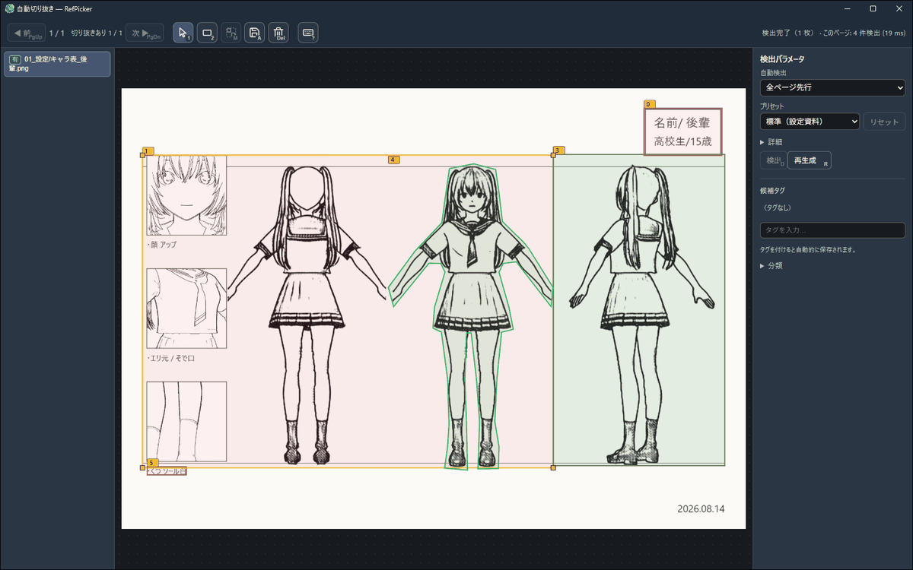

候補の段階では<b>切り抜きとして確定されていません</b>。候補を切り抜きとして採用するかどうかを選びます。画像の種類（現在は「設定」または「作監修正」）でプリセットを変えると、検出される候補が変わります。

**使い方:**

1. メイン画面で、処理したい画像が一覧に出るように絞り込みます（表示単位は `ファイル`）。
2. ツールバーの自動切り抜きのボタン（`Alt+A`）を押すと、**「自動切り抜きで処理」** の確認が出ます。フィルタ結果の画像（ピン表示中はピンした画像）が送られます。**「切り抜きが無い画像だけ」** にチェックすると、まだ切り抜きの無い画像に絞れます。確認が要らないときは、確認を出さずに送ります。
3. 自動切り抜きウィンドウで、`PageUp` / `PageDown`（またはホイール）で画像を送りながら候補を確かめます。候補は開いたページから自動で検出されます（右パネルの **「自動検出」** で、全ページを先に検出するか、手動で検出するかも選べます）。
4. 残したい候補を選んで **保存** のボタン（フロッピーのアイコン・`A` キー、または候補のダブルクリック）を押すと、その場で切り抜きとして保存されます。要らない候補は **削除**（ごみ箱のアイコン・`Delete`）で消します。
5. 足りない範囲は、矩形追加（`2`）で画像の上をドラッグして描きます。描いた矩形はそのまま保存されます。1つの絵が細かく割れたときは、候補を2つ以上選んで **結合**（`M`）で1つの矩形にまとめます。
6. 今のページの候補を出し直したいときは **再生成**（`R`）を押します。保存した切り抜きは残ります。

キーのあるボタンには、右下にそのキーが小さく出ます。

ウィンドウを閉じると、送った画像の並びと保存していない候補は消えます（保存した切り抜きは残ります）。

自動切り抜きウィンドウの右パネルにある **プリセット** は、**どんなタイプの画像を対象にするか** の選択です。
選ぶと検出方法が切り替わり、**保存していない候補を捨てて、全ページを検出し直します**（保存した切り抜きは残ります。
「自動検出」が **「手動」** のときは未検出に戻るので、**「検出」**（`D`）で検出します）。
細かい値は **「詳細」** の中にあります。プリセットの初期値から変えている間は、プリセットの横に **「変更あり」** と出ます（**「リセット」** で戻せます）。

| プリセット | 対象 | 「詳細」の主要ノブの先頭 |
|---|---|---|
| **標準（設定資料）** | 白背景の設定資料 | **「描画しきい値」** — この明るさより暗い画素を描画とみなす |
| **作監修正** | 作監修正集（作画用紙・コピー・デジタル台紙） | **地色との差** — 推定した紙の色からどれだけ離れた画素を描画とみなす |

**「作監修正」を使う目安**は、次のどちらかに当てはまるときです。

- **紙が白ではない** — 緑の作画用紙、クリーム、デジタルの色付き台紙など

- 標準プリセットで **候補が画像の一番外側の矩形 1 つ**になってしまう
紙の色は 1 枚ごとに自動で推定するので、色の違う紙が混ざったフォルダでもプリセットは 1 つのままで構いません。

このプリセットでは次も自動で行われます。

- **タップ穴を候補から外す**（画像の縁の帯に完全に収まる小さな塊。用紙が横倒しでも効きます）
- **ページを横切る薄い線やスキャンの縁を無視する**（描画の詰まり具合で絵と区別します）

思ったところで切れないときは、**「詳細」** を開いて次を動かします。

- **「描画密度の下限」** — 上げると薄い線や汚れを強く落とします（下げると細切れになりにくくなります）
- **「描画密度の範囲」** — 広げるほど、線が細く疎な清書系の絵がひと塊にまとまります
- **縁の帯 / 縁マージン** — タップ穴や紙の端が候補に残るときに広げます

なお **注記・吹き出し・「作監修正」の印などは候補として出ます**。絵と注記を自動で判別するのは困難なので、
要らない候補は切り抜きとして採用しないでください（**「保存」** した候補だけが切り抜きになります）。

### 4.4 ピンに集めて並べる（ピン表示）

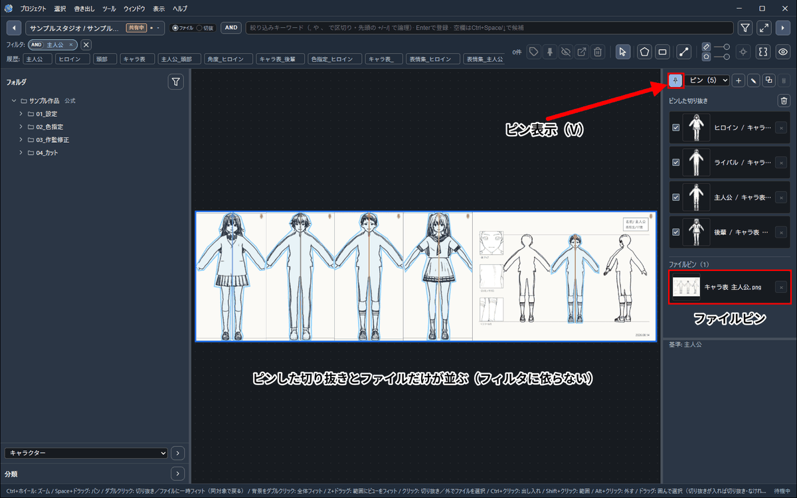

中央には<b>ピンしたものだけ</b>が、ピングループの順に並びます。

**ピンする:**

- 切り抜き: **中クリック**、選んで **P** キー、または右クリックの **ピンに追加**（[4.1](#41-ツールの基本)）
- ファイル: ファイルの上で **中クリック**、または右クリックの **「ファイルをピン」**（**ファイルピン**）。`ファイル` 表示では、選んでいるピングループに入っているファイルのタイルに、切り抜きと同じピンのアイコンが出ます

**ピングループ:**

ピンは右サイドバーの**ピングループ**に入ります。目的ごとにグループを分けておき、選択欄（**「アクティブなピングループを切り替える」**）で切り替えます。横のボタンで新規作成・名前の変更・複製・削除ができます。ピンが入るのは、選択欄で選んでいるグループです。

**ピン表示:**

右サイドバーの **「ピン表示」** のボタン（または **V** キー）を押すと、中央の一覧が、選んでいるピングループの中身だけに切り替わります。

- この間は、フィルタ語・表示単位・オミット（[6.2](#62-オミット)）に関係なく、ピンしたものがすべて並びます
- 画像のファイルピンの上でも、矩形・多角形ツールで切り抜きを作れます。選択・形の編集・タグ・メジャーも通常の一覧と同じです
- もう一度押すと通常の一覧に戻ります。フィルタ語や分類の選択を変えたときも戻ります

### 4.5 ファイルにタグを付ける（ファイルタグ）

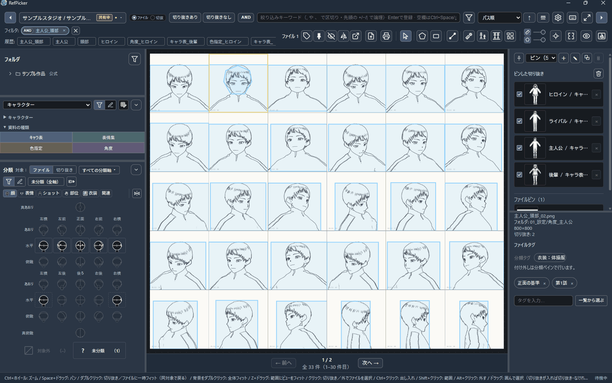

ファイルタグは<b>その画像の切り抜きに引き継がれます</b>。

ファイルそのものにもタグを付けられます（**ファイルタグ**）。画像・動画・3D のどれにも付けられます。画像に1回付けておけば、その上の切り抜きに1つずつ付けなくても、そのタグで絞り込めます。自由タグはライセンス認証なしで使えます。

**ファイルを選ぶ:**

- `ファイル` 表示の選択ツールで、切り抜きの外を押すとファイルが選ばれます。動画・3D・切り抜きの無い画像は、どこを押してもファイルです（[4.1](#41-ツールの基本)）
- 複数選ぶときは、`Ctrl`＋クリックか、ドラッグで囲みます。切り抜きのある画像をまとめて囲むときは、`Shift`＋`Alt`＋ドラッグです
- `切抜` 表示では、ファイルは選べません

**タグを付ける:**

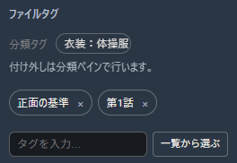

- ファイルを選んで `T` を押すか、選択中のファイルの操作にあるタグのボタン（**「ファイルタグを編集」**）を押すと、見出し **「ファイルタグ」** の自由タグのピッカーが開きます（[4.2](#42-切り抜きタグ)）。付け外しはすぐ保存されます
- 複数のファイルを選んでいるときは、選んだファイルすべてにまとめて付け外しします
- ここで付け外しできるのは**自由タグ**です。ファイルに付いた分類タグは、右サイドバーのファイルタグの欄の **「分類タグ」** の行に、読み取り専用で並びます

**ファイルに分類タグを付ける:**

- 「分類」ペインの見出しの **「対象」** を **「ファイル」** にして（`ファイル` 表示ならはじめからファイルです）、ファイルを選んで値のボタンを押します。連続付与でも、`ファイル` 表示ならファイルを1件ずつ送ります（[4.2](#42-切り抜きタグ)）
- ファイルの分類タグも、その画像の切り抜きに引き継がれます。ただし、切り抜き自身がその分類軸の値を1つでも持っていれば、その分類軸では切り抜きの値が使われます
- ライセンスの扱いは、切り抜きの分類タグと同じです（[4.2](#42-切り抜きタグ)の表）

**右サイドバー:**

- ファイルを1つ選ぶと、右サイドバーのインスペクタに、ファイル名・フォルダ・寸法・切り抜きの数と、ファイルタグの欄が出ます。ここでも付け外しできます。欄の右の **「一覧から選ぶ」** で、自由タグのピッカーを開けます
- 複数選ぶと「ファイル 3 件」のように件数が出て、ファイルタグの欄でまとめて付け外しできます

**引き継ぎと絞り込み:**

- 画像のファイルタグは、その画像の切り抜きに引き継がれます。フィルタ語（[3.2](#32-フィルタのマッチ対象と語の組み合わせ)）と「分類」ペイン（[4.2](#42-切り抜きタグ)）の絞り込みに効きます
- 切り抜きを選ぶと、引き継いだファイルタグも表示されます。外すときはファイルの側で外します

**選んだファイルでできること:**

- ピン（`P` キー）・オミット・左右反転（`H` キー）・他のアプリへのドラッグ（元のファイルをコピーとして渡します）。ボタンは選択中のファイルの操作（ツールバー）にまとまっています
- 画像は、印刷用書き出し（[5.1](#51-印刷用に書き出す)）の対象にもなります

### 4.6 切り抜きを別の画像へ写す（コピー／貼り付け）

ラフと清書のように、同じ絵の工程違いの資料では、同じ範囲を画像ごとに引き直すことになります。ある画像の切り抜きを、別の画像へまとめて写せます。

1. 写したい画像を右クリックして **「切り抜きをコピー（N個）」** を押します。その画像の切り抜きのうち、オミットしていないものすべてが、タグとメジャーの割り当てごとコピーされます
2. 貼り付けたい画像を右クリックして **「切り抜きを貼り付け（〈元の画像名〉から N個）」** を押します
   - 複数の画像をファイルとして選び（[4.5](#45-ファイルにタグを付けるファイルタグ)）、その中の1枚を右クリックすると、選んだ画像すべてに貼り付けます
   - 選んでいない画像を右クリックしたときは、その1枚だけに貼り付けます
3. 貼り付けると「**N 枚に M 個貼り付けました**」と表示されます

- 切り抜きの位置は、画像の大きさに対する割合のまま写ります。大きさの違う画像でも、同じ割合の位置に付きます
- **分類タグを写すには個人ライセンス（Pro）が要ります。** 無料のときは分類タグを落として貼り付け、「分類タグは Pro で写せます（K 個を落としました）」と知らせます。ただし、共有元から届いた画像（公式）から公式へ貼り付けるときは、分類タグの付け外しと同じく（[1.3](#13-チームで資料を共有するなら)）ライセンスなしで分類タグも写ります
- 貼り付けを取り消すときは、貼り付けた切り抜きを削除します
- コピーした内容は、プロジェクトを切り替えるか、アプリを閉じると消えます
- この2つの項目は、`ファイル` 表示で画像を右クリックしたときに出ます。ツールは何を選んでいても使えます

### 4.7 タブに出す分類軸を選ぶ（常に表示する分類軸）

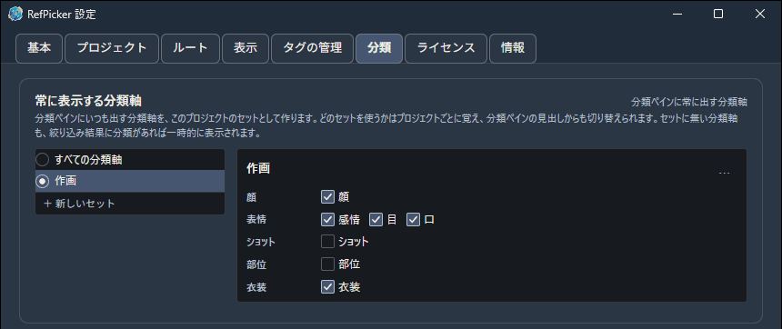

「分類」ペインのタブにいつも出す分類軸を、**セット**として選べます。背景の担当なら季節や時間帯だけ、作画なら顔と表情だけ、のように、自分の仕事に要る分類軸だけを並べておけます。

- 「分類」ペインの見出しにある、いま使っているセットの名前のボタンを押すと、セットを切り替えるメニューが出ます。メニューの **「常に表示する分類軸を編集…」** で、設定の **「分類」** タブが開きます
- 設定の **「常に表示する分類軸」** の左の一覧がセット、右がそのセットに入れる分類軸です。丸を押したセットを使います
- **「すべての分類軸」** は、どのプロジェクトにもあるセットで、すべての分類軸を出します。中身は変えられません。複製すると自分のセットとして直せます
- **「＋ 新しいセット」** を押すと、その場で名前を打って空のセットを作れます。分類軸の無いセットを使うと、タブは **関連** だけになります
- セットはプロジェクトごとに、自分の PC に残ります。共有しても配られません
- セットに入れていない分類軸も、結果に値が付いていれば点線の枠のタブで一時的に出ます（[4.2](#42-切り抜きタグ)）

**プロジェクトで使わない分類軸を非表示にする:**

セットは自分の画面だけの選び方です。プロジェクトとして使わない分類軸は、非表示にできます。

- 設定の **「分類」** タブの **「プロジェクトの分類軸」** の一覧で、分類軸の行の目のアイコンを押します。顔・表情・ショット・部位のようにアプリが持つ分類軸（**「既定」** の印）も、カスタム分類軸（[4.8](#48-分類軸を作るプロジェクトのカスタム分類軸)）も、同じように切り替えられます
- 非表示にした分類軸は、「分類」ペインのタブにも、点線の枠のタブにも、連続付与にも出ません。付いているタグは消えません。フィルタ語の検索では今までどおり一致します
- 非表示はプロジェクトの設定です。共有すると、受け取る人と共同編集者の画面からも消えます。切り替えられるのは、共有元と共同編集者です
- 新しく作ったプロジェクトでは、はじめから **ショット** が非表示です。使うときは、目のアイコンで表示に戻します

### 4.8 分類軸を作る（プロジェクトのカスタム分類軸）

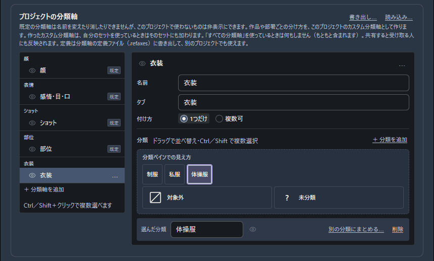

顔・表情・ショット・部位のほかに、作品や部署ごとの分け方を、プロジェクトのカスタム分類軸として作れます（例：背景の「季節」に「春」「夏」「秋」「冬」）。付け方・絞り込み方は、ほかの分類タグと同じです。

- 設定の **「分類」** タブの **「プロジェクトの分類軸」** で、**「＋ 分類軸を追加」** を押して作ります。一覧の上にはアプリが持つ分類軸（**「既定」** の印）、下にカスタム分類軸が並びます
- 分類軸ごとに、**名前**・**タブ**（「分類」ペインでどのタブに並べるか。同じタブ名の分類軸は1枚のタブにまとまります）・**付け方**（**「1つだけ」**／**「複数可」**）を決めます
- 分類軸の中の1つ1つの値を、画面では **分類** と呼びます。**「＋ 分類を追加」** で足し、名前を打ちます
- 分類は、「分類」ペインと同じ見本の上で編集します。ドラッグで並べ替えられ、名前はあとから直せます。`Ctrl`／`Shift`＋クリックで複数選べます
- 要らなくなった分類は、**「別の分類にまとめる…」** で別の分類へまとめられます。まとめた分類が付いていた切り抜き・ファイルは、まとめ先の分類に移ります。まとめると元に戻せません
- タグが付いている分類は削除できません。先に別の分類へまとめます
- 「対象外」はどの分類軸にも自動で付きます
- 分類軸の一覧も、`Ctrl`／`Shift`＋クリックで複数選べます。選んだ分類軸は、右クリックか **「…」** のメニューから、まとめて書き出し・複製・削除できます。使わない分類軸は、目のアイコンで非表示にできます（[4.7](#47-タブに出す分類軸を選ぶ常に表示する分類軸)）
- タグが付いている分類軸を削除するときは、**「タグの無い軸だけ消す」** か **「タグを外して消す」** を選びます
- **「書き出し…」** と **「読み込み…」** で、分類軸の定義を **分類軸の定義ファイル**（`.refaxes`）として書き出し、別のプロジェクトに読み込めます。読み込むときに同じ名前の分類軸があると、「季節（2）」のように番号を付けて足します
- 自分のセットを使っているとき、作った分類軸はそのセットにも加わります
- 分類軸を作るのはライセンス認証なしでできます。分類を付け外しするときの扱いは、ほかの分類タグと同じです（[4.2](#42-切り抜きタグ)の表）
- 共有すると、分類軸の定義も受け取る人に届きます。受け取る人は直せません。共同編集者は直せます（[共有ガイド](SYNC_GUIDE.md)）

### 4.9 自由タグを整理する（タグの管理・自由タグのグループ）

自由タグの書き方がばらついたときや、数が増えて探しにくくなったときは、設定の **「タグの管理」** タブでまとめて直せます。ここで直すと、切り抜き・ファイルに付いたタグもそろって変わります。分類タグ（∠ で始まるもの）は対象外です。

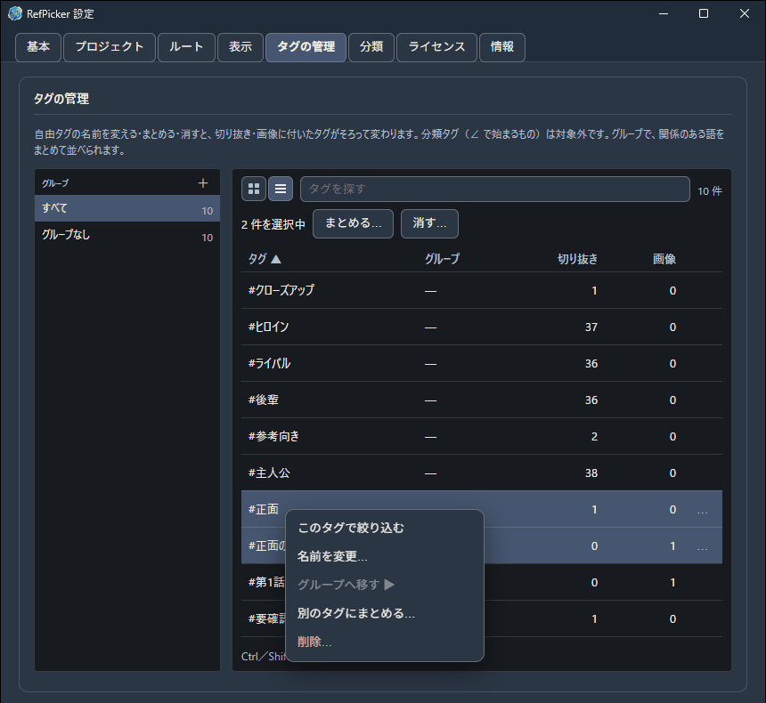

**タグを直す:**

- タブの右に、自由タグが並びます。上のボタンで **「並び」** と **「表」** を切り替えます。表では、タグ・グループ・切り抜きの件数・画像の件数の列が並び、列の見出しを押すと並べ替わります
- **「タグを探す」** の欄に打つと、一致するタグに絞れます。並べ替えは、名前順か件数順を選べます
- タグを右クリックすると、次の操作が出ます
  - **「このタグで絞り込む」**: メイン画面を、そのタグで絞り込みます
  - **「名前を変更…」**: 名前を変えます。ダブルクリックか `F2` でも変えられます。すでにある名前に変えると、1つにまとめるかを聞かれます
  - **「別のタグにまとめる…」**: 2つ以上選んでいるときに出ます。選んだタグを、別のタグにまとめます
  - **「削除…」**: そのタグを、切り抜き・ファイルから外します
- `Ctrl`／`Shift`＋クリックで、タグを複数選べます。複数選ぶと、表の上に「N 件を選択中」と **「まとめる…」**・**「消す…」** が出ます。まとめる・消すは、選んだタグにまとめて効きます。どちらも元に戻せません
- 受け取ったプロジェクトでは、公式のタグはまとめることも消すこともできません。自分で足したタグ（「手元」の印）は直せます

**自由タグのグループ:**

関係のある自由タグを、見出しごとにまとめて並べられます（**自由タグのグループ**）。例えば「話数」のグループに「#03」「#04」を置いておけます。

- タブの左の **「グループ」** の横の ＋ のボタン（**「グループを追加」**）でグループを足します。グループの並びは、左の一覧のドラッグで変えます
- タグを右クリックして **「グループへ移す ▶」** で、グループに入れます。タグを左のグループへドラッグしても移せます。外すときは **「グループから外す」** です
- 1つのタグが入れるグループは1つだけです。どのグループにも入っていないタグは、**「グループなし」** に並びます
- グループの **「…」** のメニューの **「語を足す…」** で、まだどこにも付いていない語も置けます。これから使う語を先に用意しておくと、書き方がそろいます
- グループは、自由タグのピッカー（[4.2](#42-切り抜きタグ)）の切替と、「分類」ペインの **関連** タブの見出しになります。グループそのものは絞り込みの条件にはなりません
- グループはプロジェクトの設定です。共有・共同編集・移行で届きます。変えられるのは共有元と共同編集者で、受け取る人は見るだけです
- 自由タグのグループは無料で使えます

## 5. 書き出し（クリップボード/フォルダ/ドラッグ）

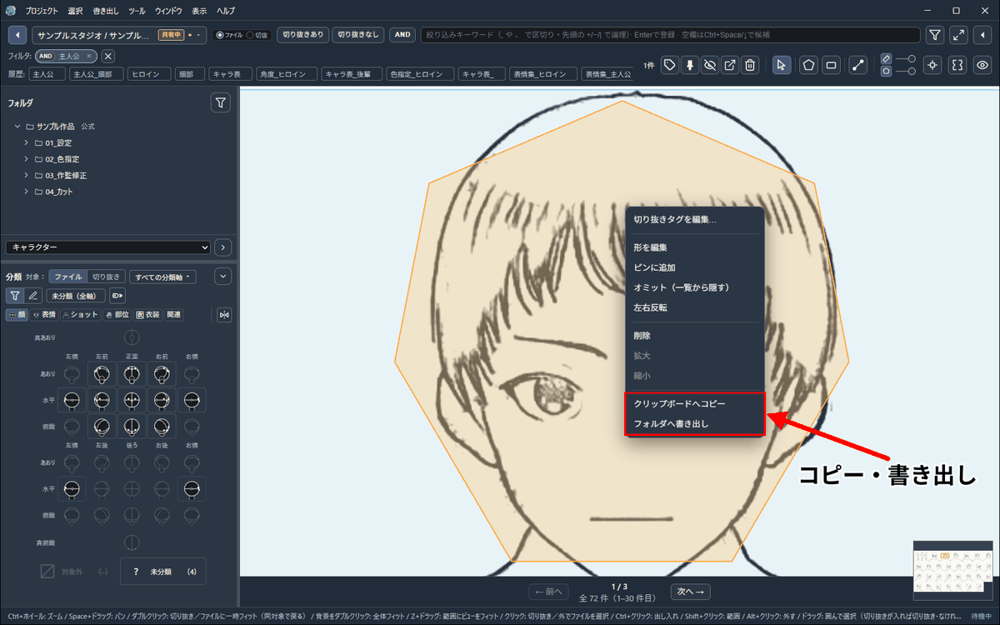

コピーとフォルダへの書き出しは<b>右クリック</b>から行います。

> 切り抜きは **一覧（表示単位 `切抜`）やピンに並べたまま**参照できます（3.1 の表示単位 / 4.1 のピン）。ここで説明するのは、**他アプリへ持ち出す**ときの書き出しです。

動画と 3D には切り抜きを作れないので、この章の書き出しの対象になりません。動画・3D のファイルそのものは、選んでツールバーのドラッグのボタンを使うと、元のファイルのコピーとして渡せます（[4.5](#45-ファイルにタグを付けるファイルタグ)）。

コピーとフォルダへの書き出しは、一覧の切り抜き上で右クリックし、メニューから実行します。ドラッグで渡すときはツールバーのボタンを使います。

- **クリップボードへコピー**:
  - 切り抜きを PNG ファイルとして一時フォルダに書き出し、その画像ファイルをクリップボードへコピーします
  - 他アプリへ貼り付ける用途です
- **フォルダへ書き出し**:
  - 指定したフォルダへ切り抜き PNG ファイルを保存します
- **ドラッグで渡す**:
  - ツールバーの選択ツールの左にある、ドラッグのボタン（**「書き出しを準備」**）を押すと、選んだ切り抜きの PNG を用意します
  - 用意ができたら、そのボタンを他のアプリへドラッグします。ファイルはコピーとして渡ります。
  - 用意している間にもう一度押すと中止します

> クリップボードやドラッグで渡すために書き出した PNG は、次に RefPicker を起動したときに消えます。ファイルとして残すときは **「フォルダへ書き出し」** を使ってください。

### 5.1 印刷用に書き出す

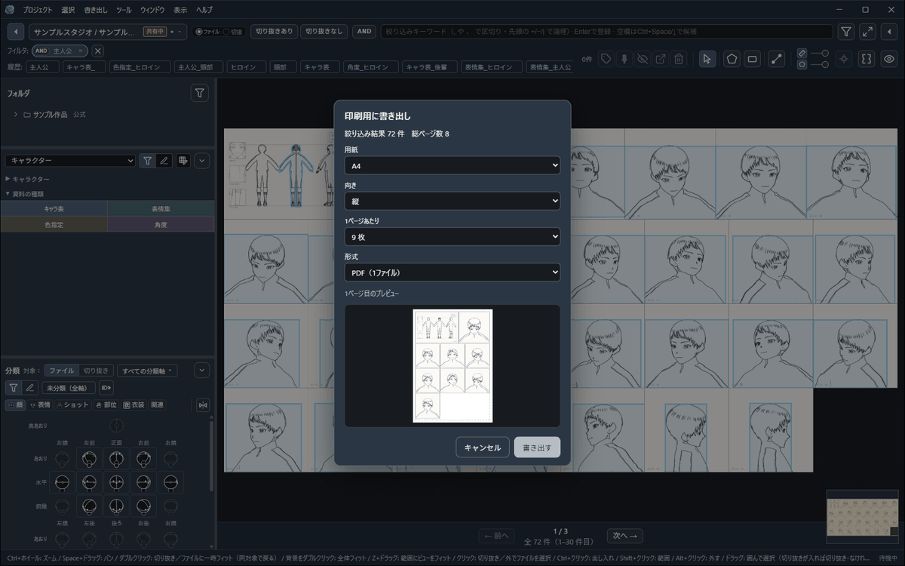

一覧と同じ並びで、<b>用紙に並べて</b>書き出します。

絞り込んだ画像や切り抜きを、用紙に合わせて並べて、印刷用の PDF／PNG に書き出せます。ライセンス認証なしで使えます。

1. 書き出したいものを一覧に出します。一部だけにするときは選んでおきます。
2. ツールバーのボタン（アイコンだけのボタンで、マウスを載せると **「印刷用に書き出し…」** と出ます）を押すと、ダイアログ **「印刷用に書き出し」** が開きます。
3. 下の項目を選び、**「書き出す」** を押します。PDF ならファイル名を、PNG なら保存先のフォルダを選びます。

**対象**は次の順に決まります。並びは一覧と同じです。

- ファイルを選んでいれば、そのファイル（[4.5](#45-ファイルにタグを付けるファイルタグ)）
- 切り抜きを選んでいれば、その切り抜き
- どちらも選んでいなければ、絞り込み結果すべて

動画と 3D のファイルは、対象から外れます。

ダイアログの上に、対象の件数と総ページ数が出ます。50 ページを超えると、印刷前に確かめるよう注意が出ます。

| 項目 | 選べるもの |
|---|---|
| **「用紙」** | A3／A4／B4／B5（はじめは A4） |
| **「向き」** | 縦／横 |
| **「1ページあたり」** | 1〜36 枚（はじめは 9 枚） |
| **「形式」** | **「PDF（1ファイル）」**／**「PNG（ページごと）」** |

- **「1ページ目のプレビュー」** に、選んだ項目での1ページ目が縮小して出ます
- 次に開いたときは、前回選んだ項目で始まります
- 書き出している間は **「中止」** で止められます
- 読めなかった画像は、その場所を空白にして書き出します

## 6. 一覧から外す（探索から除外・オミット）

一覧に出したくないものを外す方法は2つあります。

| | 探索から除外 | オミット |
|---|---|---|
| 外す単位 | フォルダ・ファイル（左のルートツリーで） | 切り抜き・ファイル（一覧で） |
| 共有・移行 | 自分の手元だけです。共有にも移行にも載りません | 自分の手元だけです。共有にも移行にも載りません |
| 戻す場所 | ルートツリーの目のアイコン | オミットビュー（[6.3](#63-オミットビュー)） |

どちらも読み込んだまま一覧から外すだけで、読み込む量は減りません。フォルダをそもそも読み込ませたくないときは、**ルートから外すフォルダ**（[1.4](#14-ルートの一部のフォルダを外すルートから外すフォルダ)）を使います。

### 6.1 探索から除外

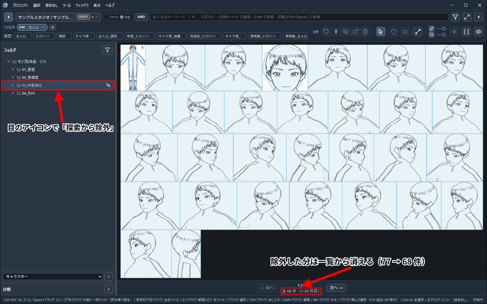

除外は<b>索引から消すのではなく、一覧に出さない</b>設定です。いつでも戻せます。

メイン画面左のルートツリーでは、フォルダ/ファイルを **「探索から除外」** にできます（目のアイコン）。

- 除外したパスは、一覧・フィルタ結果・切り抜き対象から外れます
- ディスク上の削除はしません
- ルート配下のディレクトリを除外すると、**その配下も除外**されます
- 除外は**自分の手元だけの一時的な設定**です。共有にも移行にも載らず、受け取った資料（公式）のルートでも自由に付け外しできます
- 除外は、共有の範囲には効きません。除外したファイルも、共有先の範囲の条件に一致すれば相手に渡ります（[共有ガイド 3.1](SYNC_GUIDE.md#31-範囲の条件)）

**いまの絞り込みからだけ外すなら:** ツリーの行を **Alt＋クリック** すると、そのフォルダ（ファイル）を除いて絞り込みます（フィルタの NOT）。行のクリックはそのフォルダだけへの絞り込み、**Ctrl＋クリック** は OR、**Shift＋クリック** は AND で足します。どれもフィルタ語と同じく、条件を変えれば元に戻ります。

### 6.2 オミット

切り抜きやファイルを、**削除せずに一覧から隠す**操作です。受け取った資料（公式）の切り抜きは削除できないので、要らないものはオミットで片付けます。

- 切り抜き: **Alt＋中クリック**、選んでツールバーのオミットのボタン、または右クリックの **「オミット（一覧から隠す）」**
- ファイル: ファイルの上で **Alt＋中クリック**、選んでツールバーのオミットのボタン、または右クリックの **「このファイルをオミット」**
- 隠れるのは自分の一覧だけです。共有にも移行にも載らず、ほかの人の一覧は変わりません
- 切り抜きの形が変わったり、ファイルが差し替わったりすると、オミットは自動で外れます
- ピン表示と対比表には、オミットしたものも残ります

### 6.3 オミットビュー

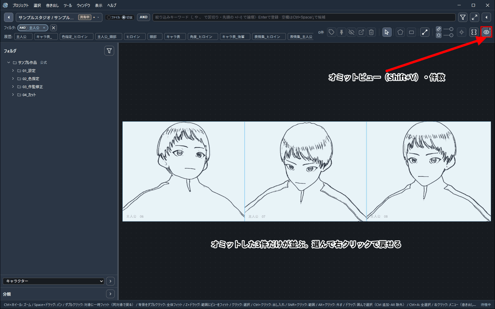

オミットしたものは<b>ここで戻せます</b>。削除はされていません。

ツールバーのオミットビューのボタン（**「オミットされたアイテムを表示」**）か **Shift+V** で、オミットしたものだけが中央に並びます。ボタンの数字は、オミットしている件数です。

- オミットした新しい順に並びます
- 戻すときは、ここで同じ操作（**Alt＋中クリック**、または右クリックの **「オミットを解除」**）をします
- もう一度ボタンを押すと通常の一覧に戻ります。フィルタ語や分類の選択を変えたときも戻ります

## 7. プロジェクトの移行
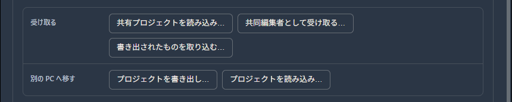

移行のボタンは<b>「別の PC へ移す」の段</b>にあります。共有のボタンとは段が分かれています。

別PCへ **プロジェクト一式**（公式＋個人ルート・切り抜き・メジャー・ルートから外すフォルダ・**ファイル同梱**。探索から除外は載りません）を移すには、設定「プロジェクト」タブの **「別の PC へ移す」** の段から:

1. 移行元PCで **「プロジェクトを書き出し…」** → 単体ZIPに丸ごと書き出す。
2. 移行先PCで **「プロジェクトを読み込み…」** → その移行ZIPを選ぶ。**編集可能な新規プロジェクト**として取り込まれる。

共有（[共有ガイド](SYNC_GUIDE.md)。配る・受け取る・共同編集で、バージョンを揃え続ける）とは**別系統**です。継続的にバージョンを揃えたいなら共有、まるごと持っていって続きを編集したいなら移行を使います。移行で読み込めるのは **「プロジェクトを書き出し…」** で作った移行用 ZIP だけです（共有フォルダは読み込めません。共有を受け取るときは **「共有プロジェクトを読み込み…」** を使います。**「選んで書き出す…」** で書き出された ZIP は、**「受け取る」** の段の **「書き出されたものを取り込む…」** で取り込みます）。読み込んだプロジェクトは公式データも含めて編集できる新しいプロジェクトになり、元のプロジェクトや共有フォルダには影響しません。すでにルートを登録した自分のプロジェクトがある端末で読み込むときは、個人ライセンスが必要です（新しい PC での最初の読み込みは無料です）。

**プロジェクトの印**は、プロジェクトの切り替えと設定に出ます。次の4通りです。

| 印 | どんなプロジェクトか |
|---|---|
| **「共有中」** | **「共有を始める…」** で共有を始めて、配っているプロジェクト |
| **「受け取り」** | 共有を受け取ったプロジェクト。公式のデータは変更・削除できません |
| **「共同編集」** | 共同編集者として受け取ったプロジェクト。公式のデータも編集できます（読み取り専用ではありません） |
| （印なし） | 共有していないプロジェクト |

共同編集を始めた人のプロジェクトは **「共有中」**、共同編集者として加わった人のプロジェクトは **「共同編集」** の印になります。

**受け取ったプロジェクトは書き出せません**（共同編集者として受け取ったものも同じです）。公式データは共有元のものなので、移行 ZIP には含めません。別の PC で使うときは、その PC で **「共有プロジェクトを読み込み…」**（共同編集者は **「共同編集者として受け取る…」**）から共有フォルダを受け取り直してください。

---

**ここまでが、資料を見ながら描く立場の人（原画・動画・作画監督など）の範囲です。**
以降の2章は、**資料・プロジェクトのデータを作る・配る側**（制作進行・設定制作など）の作業です。
受け取った資料を使うだけなら、[11. よくあるつまずき](#11-よくあるつまずきトラブルシュート) まで飛ばして構いません。

---

## 8. メジャー・正規化 ＜資料を作る側＞

**この章は、資料・プロジェクトのデータを作る人向けです。**

**メジャーの機能の表示:** メジャー・メジャー管理・対比表・切り抜きの正規化のボタンとキーは、設定の「基本」タブの **「メジャー（定規）の機能」** で出し入れします。メジャーが1つも無い PC（新しく入れた PC を含む）では、はじめは隠れています。使うときは **「表示する」** にチェックを入れます。隠しても、メジャーのデータは残ります。共有でも今までどおり届きます。

キャラごとに「頭の先から足先まで」のような**基準の線**（メジャー）を引いておくと、
別々の画像・別々の縮尺で描かれた絵を、**同じ大きさへ揃えて**並べられます。
その結果を書き出したものが [9. 対比表](#9-対比表-資料を作る側) です。

### 8.1 メジャーの割り当て（メジャーツール）

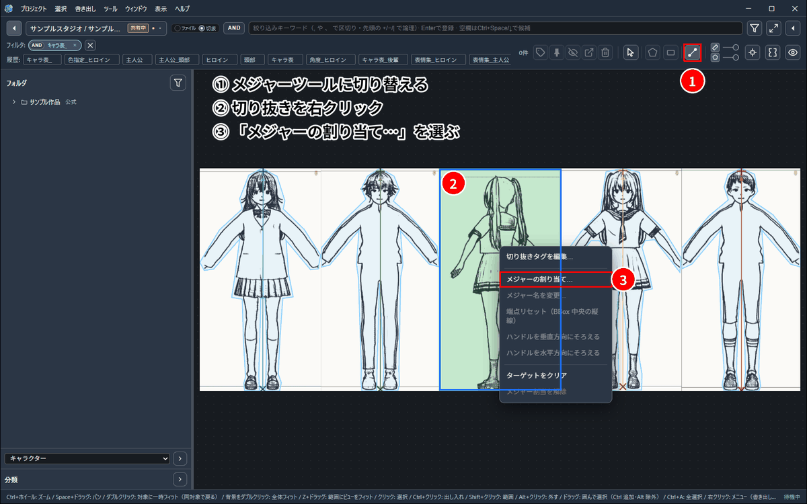

メジャーは「この絵のこの線を、比較の基準にする」という宣言です。<b>1つの切り抜きに1本</b>割り当てるというルールです。

メイン画面でツールを **「メジャー編集」** に切り替え、切り抜き上で右クリックしてメニューから実行します。

- **メジャーの割り当て…**
  - 複数選択にも対応（件数表示あり）
  - 既に割り当てがある場合は端点位置を維持してメジャーだけ差し替えます
  - 未割り当ての場合、端点は **BBox 左右中央の縦線（下端→上端）** に初期配置されます
- **メジャー名を変更…**（単一対象、割り当て済みのみ）
- **端点リセット（BBox 中央の縦線）**
- **ハンドルを垂直方向にそろえる / 水平方向にそろえる**
- **メジャー割当を解除**（割り当て済みのみ）

### 8.2 切り抜きの正規化ウィンドウ

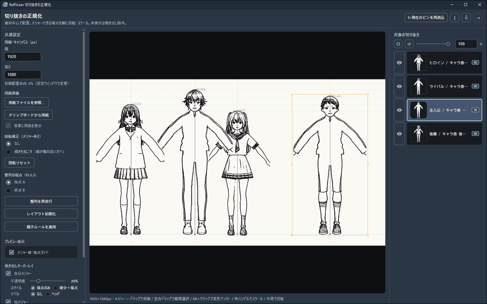

別々の画像・別々の縮尺で描かれた絵を、メジャーを軸に<b>同じ大きさへ揃えて</b>重ねます。

メイン画面のツールバーの **「切り抜きの正規化ウィンドウを開く」** から開きます。

**並ぶもの:** 右サイドバーで選んでいるピングループの、切り抜きのピンです（ファイルピンは入りません。[4.4](#44-ピンに集めて並べるピン表示)）。右サイドバーのピンの各行のチェック（**「切り抜きの正規化ウィンドウへ送る」**）を外したものは入りません。送るピンが1つも無いときは、一覧で選んでいる切り抜きが並びます。開いたあとでピンを足したときは、ウィンドウの **「現在のピンを再読込」** で取り直せます。

**画面の構成:**

- **左ペイン**: 用紙・キャンバス、用紙画像、回転補正、整列端点、プレビュー表示
- **中央**: キャンバス（ドラッグで移動）。書き出す範囲は明るい無地と細い枠線で示します。キャンバスからはみ出した切り抜きは暗く表示されます（書き出しでは切れる部分です）
- **右ペイン**: 対象の切り抜き（表示/非表示、並べ替え、選択の編集、プリセット）

メジャーを割り当てた切り抜きは、**基準メジャーとの比**でサイズが揃って表示されます。
**最終的な出力サイズ**は、このウィンドウのスケール・キャンバス寸法・配置で決めてください。

#### 書き出し

- 右上の **「フォルダへ書き出し…」**（⇩）: 合成した PNG をフォルダへ保存（非表示の切り抜きは除外）
- 右上の **「ドラッグで書き出し」**（⇢）: ドラッグ開始で合成 PNG をまとめてドラッグ（Windows のみ、非表示は除外）

#### よく使う設定

- **用紙・キャンバス（px）**: 書き出し解像度（論理キャンバス）
- **用紙画像**: 編集ビュー用の下絵（プレビュー上のみ。書き出し PNG には含めません）
- **回転補正（メジャーあり）**: なし / 傾きを起こす（縦か横の近い方へ）。メジャーごとに、縦と横の近い方の軸へまっすぐにします（縦長のキャラは縦に、横長のキャラは横に）
- **整列の端点**: 始点A / 終点B（メジャー付きの整列や回転・スケールの軸）
- **対象の切り抜き**: 目のアイコンで表示/非表示（非表示は書き出し除外）

#### 書き出しオーバーレイ（メジャーの焼き込み）

書き出した PNG 画像に、**メジャーを薄く焼き込んでおく**ことができます。外部エディタで対比のガイドとして使うことを目的とした機能です。例えば、レイアウトでキャラクターの対比を把握するのに役立つかもしれません。

既定では、その切り抜き自身のメジャーと、同時に書き出す他の切り抜きのメジャーの両方が、**薄い端点だけ**で入ります。左ペインでそれぞれ **表示/非表示・濃さ・線の出し方・名前の有無** を変えられます。色はメジャーの色のままです。

### 8.3 メジャー管理ウィンドウ

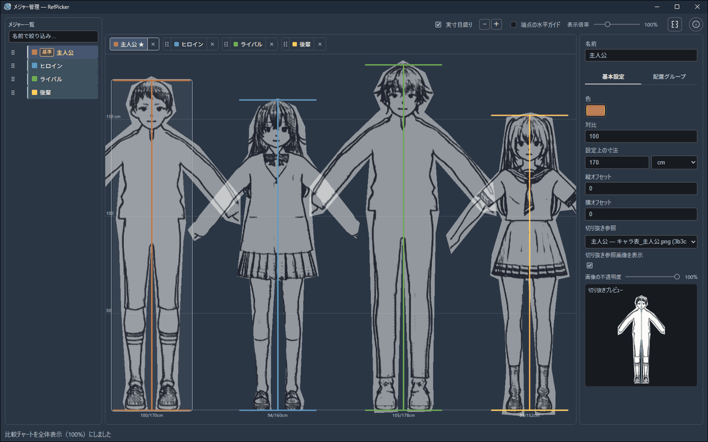

★が基準です。基準を決めてから、ほかのメジャーの対比を見ます。

ツールバーの **「メジャー管理ウィンドウを開く」** から、メジャー定義と比較チャートを編集します。

- **対比 S（スケールの略）** — 基準メジャーに対する相対スケール（比較チャートの棒の高さ・ドラッグで調整）
- **設定上の寸法** — 基準メジャーにだけ、身長などの実寸を入れられます。入れると他のメジャーの寸法は対比から計算され、比較チャートに実寸の目盛りを出せます
- **基準メジャー** — 一覧・右クリックまたは比較 UI から指定（★ 表示）
- **親子（一覧のツリー）** — 行の左のつまみ（⠿）をドラッグして、ほかの行の真ん中に落とすとその行の子になります。
  **行と行の間に落とすと**横線が出て、マウスを左へ寄せるほど浅い階層へ入ります（いちばん左＝**最上位**）。線の端に行き先が出ます。
  並びは名前順のままです。自分自身や自分の子の下へは落とせません

## 9. 対比表 ＜資料を作る側＞

**この章も、配る資料・プロジェクトデータを作る人向けです。**

対比表は**キャラ対比**の表です。メジャーを割り当てた切り抜きを**共通の地面**（ベースライン）に
並べ、左端の目盛り・頭上のキャラ名・タイトルまで焼き込んだ **1 枚の PNG** を作ります。

[8.2 切り抜きの正規化](#82-切り抜きの正規化ウィンドウ) がその場で1枚に揃える作業なのに対し、対比表は**別ウィンドウ・別データ**として残ります。

前提: 対比表に並べる切り抜きには **メジャーが割り当てられている**必要があります。
未割当の切り抜きは、追加するときにスキップされます（[8.1](#81-メジャーの割り当てメジャーツール) で割り当ててください）。

### 9.1 作成（対比表エディタ）

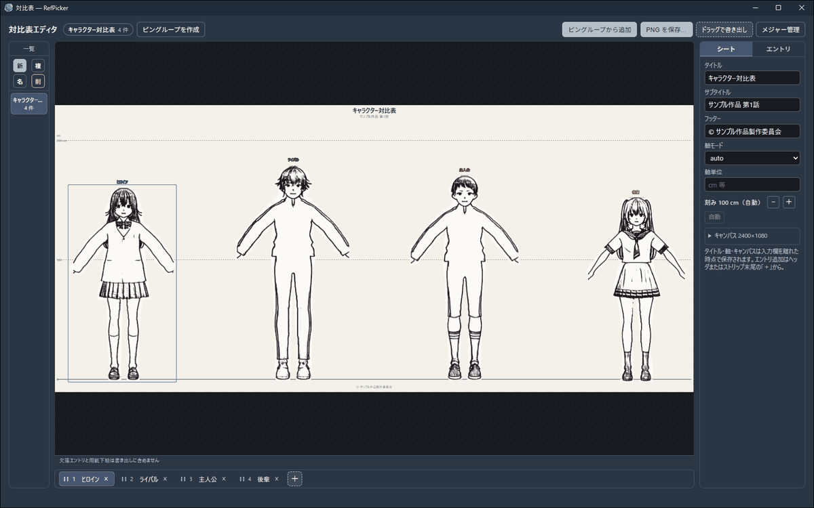

元の設定やメジャーを直せば、次に開いたとき<b>作り直されます</b>。

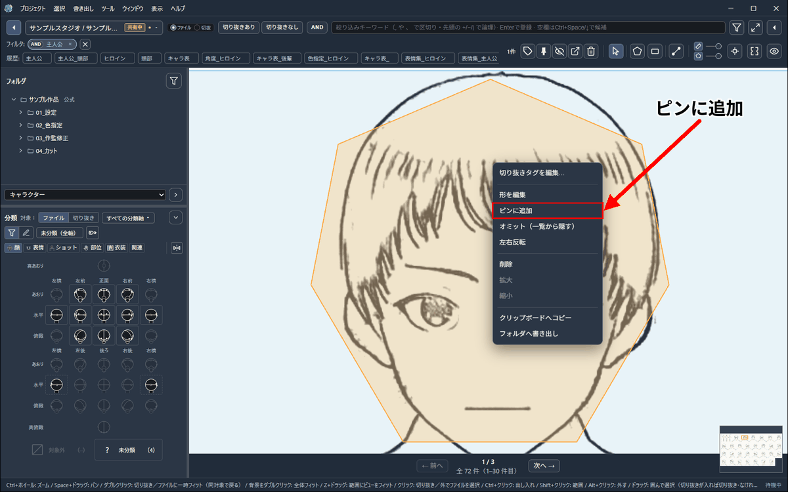

対比表に入れる切り抜きは、まず<b>ピン</b>に集めます。

**作る手順:**

1. メイン画面で対象の切り抜きにメジャーを割り当てる（[8.1](#81-メジャーの割り当てメジャーツール)）
2. 右サイドバーのピングループの選択欄で、使う **ピングループ** を選ぶ（**「新しいピングループ」** で作れます。[4.4](#44-ピンに集めて並べるピン表示)）
3. 対比表に入れる切り抜きを **ピン** する（中クリック、または右クリック → **ピンに追加**）
4. ツールバーの **「対比表エディタを開く」** からエディタを開き、左の **新規** で対比表を作る
5. **「ピングループから追加」** でピングループを選び、入れる切り抜きにチェックして追加する

**エディタの画面構成:**

- **左**: 対比表一覧（新規 / 複製 / 改名 / 削除）
- **右**: タイトル・軸・キャンバス設定、プレビュー、エントリ並べ替え、エントリ編集、PNG 書き出し

### 9.2 ピックアップ（フィルタ／ピン）

- **フィルタ語**で一覧を絞り込み、必要な切り抜きだけをピンする運用が基本です
- あとから足すときも **「ピングループから追加」** を使います
- メジャー未割当の切り抜き・ファイルピン・すでに入っている切り抜きはスキップされ、件数が表示されます
- 逆に、対比表のエントリから **「ピングループを作成」** で新しいピングループを作れます（作ったグループがアクティブになります）
- エントリは元の切り抜きとメジャーに紐づいています。元の切り抜きやメジャーを直すと、対比表を開いたときに最新の見た目で再構成されます

### 9.3 並べ替えとエントリ編集

並び順とラベルは<b>エントリごと</b>に直せます。

対比表エディタ右側のエントリ一覧で操作します。

- **ドラッグで並べ替え**: 各行左のハンドルをドラッグし、順序を入れ替えます（横並びの順になります）
- **ラベル上書き**: 頭上に出す名前（空なら導出ラベル）
- **実寸値を副次表示**: 実寸または相対値を副次表示します
- **副次ラベル / タグ**: 衣装名など任意の一行
- **縦オフセット / 列幅比**: メジャーが足元まで届かない場合などの補正と、列の横位置の調整

参照先の切り抜きが削除されたエントリは **欠落**（⚠）として残り、プレビューではプレースホルダ表示になります。警告一覧から削除できます。

### 9.4 目盛り・ラベル・タイトル

右側の **タイトル / 軸 / キャンバス** パネルで設定します（入力はプレビューへ即反映され、**入力欄を離れた時点で保存**されます）。

| 項目 | 内容 |
|------|------|
| タイトル / サブタイトル / フッター | 焼き込み文言（空なら描かない）。フッターに © 表記などを置けます |
| 軸モード | `auto`（実寸可能なら実寸、そうでなければ相対）/ `realUnit` / `relative` / `hidden` |
| 軸単位・min / max / step | 実寸軸の表示単位と目盛り範囲（空欄は自動） |
| キャンバス幅・高 | 出力 PNG の論理ピクセルサイズ |
| 列間隔比 | エントリ間のすき間 |

基準メジャーはメジャー管理ウィンドウで指定したものを使います（相対軸では 100＝基準）。

### 9.5 書き出し・配布

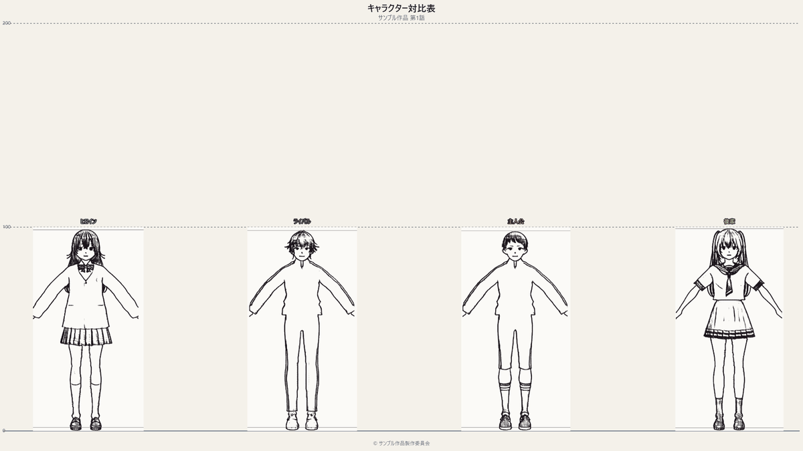

書き出した1枚には<b>目盛りと名前とタイトルが焼き込まれています</b>。そのまま配れます。

プレビュー直上の操作です。

- **PNG を保存…**: 保存ダイアログでパスを選び、目盛り・罫線・ラベル・タイトル込みの単一 PNG を書き出します（既定ファイル名は対比表名）
- **ドラッグで書き出し**: チップをドラッグし、エクスプローラーや他アプリへ PNG を渡します（Windows のみ）

注意:

- **欠落エントリは書き出しに含まれません**。欠落がある場合は確認ダイアログが出ます
- 用紙下絵は対比表にはありません（切り抜きの正規化の用紙画像とも無関係です）
- 配布物は静止画 PNG です。編集可能な対比表ドキュメント自体の同期配布は対象外です

### ここが押せない場合

| 症状 | 確認 | 解決 |
|------|------|------|
| 対比表・メジャーのボタンが見当たらない | 設定の「基本」タブの **「メジャー（定規）の機能」** | **「表示する」** にチェックを入れる（[8](#8-メジャー正規化-資料を作る側)） |
| 「ピングループから追加」で入らない | メジャー未割当／ファイルピン／追加済み | 8.1 でメジャーを割り当てる／切り抜きをピンする |
| PNG を保存… が無効 | 書き出し可能なエントリが 0 件 | 欠落でないエントリを 1 件以上入れる |

## 10. データの保存場所

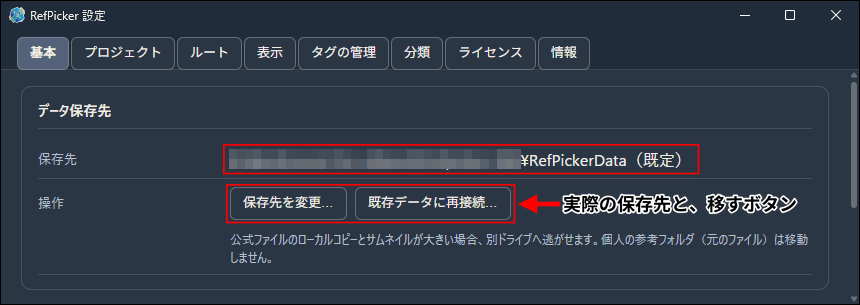

「保存先」の行が、いま使っている保存先です。

データベース・キャッシュ・一時エクスポートは、**データ保存先**（データルート）の配下に保存されます。
既定は **`RefPicker.exe` と同じフォルダの `RefPickerData`** です。
実際のパスは 設定 →「基本」→ **「データ保存先」** で確認でき、そこで別の場所へ移せます。
ライセンス認証の状態はこのフォルダに含まれません（別の PC へ移したときは、移した先で認証し直してください）。

> ⚠ **更新のときに解凍先フォルダごと消すと、このデータも消えます。**`RefPicker.exe` だけを
> 上書きしてください（[QUICKSTART.md](./QUICKSTART.md)）。

- `projects.json`（プロジェクト一覧）
- `projects/<projectId>/crossref.db`（プロジェクトごとの SQLite）
- `projects/<projectId>/thumbs/`（サムネキャッシュ）
- `projects/<projectId>/exports/`（クリップボードやドラッグで渡す PNG。次の起動で消えます）

サムネイルと表示用のキャッシュは、起動後とプロジェクトの切り替え後に自動で片付きます（使われなくなったものだけを消します）。

### 10.1 RefPicker を消すとき（アンインストール）

RefPicker はインストールせずに使うアプリなので、Windows の「アプリ」の一覧には出てきません。次の手順で消します。

1. RefPicker を終了します。
2. ライセンス認証をしていた場合は、先に 設定 →「ライセンス」タブ →「**ライセンス認証…**」の画面で「**解除**」を押します（ライセンスの枠が戻り、別の PC で使えるようになります）。
3. 解凍したフォルダ（`RefPicker.exe` と `RefPickerData` があるフォルダ）を削除します。データ保存先を別の場所へ移していた場合は、そのフォルダも削除します。
   > ⚠ 作ったプロジェクト・切り抜き・タグもすべて消えます。残したいものは、先に「**プロジェクトを書き出し…**」で書き出してください（[7](#7-プロジェクトの移行)）。
4. 画面の表示の設定が残るフォルダ `%LOCALAPPDATA%\com.refpicker.desktop` を削除します。
5. ライセンス認証をしていた場合は、次も削除します。
   - フォルダ `%LOCALAPPDATA%\animtools-suite`
   - Windows の「資格情報マネージャー」→「Windows 資格情報」で、`animtools-suite.` で始まる項目
   > ⚠ この2つは、animtools のほかのアプリ（EconTemple など）と共有しています。ほかのアプリを使い続けるなら消さないでください。

## 11. よくあるつまずき（トラブルシュート）
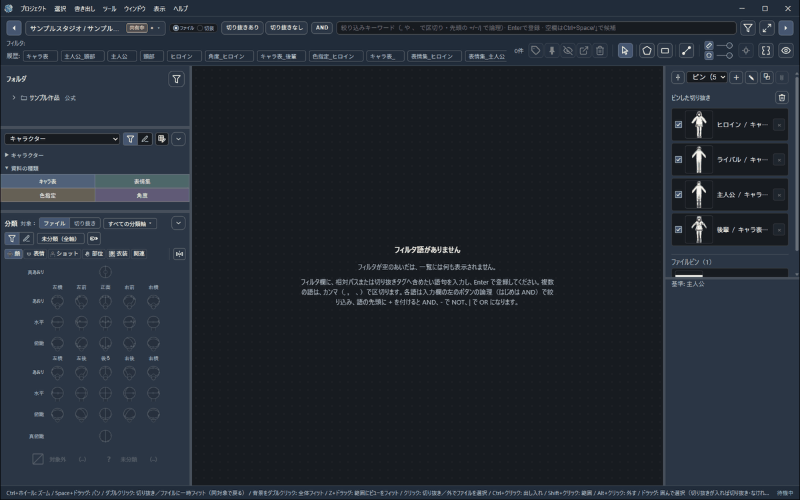

<b>語を入れて Enter</b> を押すまで一覧は出ません。

### 一覧に何も出ない

- フィルタ語が空だと一覧は表示されません。入力欄に語句を入れて **Enter で登録**してください。
- ルートが未登録の場合は、設定でルートを追加してスキャンが完了するまで待ってください。

### 「切り抜きの新規作成」ができない

- 表示単位が `切抜` のときは新規作成できません。`ファイル` に切り替えてください。

### クリップボードへコピーしたのに貼り付けできない

- クリップボードには画像ファイルとして入ります。貼り付け先アプリがファイルの貼り付けに対応しているか確認してください。
- コピーしたあとに RefPicker を起動し直していないか確認してください。書き出した PNG は次の起動で消えるので、もう一度コピーしてください。

### 別のプロジェクトを更新しても、今の一覧は変わりません

- 通常、**開いているプロジェクトだけ** 一覧が自動更新されます。別のプロジェクトへの適用はバックグラウンドで完了し、切り替えたときにそのプロジェクトの内容が表示されます。

### 取り込みが「購読先 (…) が一致しません」で拒否される

- 配布データは **対応するプロジェクト** にだけ適用できます。別のプロジェクトの共有フォルダを選んでいないか、プロジェクト切替で正しいプロジェクトを選んでから、もう一度 **「更新（新しいバージョンを取り込む）」** を押してください。
- 自分で作った（共有元の）プロジェクトには取り込めません（**「対象は受け取りプロジェクトではありません（発行元プロジェクトには取り込めません）」**）。受け取り用のプロジェクトを選んでください。

### 更新バッジが付くが、更新できない

- 共有フォルダのパスが正しいか、共有元が最新のバージョンを反映済みかを確認してください。プロジェクトごとに**別の共有フォルダ**を記憶しているので、取り違えていないかも確認してください。詳しくは [共有ガイド](SYNC_GUIDE.md) の「うまくいかないとき」を参照してください。

### 公開・書き出しが「読み込みが終わっていない」で断られる

- 読み終えていないルート（[1.5](#15-読み込みに時間がかかるとき中断して続きから)）があるあいだは、共有フォルダへの反映（公開）・プロジェクトの移行の書き出し・選んで書き出す、はできません。設定の「ルート」タブで、印が付いているルートの読み込みが終わるのを待ってから、もう一度押してください。アプリを閉じていた場合は、開けば続きから読み込みます。

### PSD が取り込めない（合成画像が無い）

- Photoshop で「互換性を優先」を入れずに保存した PSD・PSB には、合成画像がありません。RefPicker はこのファイルを取り込めません
- 取り込めなかったファイルがあると、設定の「ルート」タブで、そのルートに **「取り込めないファイル」** の件数が出ます
- Photoshop で「互換性を優先」を入れて保存し直してから、そのルートの **「再スキャン」** を押してください

### 更新したのに動画・3D・PSD が一覧に出ない（再スキャン）

- RefPicker を新しいバージョンにしただけでは、すでに登録したルートの中の、新しく扱えるようになった種類のファイル（動画・3D・PSD・PSB・.clip・TGA）は一覧に入りません
- 設定の「ルート」タブで **「全ルートを再スキャン」** を押してください。読み終えると、一覧に並びます

### 「新しいバージョンの RefPicker で作られています」と出て受け取れない

- 共有元が、あなたより新しいバージョンの RefPicker で反映した共有は、取り込まずに止まります。「この共有は新しいバージョンの RefPicker で作られています。」と出て、受け取ったプロジェクトに「更新が必要」と出ます
- それまでに取り込んだ分は、そのまま見られます
- RefPicker を新しいバージョンにすると、次の **「更新」** でまとめて取り込めます。前のバージョンのままだと起きることは、[共有ガイド 9.2](SYNC_GUIDE.md#92-前のバージョンのままだと起きること) を見てください
